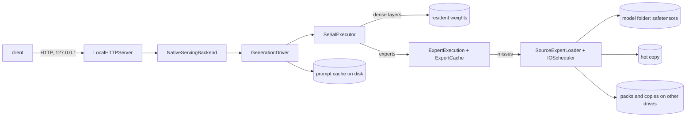
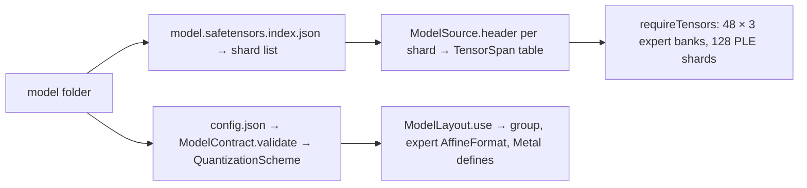
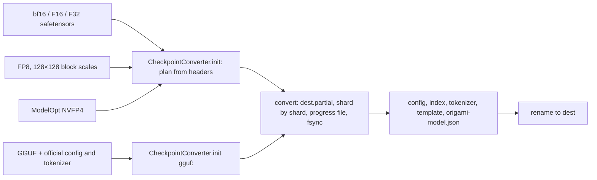
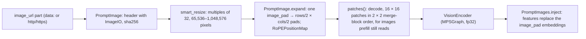
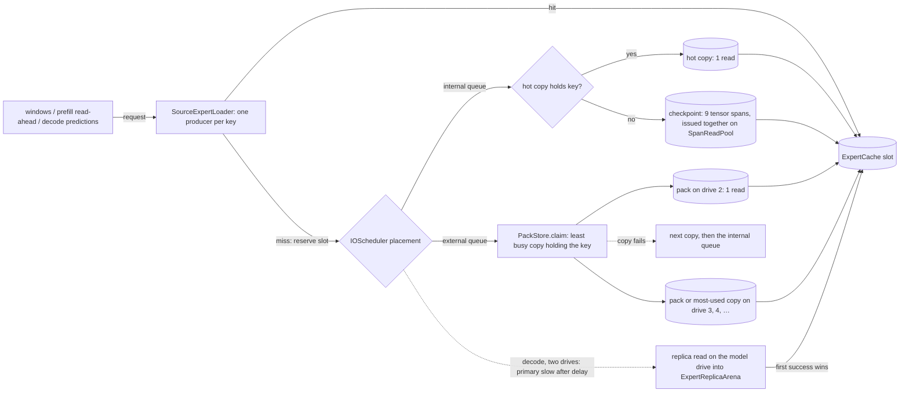
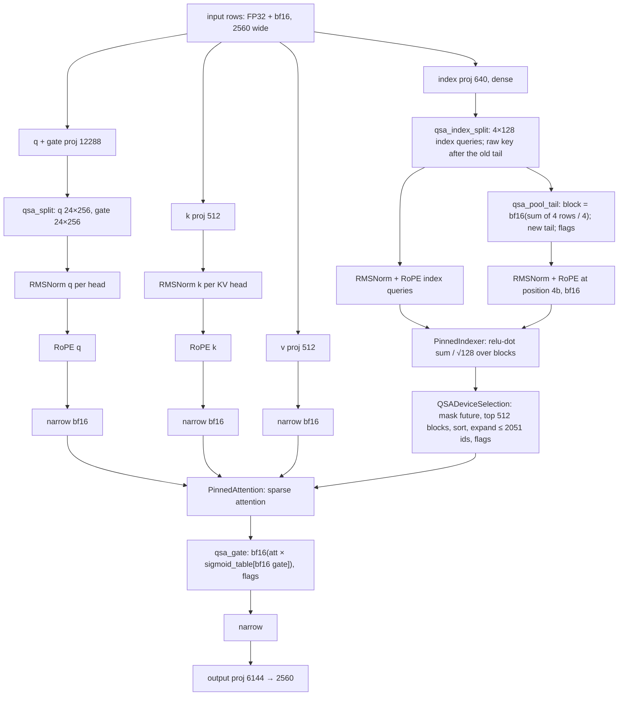

# Origami internals

How Origami works, for an engineer who has never seen it. It covers the model, the formats, the life of a
request, expert streaming, the Metal kernels, memory, persistence, the server, the CLI, correctness, security and
the measured numbers. Using Origami (install, settings, clients, troubleshooting) is in [README.md](README.md);
how to send a change is in [CONTRIBUTING.md](CONTRIBUTING.md). Types and files are named so you can find them with a
search; there are no line numbers.

## Contents

1. [What Origami is](#1-what-origami-is)
2. [Source map](#2-source-map)
3. [The model](#3-the-model)
4. [Weights and formats](#4-weights-and-formats)
5. [The life of a request](#5-the-life-of-a-request)
6. [Expert streaming](#6-expert-streaming)
7. [Metal kernels](#7-metal-kernels)
8. [Memory](#8-memory)
9. [State and persistence](#9-state-and-persistence)
10. [The server](#10-the-server)
11. [The CLI](#11-the-cli)
12. [Correctness](#12-correctness)
13. [Security model](#13-security-model)
14. [Performance, limits and open gaps](#14-performance-limits-and-open-gaps)

---

## 1. What Origami is

Origami is one native macOS binary (Swift and Metal, no Python, no MLX at run time) that serves
mixture-of-experts models through an OpenAI-compatible HTTP server on `127.0.0.1`. Version 3.0 serves three, one at
a time: Qwen3.8-Flash-Next on its own engine (the "Qwen engine", which most of this document describes), and
GLM-5.3-Flash and DeepSeek-V4.1-Flash GGUFs on a shared "family engine" (section 4, Family engines).
Qwen3.8-Flash-Next is a 104 GB mixture-of-experts checkpoint. Origami runs it on Apple-silicon Macs with 24 GB of
memory or more.

**The core idea.** Most of the model's bytes are experts, and each token uses few of them:

| Part | On disk (4-bit, group 64) | Used per token | Where it lives |
|---|---|---|---|
| Routed experts: 48 layers × 512, top 10 per layer | 24,576 records × 2,764,800 B ≈ 68 GB | 480 records ≈ 1.3 GB | on SSD; an expert cache in memory holds as many as fit |
| PLE n-gram table (layer 1) | 320,001,536 rows × 100 B ≈ 32 GB | 16 rows | on SSD, read row by row |
| Token embedding table | ≈ 0.36 GB | one row | read row by row |
| Dense weights: attention, linear attention, hyper-connections, shared experts, router, LM head | ≈ 3 GB | all of it | resident in Metal buffers |
| Vision tower | ≈ 0.9 GB (bf16) | only for images | loaded for one image request, then released |

The dense weights are touched by every token, so they stay resident (`ResidentTensorCache`, about 2.6 GB of raw
quantized words; `ResidentFloatTensorCache`, about 0.4 GB of FP32 copies of the small float matrices). Everything else
is streamed: experts are read into a cache of slots, the PLE and embedding rows are read per token. Expert use is
skewed and repeats from token to token, so the cache, prediction of the next layer's experts and read-ahead turn most
of the 1.3 GB per token into cache hits. The remaining misses are read from the drives at the rate the SSDs allow.



**Principles that shape the code.**

- **Exact by default.** In exact mode a temperature-0 reply is deterministic and byte-identical across builds that
  keep the arithmetic. Every GPU kernel reproduces a pinned reference schedule bit for bit (section 12). Speed work
  that changes rounding is a separate, labelled switch.
- **One request at a time.** One generation owns the executor and the GPU. Others queue (section 10).
- **Fitted to the Mac.** The plan sizes everything from the Mac's memory, drives and GPU family at start, and the
  memory governor follows the Mac afterwards (section 8).
- **Forgiving.** Origami refuses only what it cannot run: an architecture its kernels are not specialised for, a GPU
  without the needed features, a damaged file. Everything else is ignored, converted or worked around.

---

## 2. Source map

The package (`Package.swift`, Swift tools 6.0, macOS 15 or later at run time) has six targets. The build needs the
macOS 26 SDK: the M5 TensorOps kernel is compiled from Metal 4 source.

| Target | Path | What it is |
|---|---|---|
| `CExactIO` | `Sources/CExactIO` | A small C library: exact `pread` loops, file and volume identity, APFS clones, memory counters, page wiring, one atomic store. Its functions are `origami_*` (`origami_pread_exact`, `origami_available_memory`, `origami_wire_pages`, …). |
| `OrigamiEngine` | `Sources/OrigamiEngine` | The engine library: both engines, their formats, IO, caches, kernels, persistence, planning and the HTTP server. 204 files in 17 subsystem folders (below). |
| `origami` | `Sources/origami` | The CLI and the front server: argument parsing, settings, stores, model registry and downloads, diagnostics, the dashboard's back end and the server's callbacks. 27 files (below). No arithmetic. |
| `OrigamiEngineChecks` | `Sources/OrigamiEngineChecks` | Model-free checks that need the engine's `package` internals (the `*SelfChecks` types). Only `engine-checks` links it, so `origami` ships without them. |
| `EngineChecks` | `Tests/EngineChecks` | The `engine-checks` executable: model-free checks printed as JSON (section 12). |
| `CDeviceProbe` | `Tests/CDeviceProbe` | Counts the Metal device requests inside `engine-checks`, so only checks that used the GPU can be skipped for it. |

Dependencies, both pinned exactly in `Package.swift` and `Package.resolved`: `swift-transformers` (1.3.3) for the
tokenizer and chat templates, and `swift-jinja` (2.4.2), its template engine, pinned to the version swift-transformers
resolves to and used directly by `TokenizerStack` (for Python's `dict()` in templates). Parts of the arithmetic are
adapted from SlotStream and MLX (MIT), and the GGUF matrix kernels from llama.cpp's ggml-metal (MIT); see
`THIRD_PARTY_NOTICES.md`.

`Tests/cli-checks.sh` checks the CLI contract. `Tests/Fixtures` holds small configs, model headers, a route trace,
sampler golden values and GGUF dequantization vectors.

### The engine by folder

Paths are under `Sources/OrigamiEngine`. "Qwen engine" is the code that runs Qwen3.8-Flash-Next; "family engine" the
code that runs the GLM-5.3-Flash and DeepSeek-V4.1-Flash GGUFs (section 4, Family engines).

| Folder | What it is | Files | Main types |
|---|---|---|---|
| `Core` | Low-level pieces every part uses: bf16 rounding, exact file reads, the GPU-interruption retry and command-buffer limit, the `Host` and `Origin` rule, the GPU keep-alive | `ArithmeticDigest`, `BF16`, `CommandBudget`, `ExactFile`, `GPURetry`, `HostGuard`, `RequestGPUKeepAlive` | `BF16`, `CommandBudget`, `ExactFile`, `FileIdentity`, `EngineError`, `GPURetry`, `HostGuard`, `RequestGPUKeepAlive` |
| `Models` | What a model is: Qwen's architecture contract, checkpoint view and layout; the family geometry read from a GGUF; the tokenizer and chat template; model identity and compatibility | `LocalModelIdentity`, `ModelCompatibility`, `ModelContract`, `ModelFamily`, `ModelLayout`, `ModelSource`, `TokenizerStack`, `VerifiedContentReceipt` | `ModelContract`, `ModelSource`, `QuantizationScheme`, `AffineFormat`, `ModelLayout`, `ModelFamily`, `ModelGeometry`, `TokenizerStack`, `ReplyText`, `ModelCompatibility` |
| `Formats` | Formats on disk and converters: packs and stores, GGUF parsing, dequantization and quantization, ggml-metal's matrix kernels (used by both engines), the checkpoint converters | `CheckpointConverter`, `GGMLMatrixKernels`, `GGUF`, `GGUFConversion`, `GGUFExperts`, `GGUFGrids`, `GGUFQuantize`, `PackStore`, `StoreBuilder`, `StoreFormat` | `CheckpointConverter`, `GGUFSource`, `GGUFQuant`, `GGUFQuantize`, `GGUFExperts`, `GGUFExpertKernels`, `GGMLMatrixKernels`, `PackStore`, `TensorSpan`, `StoreBuilder`, `StoreHeader` |
| `Memory` | Memory accounting and its policies (the ledger and the governor serve both engines), phase budgets, Qwen's resident tensor caches | `ConversationPhaseBudget`, `MemoryAdmission`, `MemoryAllocationAdmission`, `MemoryBudgetPolicy`, `MemoryCacheRelief`, `MemoryGovernor`, `MemoryLedger`, `ResidentFloatTensorCache`, `ResidentTensorCache`, `WiredMemoryPolicy` | `MemoryLedger`, `MemoryGovernor`, `MemoryGovernorPolicy`, `MemoryBudgetMode`, `ConversationPhaseBudget`, `ResidentTensorCache`, `ResidentFloatTensorCache`, `WiredMemoryPolicy` |
| `Streaming` | The engine-neutral parts of expert streaming: the IO scheduler, the expert slot core (both engines' caches run on it), the hot copy and its keeper, and pieces both engines already use | `ExpertReadReplica`, `ExpertSlotCore`, `FastLateMissSkip`, `HotCopy`, `HotCopyCurve`, `HotCopyKeeper`, `HotCopyPlaces`, `HotCopyRefreshPlan`, `HotCopySet`, `IOScheduler`, `QualityDial` | `IOScheduler`, `HotCopy`, `HotCopySource`, `HotCopyKeeper`, `QualityDial`, `FastLateMissSkip` |
| `Qwen/Streaming` | Qwen's expert streaming: the expert cache and its reuse policy, the loader, the read pools, the hot copy's ranking (`RoutingProfile`; the copy itself is `Streaming/HotCopy`), drive calibration, hedge replicas (the race and its arena are `Streaming/ExpertReadReplica`), PLE and host-stage prefetch | `DelayedExpertContribution`, `ExpertCache`, `ExpertExecution`, `ExpertReuseCalibration`, `ExpertReusePolicy`, `ExpertSourceOnlineCalibration`, `ExpertSourceSelection`, `HostStagePrefetch`, `HotExpertRanking`, `KnownPLERows`, `PLERowPrefetch`, `PairResidencyBackoff`, `RoutingProfile`, `SourceExpertLoader`, `SpanReadPool` | `ExpertCache`, `ExpertExecution`, `ExpertDemandWindow`, `SourceExpertLoader`, `SpanReadPool`, `ExpertReadReplica`, `ExpertReplicaArena`, `ExpertReusePolicy`, `HotExpertRanking`, `RoutingProfile`, `PLERowPrefetch` |
| `Qwen/Kernels` | Qwen's quantized and dense Metal kernels and the host arithmetic they reproduce | `DecodeProjectionKernel`, `ExpertMultirowQMV`, `FusedExpertExecution`, `GatheredExpertDecode`, `GatheredExpertTiledKernel`, `GroupedExpertKernel`, `LayerArithmetic`, `LayerMath`, `LayerUnaryArithmetic`, `PinnedDenseLinear`, `PinnedReductions`, `QuantizedMMABF16Kernel`, `QuantizedSchedule`, `QuantizedTensorOpsKernel`, `QuantizedTiled32Kernel`, `QuantizedTiled32PrefetchKernel`, `ReferenceKernels` | `ReferenceKernels`, `QuantizedSchedule`, `GatheredExpertDecode`, `FusedExpertExecution`, `PinnedDenseLinear`, `PinnedReductions`, `LayerMath`, `LayerArithmetic` |
| `Qwen/Attention` | QSA sparse attention: kernels, indexer, RoPE, selection, paged and file-backed key/value storage | `BatchedTopIndices`, `CompactPrefillReuse`, `CompactSelectedAttention`, `PinnedAttention`, `PinnedIndexer`, `PinnedRoPE`, `PrefillAttentionReuseKernel`, `QSADecodeStorage`, `QSADeviceSelection`, `QSAExactPrefillKernels`, `QSAExecutionBlock`, `QSAExecutionScalars`, `QSAFilePageStore`, `QSAFileStaging`, `QSAFileVector`, `QSAPagedAttentionStorage`, `QSAPages`, `RegisterAttentionKernel` | `PinnedAttention`, `QSAExecutionBlock`, `QSADeviceSelection`, `BatchedTopIndices`, `QSAPageArena`, `QSAPagedStorage`, `QSAImmutablePage`, `QSAFilePageStore`, `QSAFileStaging` |
| `Qwen/Layers` | Qwen's other layers on the GPU and the host (GDN, hyper-connections, residual injection, PLE), the vision tower and image preprocessing, the MTP head | `DevicePLE`, `FusedGDNPreparation`, `FusedHCDecode`, `FusedHyperConnection`, `FusedResidualInjection`, `GDNBufferRegion`, `GDNDeviceBlock`, `GDNExactKernels`, `GDNInputProjections`, `GDNRecurrentStorage`, `HCDecodeFusionKernels`, `HCExactFusionKernels`, `MTPHead`, `PromptImages`, `ReferencePLE`, `VisionEncoder` | `GDNDeviceBlock`, `GDNRecurrentStorage`, `FusedHCDecode`, `FusedHyperConnection`, `FusedResidualInjection`, `DevicePLE`, `ReferencePLE`, `PLEHash`, `PromptImage`, `RoPEPositionMap`, `VisionEncoder`, `MTPHead` |
| `Qwen/Execution` | Running Qwen: the serial executor, whole-scope prefill and fused decode, early demand and pre-routing, the prefill read-ahead and its policy, reference weights and workspaces, the MTP pair step's schedule, the Qwen serving backend | `DecodeEarlyDemand`, `DecodeFrontierScalars`, `DecodeFrontierWeights`, `DecodePrerouting`, `NativeServingBackend`, `PrefillExpertReadAhead`, `PrefillMoEWorkspace`, `PrefillReadPolicy`, `PrefillReadSchedule`, `PrefillTilePipeline`, `QwenPairSchedule`, `QwenVerifierCostProbe`, `ReferencePhaseWorkspace`, `ReferenceWeights`, `SerialExecutor`, `WholeExecutionScalars`, `WholeExecutionSchedule`, `WholeExecutionWorkspace`, `WholeLayerExecution`, `WholeLayerWeights`, `WholePrefillScope` | `SerialExecutor`, `WholeExecutionSchedule`, `WholeLayerExecution`, `WholePrefillScope`, `DecodeEarlyDemand`, `DecodePrerouting`, `PrefillExpertReadAhead`, `PrefillReadPolicy`, `PrefillMoEWorkspace`, `ReferenceWeights`, `NativeServingBackend`, `ThinkCloser` |
| `Family` | The family engine: the shared runner, its kernels and routing, the serving backend, saved-state files, tokenizer support, the GLM converter, and opt-in observers | `FamilyBackend`, `FamilyConverter`, `FamilyHostPhaseTiming`, `FamilyKernels`, `FamilyResidentPack`, `FamilyRouteTrace`, `FamilyRouting`, `FamilyRunner`, `FamilyScratchOwnership`, `FamilyStateFile`, `FamilySupport` | `FamilyRunner`, `FamilyModel`, `FamilyServingBackend`, `FamilyKernels`, `FamilyRouting`, `FamilyStateFile`, `FamilySupport`, `FamilyConverter` |
| `Family/Models` | The forward passes and DeepSeek's Engram reads | `DeepSeekEngramRead`, `DeepSeekModel`, `GLMModel` | `GLMModel`, `DeepSeekModel`, `DeepSeekEngramHash` |
| `Family/Streaming` | The family engine's resident weights and expert streaming: the expert pools, the hot copy's records (`FamilyHotCopySource`), slab wiring, the guess policy, and opt-in experiments | `FamilyEviction`, `FamilyHedges`, `FamilyHotCopySource`, `FamilyPoolState`, `FamilyPrefetchObservations`, `FamilyPrefetchPolicy`, `FamilySlabStorage`, `FamilyWeights` | `FamilyWeights`, `FamilyExperts`, `FamilySlabStorage`, `FamilyPrefetchPolicy` |
| `Conversation` | Sequence state, the conversation and its frontiers, checkpoint images and the paged file, the prompt cache (shared by both engines) and prefix reuse | `CheckpointPages`, `ConversationFrontierIndex`, `ConversationFrontierStore`, `ConversationGeometry`, `ConversationScopeCapture`, `ModelCheckpoint`, `PagedCheckpointFormat`, `PagedCheckpointStore`, `PersistentCheckpointStore`, `PersistentConversation`, `PrefixReuseController`, `PromptCache`, `PromptCanary`, `PromptEncodingCache`, `SequenceState`, `State` | `SequenceState`, `QSAState`, `GDNState`, `PersistentConversation`, `ConversationFrontierIndex`, `ConversationFrontierStore`, `ConversationGeometry`, `ModelCheckpoint`, `PagedCheckpointFormat`, `PromptCache`, `PrefixReuseController` |
| `Serving` | The HTTP server and the engine-neutral parts of a request: parsing and wire formats, sampling, stop strings, tool-call parsing, the model scheduler, the dashboard page, request records; also `GenerationDriver`, Qwen's request loop on `SerialExecutor` (the family backend reuses some of its helpers) | `DashboardAssets`, `DashboardPage`, `DashboardScript`, `DashboardStyles`, `GeneratedTokenSequence`, `GenerationDriver`, `GenerationProgress`, `HTTPIngressPolicy`, `HTTPRequestLifecycle`, `JSONMode`, `LocalHTTPServer`, `ModelScheduler`, `RequestPhaseCounters`, `RequestRecords`, `Sampler`, `SamplingDefaults`, `ServingPrompt`, `ServingProtocol`, `ServingWires`, `StopSequenceFilter`, `ToolCallAnchor` | `LocalHTTPServer`, `BoundedHTTPRequestDecoder`, `ServingRequest`, `ServingStream`, `ToolCallSplitter`, `WireTranslation`, `WireWriter`, `GenerationDriver`, `ReferenceSampler`, `JSONConstraint`, `SamplingDefaults`, `ModelScheduler`, `DashboardPage`, `RequestRecorder` |
| `Planning` | The start-up plan and runtime assembly: memory and context planning, the validated runtime configuration, the tuner's rules and request overrides, the learned memory budget | `OrigamiPlan`, `OrigamiRuntime`, `ReleaseExecution`, `RuntimeConfiguration`, `SelfTuning` | `OrigamiPlan`, `OrigamiHost`, `OrigamiStorage`, `OrigamiMemory`, `OrigamiRuntime`, `DeferredBackend`, `RuntimeConfiguration`, `SelfTuning`, `TuneOverrides`, `MemoryHistory` |
| `SelfChecks` | What the checks need inside the engine: where their fixtures are, and the skip error | `CheckFixtures` | `CheckFixtures`, `FixtureUnavailable` |

The checks that need the engine's `package` internals are the `OrigamiEngineChecks` target (`CompactAttentionSelfChecks`
to `WholeTokenPlanSelfChecks`, `HostStagePrefetchSelfChecks`, `SpanReadPoolSelfChecks`). Two stay beside the code
they check because they inject faults through its `fileprivate` file descriptors (`ConversationFrontierSelfChecks`,
`QSAFilePageSelfChecks`); the rest of the checks are in `Tests/EngineChecks`.

**One shared streaming core, later.** `Streaming/` holds the pieces both engines already share and is where the
shared expert-streaming core will grow (`ROADMAP.md`, item S1). Today each engine still has its own expert cache and
read path: `Qwen/Streaming` (slabs, packs, the hot copy and replicas; section 6; the IO scheduler it uses is in `Streaming/`) and `Family/Streaming`
(pools, the hot copy, guesses and read-ahead; section 4, Family engines).

**Files the rest of this document does not describe**, by group:

- Memory policy: `MemoryBudgetPolicy` (automatic or explicit budget mode, pressure levels, `MemoryGovernorPolicy`),
  `MemoryAdmission` (planning arithmetic: each phase's fixed owners, allocates nothing), `MemoryAllocationAdmission`
  (a note only: physical allocation admission lives in `MemoryLedger`), `MemoryCacheRelief` (a status snapshot of the
  expert bytes released since the last request), `WiredMemoryPolicy` (checks an explicit memory budget against
  macOS's wired-memory ceiling, `iogpu.wired_limit_mb`; the CLI's `WiredMemory` raises the ceiling, section 13).
- Request plumbing: `HTTPIngressPolicy` (the routing rule the front and the model process share; small read-only
  observations get reserved control slots), `HTTPRequestLifecycle` (timing of one connection and request on a
  monotonic clock; the front's and the model process's views of a proxied request are kept apart),
  `RequestPhaseCounters` (Qwen's read counters at request and phase boundaries), `ToolCallAnchor` (section 11),
  `PromptEncodingCache` (bounded reuse of template conversion and tokenization of unchanged parts, per tokenizer, for
  all three models).
- Model identity: `LocalModelIdentity` (a local file's incarnation: resolved path, file object and change times; not a
  content digest), `VerifiedContentReceipt` (the opt-in `origami content` receipts: streamed SHA-256 against a manifest;
  see `docs/content-receipts.md`), `ModelCompatibility` (judges a checkpoint from its headers, local or by HTTP range
  reads, for `/v1/models/found` and `/v1/models/check`).
- Family streaming helpers on the default path: `FamilyPrefetchPolicy` (decides which guessed reads to start; always
  on, section 4), `FamilySlabStorage` (slab wiring and ledger ownership), `FamilyPoolState`
  (`FamilyRunner.poolRows`: pooled keys for a run of rows without keeping completed groups' keys and gates),
  `HotCopyRefreshPlan` (the hot copy's free-space and payload-name rules), `FamilyScratchOwnership` (scratch buffers
  whose lifetimes never overlap share storage; on by default, `ORIGAMI_SCRATCH_COMPACTION=0` keeps the reference
  layout; Qwen's whole-execution workspace uses it too).
- Opt-in research code, off unless switched on (bounded, and none of it changes an exact reply unless it says so):
  - family observers: `FamilyRouteTrace` (`ORIGAMI_FAMILY_ROUTE_TRACE=1`), `FamilyHostPhaseTiming` (`ORIGAMI_FAMILY_PHASE_TIMING=1`),
    `FamilyPrefetchObservations` (`ORIGAMI_FAMILY_PREFETCH_OBSERVATIONS=1`);
  - a non-exact prototype: `FamilyResidentPack` (dense weights requantized, the model's Q8_0 to Q4_K;
    `ORIGAMI_FAMILY_RESIDENT_Q4_PACK=<folder>`, logged as experimental). The research port of the DSpark draft model
    for DeepSeek-V4.1 was deleted on 2026-11-18 (drafting is parked);
  - experiments reached only through `origami_tune` request overrides (`TuneOverrides`, for this Mac's own tuner):
    `DelayedExpertContribution` (`delayed_experts`, approximate, Qwen), `QwenVerifierCostProbe` (`qwen_pair_probe`, a local diagnostic).
- MTP support: `QwenPairSchedule` (refuses a pair step the cache cannot hold) and `PairResidencyBackoff` (how often
  the resident-only pair step is retried after a miss).

### The CLI by file

Paths are under `Sources/origami`.

| Group | Files | What they do |
|---|---|---|
| Entry and commands | `main`, `Commands`, `Diagnostics`, `ContentCommand`, `Refresh`, `Terminal` | Parsing and dispatch (`CommandSpec`); setup, serve, stop, start, status, store, model, config, cache, verify, refresh, uninstall; inspect, doctor, bench, report, dashboard; `origami content` (offline content receipts); console output |
| Settings, models and drives | `Settings`, `Models`, `Stores`, `Folders`, `HotCopy`, `FamilySetup`, `ObservationProvenance` | Settings resolution and the validator; the model registry and Hugging Face downloads; store scanning and calibration; the dashboard's folder browser; where a family hot copy goes; family expert packs at setup; start-up provenance tags (hashes of the explicit, non-secret start-up inputs) |
| The front and the dashboard's back end | `ModelFront`, `Access`, `DashboardState`, `Jobs`, `Storage`, `MoveJournal`, `WiredMemory` | The front and its model processes (section 10); `listen lan`, its QR code and the launchd restart; the `/v1/dashboard` snapshot; the dashboard's jobs; the storage map, moves and their journal; raising macOS's wired-memory ceiling |
| Status and tuning | `Status`, `FamilyStatus`, `MemoryAdmissionReport`, `ChatCommands`, `Tune`, `TuningSession`, `TuningTradeoffs`, `TuningConditions` | `/v1/status` and `/v1/plan` for Qwen and for the family engines; a coarse memory report; chat commands and saved prompts for both engines (`PromptKeeper`); `origami tune` |

---

## 3. The model

### Architecture

`ModelContract` pins the architecture the kernels are specialised for. `ModelContract.validate(config:)` compares
these values with `config.json` and refuses anything else, naming the field.

| | Value |
|---|---|
| `model_type` | `qwen4_exp` |
| Layers | 48: QSA sparse attention where `layer % 4 == 3` (12 layers), gated delta net (GDN) elsewhere (36 layers) |
| Hidden size | 2,560; the residual is 4 hyper-connection streams × 2,560 = 10,240 values per token |
| Experts | 512 per layer, 10 routed per token, intermediate size 640, plus one gated shared expert |
| QSA | 24 query heads, 2 KV heads, head dim 256, sigmoid output gate; indexer of 4 heads × 128 over pooled 4-token blocks |
| GDN | 16 key heads and 48 value heads of 128; convolution width 4 |
| PLE | per-layer n-gram embeddings in layer 1: 128 shards × 2,500,012 rows |
| Vocabulary | 248,320 |
| Rotary | θ = 10⁷, partial (first 64 of 256 dims); interleaved M-RoPE sections [11, 11, 10] for images |
| Context | up to 262,144 tokens |

`ModelContract.validate(device:)` probes the GPU instead of matching a chip name: unified memory, Metal family Apple7
(M1) or later, 32 KiB of threadgroup memory. `ModelContract.supportsBFloatMatrices` is true from Apple8 (M2).

### The residual stream and one layer

Every value the reference graph stores in bf16 is rounded exactly there (`LayerArithmetic.round`, round to nearest
even, NaN made quiet). FP32 buffers hold bf16-representable values throughout.

```
residual R [T, 4 × 2560]          embedding row copied into all four streams
layer 1 only:  R += PLE(R)                                      ReferencePLE / DevicePLE
(x1, g1) = HC_attn(R)          x1 [T, 2560], g1 [T, 4]          LayerMath.hyperConnection / FusedHCDecode
a        = QSA(x1) if layer % 4 == 3 else GDN(x1)               QSAExecutionBlock / GDNDeviceBlock
R[s]     = bf16(R[s] + bf16(a · g1[s]))   s = 0..3              FusedResidualInjection
(x2, g2) = HC_mlp(R)
m        = bf16(routed + bf16(shared · gate))                   experts + shared expert
R[s]     = bf16(R[s] + bf16(m · g2[s]))
after layer 47:  x = HC_mixer(R) (no gates) → lm_head → logits
```

**Hyper-connection (HC).** Each sublayer reads all four streams and writes back into all four. Weights per HC:
`hc_norm` (stored as 1 + w), a down projection 10,240 → 320 and an up projection 320 → 10,240 (both 4-bit), and a
dense `block_inject_weight` [4, 10,240].

```
norm     = grouped RMS(bf16(R), 4 groups of 2560, ε 1e-6) · hc_norm
down     = bf16(W_down · bf16(norm))                     [320]
act      = SiLU(bf16(down / 4))
rawUp    = bf16(W_up · act)                              [4 × 2560]
mixed[c] = bf16(Σ_s bf16(sigmoid(rawUp[s,c]) · norm[s,c]) / 4)   streams summed in order 0..3
gates[s] = bf16(2 · sigmoid(bf16(bf16(W_inject · norm)[s] / 4)))
```

The sublayer input is a learned, per-token weighted mean of the four normalised streams; the gates decide how much of
the sublayer's output each stream receives.

**QSA (sparse attention).** Each query attends to at most 2,051 keys. Up to 2,048 keys of context it sees every
causal key. Beyond that, the indexer scores pooled 4-token key blocks (relu dot products of 4 index heads, summed and
divided by √128), and the query attends to the top 512 blocks (2,048 keys) plus the 0–3 keys of its own unfinished
block. Projections: q and gate 2,560 → 12,288, k and v 2,560 → 512, index 2,560 → 640, output 6,144 → 2,560.
Per-head RMS norm and RoPE on q, k, index queries and pooled keys; the output is gated by a sigmoid per element. The
GPU graph is in section 7.

**GDN (gated delta net, linear attention).** `in_proj_qkv` 2,560 → 10,240 (q 16×128, k 16×128, v 48×128),
`in_proj_z` 2,560 → 6,144, dense `in_proj_a`/`in_proj_b` 2,560 → 48, a width-4 causal convolution, and a recurrent
state S of 48 × 128 × 128 FP32 (3 MiB) per layer. Per token:

```
c_t     = SiLU(bf16(Σ_tap raw[t+tap] · w[ch][tap]))      raw = [3 tail rows | new rows], taps ascending
q, k    = L2-normalised per key head (q also × bf16(128^-0.5)); v = c_v
beta    = sigmoid(bf16(b));  decay = exp(-exp(bf16(A_log)) · softplus(bf16(a + dt_bias)))
per value row:  S ·= decay;  mem = S·k;  delta = (v - mem)·beta;  S += k·delta;  o = bf16(S·q)
out     = out_proj(bf16(RMS128(o) · norm · sigmoid(z)))
```

Value head h uses key head h / 3. S is never rounded to bf16. Masked tokens leave S unchanged.

**MoE.** The router (dense 2,560 → 512, FP32 output) picks the top 10 (ties to the lower index, NaN lowest), a
softmax over those ten gives the weights, each expert computes `down(SiLU(gate·x) · up·x)`, and the ten outputs are
summed in a fixed rank order (`pinned_expert_reduce10`). The shared expert (2,560 → 640 → 2,560) is gated by
`sigmoid(shared_expert_gate · x)`.

**PLE (layer 1).** For each token, `PLEHash.rows` hashes the bigram (heads 0–7) and trigram (heads 8–15) of the token
and its two predecessors into 16 rows of the 320M-row table (an EOS id resets the history). The 16 dequantized rows
become a key, value and query against the residual; a sigmoid gate, an RMS norm, a width-4 convolution over the last 9
rows and a SiLU produce a residual update. Only the two previous token IDs matter, so `SequenceState.history` keeps two
tokens. A row is 100 bytes: 160 4-bit codes, 5 bf16 scales, 5 bf16 biases (group 32).

**Readout.** After layer 47 the HC mixer (no injection) reduces the four streams to one row, and the 4-bit LM head
(248,320 × 2,560) gives logits for the last row only.

**Arithmetic conventions.** Unary functions take a bf16 input. `LayerUnaryArithmetic.pinned` evaluates the GPU kernel
`bf16_unary_pinned` once over all 65,536 bf16 inputs for sigmoid, SiLU and softplus, so host and GPU use the same
tables. Kernels test conservative exponent bounds (non-finite operands, values near underflow, subnormals the GPU would
flush) and set an exception word; the host then recomputes the flagged tile with the unchanged CPU arithmetic, so
replies stay exact on rare values (section 12).

### Images

The language model uses interleaved M-RoPE: a text token's three positions (t, h, w) are equal, so text-only prompts
are unchanged; an image starting at position p gives its tokens (p, p + row, p + column), and the text after it
continues at p + max(rows, columns). `RoPEPositionMap` holds this per prompt; `PinnedRoPE` builds per-pair tables from
it. The vision pipeline is in section 5.

### MTP head

Every release of the model carries a multi-token-prediction head (`language_model.mtp.*`). The main model ignores it.
The opt-in speculation path that uses it is in section 5.

---

## 4. Weights and formats

### Opening a model



`ModelSource` is a read-only view of an MLX checkpoint folder. It resolves symlinks (so Hugging Face cache folders
work), reads the config through `ModelContract`, and takes the shard list from the index's `weight_map` (names with
`/` or a leading `.` are refused) or a single `model.safetensors`. `header(of:)` parses each shard's safetensors
header: an 8-byte little-endian length (1 B to 64 MiB), a JSON table, and `data_offsets` relative to the header end.
That gives one `TensorSpan(file, dtype, offset, length, shape)` per tensor, with names canonicalised to
`language_model.…` (vision stays `vision_tower.…`). Offsets, lengths, shapes and dtypes are checked against each
other and the file size before use.

`requireTensors` checks everything the expert and PLE readers address by computed name: every
`switch_mlp.{gate,up,down}_proj.{weight,scales,biases}` has 512 rows and adds up to the scheme's record size (for
`gguf-experts`, `GGUFExperts` checks the GGUF's banks instead); every PLE shard has 2,500,012 rows of 80/10/10 bytes.

The model **fingerprint** is SHA-256 over the config, the index, the GGUF expert manifest if any, and each `shard:size`. Stores, routing profiles,
calibrations and the prompt cache are bound to it, so copying or moving the model keeps them valid. `shardModified`
lets reads refuse a shard rewritten while serving ("restart it").

### `ModelLayout`: one layout per process

`ModelLayout` holds the process-wide quantization group, the expert `AffineFormat` and the expert record size.
`ModelLayout.use(scheme, experts:)` sets it before anything is sized or compiled. Every quantized Metal library is
prefixed with defines from it: `QBITS`, `QGROUP`, `QFP4`, `QPROJ_CODES`, `QPROJ_META`, `QPROJ_BYTES`, and the macros
`QVAL(code)`, `QSCALE(s, b, i)`, `QBIAS(b, i)`. Every kernel reads a weight as
`QVAL(code) · QSCALE(...) + QBIAS(...)`.

`OrigamiRuntime.load` calls it with `serving: true`. From then on the layout is fixed for the life of the process:
changing it is a programming error that stops the process. A running server never plans with another layout,
and `/v1/plan` previews only the running layout. Checks that test another
layout (`withGroup32`) switch it without a runtime and restore it.

### Quantization schemes

`QuantizationScheme` (in `ModelSource.swift`) names what `ModelContract.scheme` accepts:

| Scheme | Dense matrices | Experts | Source |
|---|---|---|---|
| `affine-4bit-g64` | MLX affine 4-bit, group 64 | same | the original 4-bit MLX release and fine-tunes converted the same way; the output of `origami model add` |
| `affine-4bit-g32` | MLX affine 4-bit, group 32 | same | `mlx-community` group-32 builds (8-bit router and gates dequantized at load) |
| `nvfp4-experts` | affine 4-bit, group 64 | NVFP4: E2M1 codes, one E4M3 scale per 16 weights, one FP32 global scale per matrix | NVIDIA's NVFP4 release, converted |
| `gguf-experts` | affine 4-bit, group 64 | a GGUF's own encodings, per layer and projection (IQ1_M to Q6_K), read from the GGUF | a GGUF whose experts are under 4.5 bits per weight, or pruned, converted (see GGUF experts below) |

Both affine schemes need the PLE table as 4-bit group-32 shards. The small matrices Origami keeps as floats
(`ModelContract.floatModules`: router `mlp.gate`, `shared_expert_gate`, `block_inject_weight`, GDN
`in_proj_a`/`in_proj_b`, the indexer's `index_qk_proj`) may arrive as bf16 or as any 2-, 4- or 8-bit affine layout;
`ResidentFloatTensorCache` dequantizes them at load as `scale · code + bias` in FP32 (the value MLX's affine matmul
uses).

The engine computes with the zero-centred norms (`CheckpointConverter.plusOneNorms`: `q_norm`, `k_norm`, the
indexer's and PLE's norms, every `hc_norm`) as stored 1 + w, which is how carloslfu's build and Origami's conversions
store them; mlx-community's group-32 build stores w. `ModelSource.storesZeroCentredNorms` reads the attention q/k norms
when a model loads (mean about 0.93 stored as 1 + w, about −0.07 as w; the threshold is 0.5) and, for w, every
`PackStore.readTensor` of those norms adds the 1 as the converter does (bf16(w + 1)). Check
`zero_centred_norms_read_as_one_plus_w` (both kinds, and the real checkpoint with `ORIGAMI_MODEL`).

An expert **record** is gate, up and down back to back, each as codes, then scales, then biases. Each projection is
640 × 2,560 or 2,560 × 640, so all three have the same size:

| Format | Per projection (codes + scales + biases) | Record |
|---|---|---|
| 4-bit group 64 | 819,200 + 51,200 + 51,200 | 2,764,800 |
| 4-bit group 32 | 819,200 + 102,400 + 102,400 | 3,072,000 |
| NVFP4 (group 16, E4M3 scale byte, FP32 global where the biases would start) | 819,200 + 102,400 + 4 | 2,764,812 |

Code layouts inside a projection:

```
affine 4-bit   UInt32 words [rows][width/8]; nibble i at word i/8, bits (i%8)*4      QVAL = float(code)
               scales, biases: bf16 [rows][width/group]
NVFP4 (QFP4)   E2M1 nibbles, same packing; QVAL places the code bits in a half's exponent and mantissa,
               which gives value / 2^14 exactly (subnormals too) with no table; QSCALE = E4M3 byte (same trick,
               scaled back) × the matrix's FP32 global scale; QBIAS = 0
```

NVFP4 avoids a lookup table on purpose: per-thread indexing into constant memory serialises.

**GGUF experts** (`gguf-experts`, `GGUFExperts.swift`). A Qwen GGUF whose routed-expert banks average under 4.5 bits per
weight (Origami's own 4-bit records are 4.5, so requantizing would lose quality and the size advantage), or that keeps
fewer than 512 experts (`CheckpointConverter.keepsExpertsNative`), keeps its banks in the GGUF. `origami model add`
converts everything else as for any GGUF and writes `gguf-experts.json` beside it (`format: origami-gguf-experts-v1`:
`experts`, the GGUF `files` with their sizes, and per layer `gate`, `up` and `down` with the file's absolute path, the
bank's data `offset`, the `stride` from one expert to the next, the ggml `type`, `rows`, `columns` and `expert_bytes`;
a fused `ffn_gate_up_exps` bank is two parts with a stride of two experts' gate and up), and its config says
`quantization.expert_format: gguf` and the GGUF's `num_experts`. `ModelSource` reads the manifest as untrusted input
(at most 1 MiB; 48 layers; the architecture's shapes; types `GGMLMatrixKernels` runs, with a block above 1; every bank
inside its file; the files present with their recorded sizes; coded `model_incompatible` or `model_incomplete` errors)
and folds it into the fingerprint, so the model's identity includes where its experts are; moving the GGUF means adding
it again.

A record is a 16-byte header (magic `OGGX`, layer, expert, 0), then gate, up and down in their GGUF bytes, each from a
16-byte boundary (ggml's kernels take 16-byte aligned weights), padding zeroed. Each layer has its own part offsets;
every cache slot is the largest layer's record (`GGUFExperts.recordBytes`), so a smaller layer leaves the rest of its
slot unused. The header lets each kernel that is handed only a record's buffer and offset (decode groups, prefill jobs,
the layer command) find its layer's types. `PackStore.readOriginalExpert` writes the header and reads the three spans
from the GGUF (through `SpanReadPool` when enabled), with the same identity checks as shard reads. On the GSQ-RCO
IQ3_XXS release the records run from 1,305,616 to 2,329,616 bytes by layer (the experts average 2.84 bits per weight):
slots of 2,329,616 bytes, 16% under the 4-bit 2,764,800, where records of their own sizes would average 37% under. The
pruned Coder (3.33 bits per weight, 256 experts): 1,510,416 to 2,662,416 bytes, slots 4% under 4-bit.

`GGUFExpertKernels` computes them on ggml's matrix kernels, as llama.cpp does: the bf16 activations widened to f32,
gate and up (one mul_mv batch dispatch per run of consecutive ranks in decode; mul_mv up to 8 rows and mul_mm above in
prefill), SiLU(gate) × up in f32, down. Decode keeps `GatheredExpertDecode`'s entry points (`encodeReadyGroup`,
`encodeRegion`, `evaluate`): each record writes its canonical rank's spans of the shared buffers (the f32 input row in
`product`, the f32 products in `gate`), so any split into groups gives the same bytes, and the same ten-rank reduction
reads them. Prefill keeps `FusedExpertExecution`'s jobs and layer command: the workspace's gather and scatter around
the GGUF tile, stages separated by barriers so a wave's tiles run side by side. The arithmetic differs from the MLX
schedules (other weights, f32 products, mul_mm's half staging, under which an activation above 65,504 becomes infinite
in a prompt, as in ggml), so the scheme is NUMERIC against any other build. Queued (pre-encoded) decode runs them too:
`GGUFExpertKernels.encodeDeferredGroup` is `encodeGroup` for records not known when it is encoded, on ggml's mul_mv
twins `kernel_mul_mv_gather_<type>` (matrix y at the GPU address the resident lookup or the host fill wrote, input and
output at its rank's spans, every ggml threadgroup of the matrix in steps of the grid width) and a rank-indexed SwiGLU,
all on the tile8 kernels' indirect grids (20 or 80 by the record count), so each record computes the joined group's
bits. The record count must come from the indirect grid, as the tile8 kernels take it: read inside the kernels from the
grid word, some resident ranks came out wrong in layers whose late group was empty (the host signals before the GPU
reaches the group), and replies changed from run to run. What it turns off: packs and expert copies (`origami setup` builds none;
the stores of an MLX build of the same model are not used), the reference CPU expert path and MTP speculation (the head needs 4-bit group-64 experts; off with a note).
The hot copy applies (`HotCopy.qwenKeeper`, the 4-bit model's keeper, places and counts): its folder is `hot` in this
model's folder of `hot_copy_dir`, else of the data folder's store, and `Stores.plan` gives none on the GGUF's own drive
(three reads there against one here at the same speed). A record in the copy is its layer's own bytes
(`ModelSource.hotCopyRecordBytes`: header and the three parts, without the padding a cache slot adds up to the largest
layer's record), read for a build from the GGUF (`PackStore.readHotCopyRecord`); `PackStore.readInternalExpert` reads
it into the slot and zeroes the padding, the bytes `readGGUFExpert` leaves. The automatic size starts at 6,536 records
of the average size. Split reads stay off (a GGUF record is read whole).
Checks: `gguf_experts_match_reference`, `gguf_expert_manifest_bounds`, `converter_gguf`,
`gguf_queued_decode_matches_joined`, `gguf_experts_hot_copy_matches_gguf`.

**Low-bit experts on an exact model** (`origami model add <experts.gguf> --base <model>`, `ExpertVariant`). The same
scheme without a conversion: the experts from a GGUF's transformer part (`GGUFSource(partial:)`: the PLE part need not
be there), everything else from an exact 4-bit group-64 model. `GGUFExperts.variant` checks the pairing from headers
and five layers' routers (about 13 MB): qwen4exp without `prism.hadamard.*`, the config's geometry against the GGUF's
metadata, every token of the base's tokenizer.json at the same id, the router and shared-expert gate of layers 0, 11,
23, 35 and 47 equal value for value (a base with quantized routers is refused, not compared), banks of the
architecture's shapes in types `GGMLMatrixKernels` runs; then writes the manifest the converter would. The folder the
engine opens is generated in `<data_dir>/variants/<name>`: links to the base's files, its config with
`expert_format: gguf`, and `gguf-experts.json`. The models.json entry adds `base` and `experts`; `model remove`
deletes only that folder. Check: `gguf_experts_variant_pairing`.

**Pruned experts.** A GGUF that keeps fewer experts per layer (ISTA-DASLab's Coder keeps 256 of 512) runs in the same
512-expert layout and tables: `ModelLayout.routedExperts` is the GGUF's count, the converter pads the router to 512 rows
with zeros, and every top-10 selection masks the router columns past the count with NaN, which ranks below every score
with ties to the lower column (`BatchedTopIndices.maskColumns`, on the GPU in `WholeLayerExecution.encodeRouterSelection`,
which decode, prefill tiles and pre-routing share, and on the host in the joined path), so they are never chosen. The
prefill read-ahead skips them, routing ids past the count are refused, and the plan counts every expert as
48 × the count. Check: `gguf_pruned_router_never_selects_padding`.

**Smaller experts made by Origami (removed).** 3.0 could re-quantise the 4-bit experts to 3 or 2 bits without
calibration (`expert_bits`, `ExpertRequantize`, `pack-<n>bit.json`) and convert a GLM or DeepSeek GGUF's bigger experts
with the reference quantiser (`FamilyExpertPack.build`). Published, calibrated low-bit files registered with
`model add --base` measured better on every count, so both are gone. A retired `expert_bits` (file, variable or named
model) is reported by `Settings.expertBitsNote` at start and in `status`, `doctor` and `setup`, and never applied;
`config set` refuses it and `config unset` removes it from the file and the model's entry. What an earlier version
wrote (`pack-3bit.json`/`pack-2bit.json` with their payloads, `family-<key>/pack-<type>`, `hot-<type>`) is never read:
`Stores.retiredExperts` lists it with its size and an `rm` command in `status` and `doctor`, and the storage map marks
it unused.

### Support for other checkpoints

| Piece | Where | New checkpoint, same layout | New quantization layout |
|---|---|---|---|
| Architecture geometry | `ModelContract.geometry` | nothing | nothing |
| Quantization layout | `QuantizationScheme`, `ModelContract.scheme`, `ModelLayout` | nothing | add a case; group 64, group 32 and NVFP4 exist |
| Expert record layout | `AffineFormat`, `ExpertProjection`, `PackStore.readExpert`, `StoreBuilder` | nothing | follows from the format |
| Quantized kernels | `ReferenceKernels`, `FusedExpertExecution`, `GatheredExpertDecode`, the tiled and MMA kernels | nothing | groups through `QGROUP`; another bit width needs new unpacking |
| Resident tensor sizes | `releaseExecution` `resident_tensor_bytes`, `dense_resident_bytes` | nothing (same shapes) | group 32 raises the resident budget by 10/9 (`OrigamiPlan.make`) |
| Hot-expert ranking | `HotExpertRanking`, then the model's own miss and use counts (`RoutingProfile`) | the hot copy follows its own counts while serving; further copies are re-ranked after 20,000 tokens and `origami setup` | same |
| Drive calibration | `DriveSpeed` per drive (all models), refined online | measured per Mac | measured per Mac |
| Tokenizer and chat template | read from the model folder | nothing | nothing |
| Vision tower | `VisionEncoder` | nothing; a checkpoint without one serves text only | nothing (stored as bf16) |
| Extra tensors (MTP) | ignored by the main model | nothing | nothing |
| Unquantized, FP8, NVFP4 and GGUF sources | `CheckpointConverter` | nothing | nothing |

**Adding a checkpoint.** If `origami status --model <folder>` shows the model, it runs. If it is refused, the message
names the field that differs. Compare a few temperature-0 replies with a known-good build (`origami inspect`, then a
handful of fixed prompts) before calling it supported.

**Adding a quantization layout.**
1. Add a `QuantizationScheme` case (its group size and expert `AffineFormat`) and detect it in `ModelContract.scheme`.
2. `ModelLayout.use(scheme)` then sets the record size (`PackStore.expertBytes`), the projection offsets
   (`ExpertProjection`) and the Metal defines every quantized kernel indexes scales and records by.
3. Register the existing parity checks for the new layout (see `withGroup32` in `engine-checks`), run
   `engine-checks`, then fixed prompts on the real build.

NVFP4 is such a layout. Its expert libraries get `QFP4`; the prefetch and MMA prefill loaders read affine words
directly and are off for NVFP4.

### Converters (`origami model add`)

`CheckpointConverter` turns a source the engine cannot run into the 4-bit MLX layout once. Planning happens entirely
in `init`, from headers only; nothing is read or written until the planned config passes `ModelContract.validate`.
The plan is a list of output shards, each with its tensors and a list of `Work`s mapping one source span to output
tensors with a `Kind`: `copy` (bytes as they are, in 64 MB pieces), `plusOne` (a zero-centred norm stored as
bf16(1 + w)), `quantize(group)` and `gateUp(group)` (MLX affine 4-bit; `gateUp` splits a stacked `[E, 2I, H]` into gate
= the first I rows of each expert and up = the rest), `floats` (GGUF float tensors written as bf16) and
`literal(Data)` (PLE hash constants that GGUF keeps as metadata). Options on a work: `row` (where a per-expert tensor
lands in the stack), `scale`/`block` (FP8 block scales), `rowOrder`/`columnOrder` (undoing llama.cpp's head tiling)
and `negativeLog` (GGUF's `-exp(A_log)`).



**bf16 (transformers layout).** Names map from `model.language_model.*` to `language_model.model.*` and
`model.visual.*` to `vision_tower.*`; stacked experts (`experts.gate_up_proj` [E, 2I, H], `experts.down_proj`)
become `switch_mlp`; conv kernels `[C, 1, K]` are relabelled `[C, K, 1]` (same bytes); the zero-centred norms
(`q_norm`, `k_norm`, the indexer and PLE norms, every `hc_norm`) are stored as bf16(1 + w), the GDN gated norm left
alone; MTP is dropped; the vision tower is copied. Matrices are quantized with MLX's affine rule, value for value:

```
scale = max((max − min)/15, 1e-7), sign-flipped toward the endpoint farther from zero
q0    = round_half_away(edge / scale); if q0 ≠ 0 { scale = edge/q0; bias = edge } else { bias = 0 }
scale, bias rounded to bf16 (BF16.encode); codes = clamp(round_half_away((v − bias)/scale), 0, 15),
packed 8 per UInt32, low nibble first
```

Group 64, the PLE n-gram tables group 32, the float modules left in bf16. The result is byte-identical to the
original 4-bit MLX release for the same weights (`converter_quantizer_matches_mlx` on 16 real rows;
`converter_layout` for names, shapes, 1 + w, gate/up and the group-32 PLE override).

**FP8.** The official FP8 release keeps everything in bf16 except the experts: one E4M3 tensor per expert
(`experts.<e>.gate_proj.weight`, `up_proj`, `down_proj`) with bf16 scales per 128 × 128 block (`weight_scale_inv`).
`planExperts` stacks each projection's experts into `switch_mlp` (all of a projection's experts must sit in one file,
as in the release), and each value is decoded as E4M3 times its block's scale, in float, before MLX's quantizer
(`converter_fp8_experts`). E4M3 has no infinity; S.1111.111 is NaN. FP8 elsewhere converts where Origami quantizes the
matrix anyway and is refused for a tensor it keeps in floats. On one layer of the release the converted experts share
82% of their codes with the bf16 conversion and differ from it by 9% RMS, about the 4-bit rounding error itself.

**NVFP4 (ModelOpt).** Expert codes (U8, nibble order already MLX's), E4M3 scales per 16 values and the FP32
`weight_scale_2` are copied bit for bit into stacked `weight` (U32), `scales` (U8) and `global_scale` (F32 [E])
tensors with a `mode: nvfp4` override. The rest is quantized to group 64 as above; the FP8 PLE table is decoded and
quantized at group 32. MTP and `input_scale` are dropped.

**GGUF** (`GGUF.swift`, `GGUFConversion.swift`). `GGUFSource` reads v2/v3 headers of one file or a
`-0000N-of-0000M` split set (skipping `mmproj*` and `mtp*` files), keeps scalars and arrays up to 1,024 elements
(longer ones, such as the tokenizer, are read past), reverses shapes into PyTorch order and rounds the data start up to
`general.alignment`. Every count, length, offset and shape is bounded before allocation. `GGUFQuant` has the ggml type
table and dequantizers for F32, F16, BF16, Q2_0, Q4_0, Q4_1, Q5_0, Q5_1, Q8_0, Q2_K to Q6_K, IQ4_NL, IQ4_XS and MXFP4, bit
for bit equal to llama.cpp's gguf-py (`gguf_dequantize`, fixture `Tests/Fixtures/gguf/dequantize.json`); IQ1–3 are
read too (checked against gguf-py, not on a real file). Ternary, Q1_0 and GGUF NVFP4 are refused by name, as are files with Hadamard rotations folded in
(`prism.hadamard.*`). `CheckpointConverter.init(gguf:support:)` checks `general.architecture == qwen4exp`, reads the
geometry from `qwen4exp.*` and undoes llama.cpp's conversion of this model and the Qwen3-Next base it extends:

- the linear attention's value heads are stored tiled across key heads and go back to grouped order: rows of the V
  part of `in_proj_qkv`, `in_proj_z`, `in_proj_a/b` and the conv channels; columns of `out_proj`; elements of `A_log`
  and `dt_bias`;
- `A_log` comes back as log(−x); conv kernels get their trailing 1 back;
- merged pairs are split: [qkv | gate], [beta | alpha], [hc down | inject] (newer files merge them, older ones do
  not; both are read);
- the indexer's q and k are joined into `index_qk_proj`; the single PLE table of 128 × 2,500,012 rows becomes 128
  shards in eight files; the I64 hash constants come from metadata;
- any tensor left unconsumed is refused, except the MTP head (`nextn`).

The official `config.json` and tokenizer are fetched from the Hub into `<data_dir>/models/.gguf-support`; the GGUF's
own `tokenizer.chat_template` wins. Expert banks under 4.5 bits per weight, or of a pruned GGUF, are not converted at
all: they stay in the GGUF (GGUF experts above), which leaves about 37 GB to write, most of it the PLE table. `converter_gguf` writes a small GGUF with llama.cpp's forward transforms and gets
the original tensors back. A 4-bit GGUF is quantized twice, so the result is NUMERIC against the original weights
(on one layer of a Q4_K_XL file: dense Q8_0 matrices 98% equal to the official conversion, Q4_K experts 73%).

**Writing.** `convert(to:)` writes into `<dest>.partial`, shard by shard with an `fsync` each, and records finished
shards in `conversion-progress.json` under the conversion's identity, so a restart skips them. It then copies the
config, index, non-weight top-level files and the chat template, writes `origami-model.json` (`converted_from`,
`source_identity`, `converted`, `chain`), removes any old `dest` and renames the partial folder onto it. A converter
never writes outside its output folder. Source reads use `ExactFile` with `F_NOCACHE` (one pass, no page-cache
pollution); quantization runs `DispatchQueue.concurrentPerform` over blocks of 64 rows. Conversion needs the output
size plus 10 GB free and asks first; an earlier conversion is reused when its `source_identity` matches.

### Named models

`origami model add` writes an entry to `<data_dir>/models.json`: name (`^[A-Za-z0-9][A-Za-z0-9._-]{0,63}$`), folder,
and a manifest (the `inspect --json` report, the fingerprint and the chat template's SHA-256). `Models.locate`
resolves a name before a path or repo id, so `--model`, the `model` setting and `model default` all take names.
Removing a name never touches its folder.

### Stores on disk

A store is any folder the user names (`origami store add`), plus the home store `<data_dir>/store`. Origami keeps one
subfolder per model in it:

```
<store>/
  <display-name>-<fingerprint[0..12]>/   found by fingerprint suffix, so renames and copies keep working
    pack.json + experts.bin + ple.bin     full pack: record i = key i at offset i × stride
                                          (stride = record rounded up to 4,096; 2,764,800 is already a multiple)
    copy/index.json + experts-generation-<UUID>.bin   further copy of the most-used experts (another drive), in
                                          the hot copy's format (`HotCopy`), written by `origami setup`
    mirror.json + mirror.bin              the same, as earlier versions' setup wrote it: still read in place, never
                                          written: records in ranking order, offset = index × record bytes
    *.partial                             only while setup writes; removed on failure and before the next build
    hot/index.json + experts-generation-<UUID>.bin   the hot copy (`HotCopy`, in `hot_copy_dir`), built while serving
```

Sizes at 4-bit group 64: a full pack is about 100 GB (68 GB of experts, 32 GB of PLE rows); the automatic hot copy 6,536 records (about 18 GB, each padded to 16 KiB).

**Header** (`StoreHeader`, `format: "origami-store-v1"`, sorted-key JSON, at most 64 MiB, size-checked before it is
read): `kind`, `model_fingerprint`, `quantization`, `expert_file`, `record_bytes`, `stride`,
`records[{key, offset, sha256}]`, `ple_file`, `ple_row_bytes` (100),
`ple_row_count`, `created`. The header binds the payload to the model fingerprint, never to an inode or a volume, so
stores survive being copied. `StoreHeader.mismatch` checks the fingerprint, the layout, record size and stride, a
record table with keys in range and unique, offsets exactly `index × stride` and 64-hex digests, completeness for
packs, no `/` in payload file names, and the payload lengths. A header for another model or layout means "rebuild",
never "refuse to start".

**Writers** (`StoreBuilder`). Eight workers read records through `PackStore`: from the checkpoint (the nine spans
issued together on a 16-thread `SpanReadPool`), or from a pack when one exists (one read instead of nine, every read
digest-checked so a bad pack record is never copied under a fresh digest). Records are written with `F_NOCACHE` into
`<file>.partial` (created `O_EXCL | O_NOFOLLOW`), hashed (the record bytes, not the padding), fsynced and renamed. The
PLE table is assembled two shards at a time by interleaving the three shard tensors row by row. The header is written
last and atomically, so an interrupted build never leaves a valid-looking store.

**Drive calibration** (`Streaming/DriveSpeed`, shared by all three models). Each drive holding the model or a copy
(Qwen: the model folder and every store with its pack or a copy; GLM and DeepSeek: the GGUF's drive, or the pack's
that replaces it, and the hot copy's) is measured with the model's record size at random 16 KiB-aligned offsets of
those files, uncached, at queue depths 1, 4 and 8 (0.75 s each, about 3 s a drive). It runs when a drive has no
measurement or one older than four weeks, before the server listens (so never during a request), and again on
`origami setup` and `origami tune`. It is skipped, and the old measurement kept, in low power mode, on battery, or when
something else moves more than 32 MB/s on the drive just before a point (IOKit's byte counters). The result is saved
in `<data_dir>/drive-speeds.json`, keyed by volume UUID. Serving compares its own view once per request (Qwen: the
online estimator's smoothed multiple; GLM and DeepSeek: the drive's moving average) and forgets a measurement that
stays off by more than 3x for ten minutes (`DriveSpeedReview`), so the next start measures it again: Qwen with a pack
and both drives measured by the online estimator's multiple, otherwise (Qwen without a pack) by its reads since the
last request, and every copy place of all three models by its lane in `HotCopySet` (`laneRates`). A per-read rate is
compared with the measured range from one reader's rate down to the deepest depth's share (`perReadRatio`), so reads
in parallel do not count as a slow drive. Each measurement also keeps how the drive was connected
(`DriveSpeed.connection`: interconnect, internal or external, the registry path from the bus to the drive's controller
and the PCIe link status), and a drive found on another port or enclosure is measured again at the next start. A copy
place's drive is measured when the place is added (a 256 MiB probe written uncached in its folder, then deleted),
not only once it holds a copy, so a new place takes its place in the speed order at once. GLM and DeepSeek start the
copies' moving average at the sum of the places' measured rates when several places hold a copy (`seed(places:)`),
since the split reads from all of them at once; each record then goes to the place expected to finish it first.
For Qwen with two drives the model and pack drives' curves become `execution.expert_source_calibration`
(`ExpertSourceCalibration(model:pack:recordBytes:)`); the replica hedge delay is 1.33 × one record's single-reader
pack time, clamped to [0.1 ms, 1 s]. The model drive's curve is of single reads, while its checkpoint reads are nine
spans: the online estimator learns that multiple. Until both drives are measured the plan uses
`ExpertSourceCalibration.neutral` (both drives 1 GB/s at every depth: reads split by outstanding bytes, ties to the
pack; the hedge waits four single-record reads). Several pack drives scale the external curve with `spread(over:)`: d
reads in flight keep min(d, drives) drives busy at depth d / drives; the further copy drives are not measured
separately. GLM and DeepSeek seed their per-drive moving averages (`FamilyExperts.seed`) with the measured rate at a
token's experts at once; unmeasured, both start equal. Calibration changes only which drive reads a record first and
when a hedge fires: every drive holds the same bytes.

**Hot copy and ranking.** `RoutingProfile` counts which experts this model's decode tokens and prefill scopes use, per
layer, and which demands found their record outside memory (`missed`: 4 per decode miss, 1 per prompt miss, once per
window; a prediction still reading that demand adopts counts as the miss it saved; a prediction demand never asks for
counts nothing), in `<data_dir>/routing-<fingerprint12>.json` (saved at most once a minute and at shutdown). The counts
decay (`HotCopy.halved`): once they cover 80,000 tokens (twice `HotCopy.decayTokens`; GLM and DeepSeek in uses, at
their layers times experts per token) every count halves, rounded up, back to 40,000 tokens: twice the 20,000 the
ranking is trusted from, so a halving never leaves too few to rank by, and an expert the workload moved to overtakes
the old ones within 80,000 tokens. The files keep their format (only values change). A fast level counts the experts
it reads, the reads a copy serves; the decay is counted in tokens, so a fast token does not slow it. Qwen's hot
copy is the shared `HotCopy` (`Streaming/`, the format the family engines use: CRC32 per record, checked on its first
read), in `hot` of this model's folder of `hot_copy_dir`, else of a store on the model's drive, else of the data
folder's store (`Stores.hotCopyFolder`). The shared `HotCopyKeeper` builds, tops up and rebuilds it while serving,
after each reply, from the counts (before the first reply it is `learning`):
`RoutingProfile.hotCopyChoice` ranks most missed first, then most used, then in the shipped `HotExpertRanking` order
(6,536 keys ranked from routing traces of the fine-tune Origami was developed on), as many records as the size holds
(automatic: 6,536). Misses lead because the cache already holds the most used experts: a use-ranked copy would mostly
duplicate it. It writes one record at a time while no request is admitted (`NativeServingBackend.withIdleHotCopy`, under
the backend lock `prepare` takes) and attaches the new copy only then (`attachHotCopy` → `PackStore.attachHotCopy`,
under the store's `hotLock`): a read takes the copy attached when it starts and keeps it. Records are read for a build
as setup read its 3.0 mirror's: from a store with the pack, every read digest-checked, else the spans. The 3.0 offline
mirror (`mirror.json` in the hot copy's store, the one `Stores.plan` then read as the hot mirror) is not read; the
keeper removes it when it starts the first build there (`Stores.retireLegacyMirror`). Other stores off the model's
drive get a full pack if it fits (a store's `--size` caps it), otherwise the next most-used experts after the hot copy's,
as a `HotCopy` store in `copy/` of the model folder (records read as for the hot copy, each with its CRC32). A further
copy an earlier version wrote (`mirror.json`, SHA-256 per record) is kept and read in place beside it; setup never
rewrites or removes it, and a drive that holds one gets no new copy. Both are read with the pack as `PackStore` copies
(below). GLM and DeepSeek read several stores the same way (`FamilyExperts.attach(copies:)`, `HotCopySet`); their
serving attaches every place's store too.

**Hot copy places** (`Streaming/HotCopyPlaces.swift`, all three engines). `hot_copy_dir` is the first place and each
`hot_copy_more` entry another, one per drive, each with its own size and its drive's 20 GB reserve (the one-place rules,
`HotCopy.placeSettings`). One `HotCopyKeeper` per place; a place's `choose` ranks only the records no faster place
*holds* (its attached copy), so a record leaves a slower place only once a faster one has written, checked and
attached it; once every rank outside the faster places is in, spare room holds the top ranks again (duplicates, last in
the order, so a smaller size drops them first; `HotCopyPlaces.fit`). Places are ordered by measured drive rate
(`DriveSpeeds`; unmeasured after measured, in the given order). After a place attaches, the slower ones plan again
(the re-split). One keeper writes at a time (`claim`, through the keepers' `idle`/`withIdle`, and the keeper's read-only
`building`). The engine gets every attached copy fastest first, read through one `HotCopySet`, whose `sources(key)` is
the list of drives holding a record and whose `read` picks among them the one expected to finish first and falls over
to the next, then to the model's files, from each copy's live lookup (a slot a swap vacates is no source from then on).
Each place's keeper follows usage by swaps in place within its own ranks: its candidates leave out what faster places
hold, a record a faster place also holds is its first victim (`HotCopyKeeper.redundant`), a swap batch counts as
writing for the one-writer rule, and any change to a place's copy re-plans the slower places. Adding, removing or
moving a place takes a restart; a size applies at once.

### Digests and identity

| What | How it is checked |
|---|---|
| Model weights | Fingerprint over config, index and shard sizes; shard size and mtime captured at load and re-checked at batch boundaries |
| A model file reopened after its drive returned | size and modification time as at the first open, the inode when the volume UUID is unchanged, and the SHA-256 of 64 KiB from the middle of the file taken at the first open (`ModelDrive`) |
| Hot copy records (either engine) | CRC32 per record in `index.json`, checked on the record's first read since the copy was opened; a mismatch drops that record (read from the model's own files from then on). A read error stops all reads from the copy for 30 s, then it is reopened off the reading thread. `origami verify` checks every record |
| Store records | SHA-256 per record in the header. While serving, one read in 1,024 is hashed (`storage.integrity: sampled`); a record that fails is dropped from that copy for the life of the process and read from another copy or the checkpoint. `origami verify` hashes every record; `--deep` also compares each record with the checkpoint |
| Store files | `fstat` identity before and after each copy read; a replaced file disables the copy |
| Downloads | size, then SHA-256 for LFS files; a mismatch deletes the part file |
| Saved conversation images | per-page roots: SHA-256 over 8 KiB chunk digests; a manifest digest; checked on every restore (section 9) |
| File-backed context pages | a SHA-256 per 8 KiB chunk, checked on every read |
| Tokenizer and template | `TokenizerStack.identity` = SHA-256 of the three files' hashes; part of every saved state's identity |

### Refreshing model files

Some SSDs read heavily read blocks far below their speed after enough reads (the development Mac's DRAM-less NVMe held
the model files at 125 MB/s 40–70% of the time while fresh copies of the same bytes read at full speed); writing a
file's own bytes back in place cures it for a while (ROADMAP R15).

**Noticing it** (`Streaming/SlowDriveReads`, shared). Each engine feeds the model files' reads: Family each demand
batch's span on the GGUF's drive with its bytes (`FamilyExperts.modelDriveReads`, beside the hedge rule's rates); Qwen
each record read from the checkpoint or its GGUF banks (`PackStore.modelDriveReads`, `begin`/`end` around the read,
overlapping reads counted as wall time with one running). The current rate is bytes over busy seconds with a
one-second decay; the healthy rate its running maximum (once 0.1 s of busy time is in the window), decaying toward it
with a one-minute time constant; a span counts as slow while the current rate is below a third of the healthy one (the
hedge rule's stall). `share` = slow / busy seconds since start, and per minute over the last hour. `high` is a share
above 20% with at least 60 s of reading: a healthy drive stays near zero, the sick one showed 40–70%, and 20% of the
time at a third of the speed adds at least 40% to reading. It is `slow_reads` on the Experts card's model row
(`StatusSource.slowReads`, `FamilyStatus.expertsFrom`; while high, and once a terabyte has been read
(`settledBytes`: before that another writer on the drive or a throttling enclosure is more likely than worn blocks),
the row's `detail` carries `SlowDriveReads.advice`), and `origami doctor` asks the running server for it. A drive slow for minutes on end lowers
its own healthy rate and stops counting: the signal sees slow periods, not a drive that is slow throughout. Never
acted on automatically. Check: `slow_drive_reads_share`.

**Counting toward the next one** (`DriveReadHistory`, `DriveReadLog`, same file). The hot copy has its own counter
(`HotCopy.reads`, around each record read). After each request the server adds what the model files' counter and the
attached copy's counted since their last record to `<data_dir>/drive-reads.json`, keyed by folder (links resolved):
bytes, busy and slow seconds since the files were last written, and the bytes read when `high` was first seen. A
counter not seen before (a restart, a new copy) counts from zero. `origami refresh` starts the model folder's count
again (`DriveReadLog.rewritten`), `origami refresh --copy` the copy's (`HotCopy.rewriteInPlace`: the payload through
`ModelRefresh.rewrite` while no other process has the copy open; check `hot_copy_inplace_rewrite_keeps_the_copy`), and
a hot copy whose payload has another name or birth time (a rebuild on new blocks) starts its own; all keep the bytes the last slowdown began after, and the row's `since_rewrite.due` is set
once 80% of that is read again. `StatusSource.sinceRewrite` puts it on the status rows, the dashboard's Drive and Hot
copy lines show it, `origami doctor` prints every entry. Check: `drive_read_history`.

**Rewriting** (`Models/ModelRefresh.run`, `origami refresh`). The weight files are a Qwen folder's shards plus its GGUF
banks, or a GGUF's parts (support files are not touched). Per file, 8 chunks of 16 MiB at a time, `F_NOCACHE`: read,
hash (SHA-256), write the same bytes back at the same offsets; `fsync` and `F_FULLFSYNC`; read and hash again; restore
the original modification time (`utimensat`); the digests must match, else it stops naming the file, the journal kept
and nothing re-bound. Every write repeats what was just read there, so the file holds the same bytes at every moment.

**Preflight.** Before the journal is written every file is opened for writing, so a read-only drive, a 0444 file
or a privacy refusal stops the refresh with nothing changed.

**Journal** (`<data_dir>/refresh.json`, written atomically after each step, removed at the end): the model's path,
whether it is a GGUF, the old identity (fingerprint or key, taken before the first write) and, once every file is
done, the new one; per file its resolved path, the stat taken before (device, inode, size, modification, change and
birth times), `started`, and when done its SHA-256 and stat after. A rerun checks each file before trusting it: done
files must match their stat after, files not started their stat before, the file that was being rewritten its device,
inode, size and birth time (its times are this refresh's own writes); anything else (a replaced, edited or missing
file) ends the refresh with the journal removed and nothing re-bound, so the earlier copies stay orphaned as for any
changed model. With the new identity recorded, a rerun only re-checks the files and that the identity still computes
the same, then re-binds. `serve` refuses the model while its journal exists.

**Lock.** Refused while a server answers on the port (`requireNoServer`) or another process holds a prompt cache
`.lock` (the flock a server holds on `<context_dir>/<epoch16>/.lock`, or on each epoch in Qwen's
`<fingerprint12>-<context>`); the refresh then holds those locks itself until it ends.

**Re-binding** (`ModelRefresh.rebind(family:old:new:places:epochs:)`, one function for ROADMAP R12 to reuse). Each step
is atomic (a rename, or a JSON file rewritten beside and renamed over with its permissions) and idempotent (a moved
folder is found at its new name and its files re-stamped again), so a stop is finished by rerunning:

| Artefact | Keyed by | Re-bound |
|---|---|---|
| Family usage counts and data-folder hot copy | `<data_dir>/family/<key>/{uses,misses}.json`, `hot*/index.json` `identity` = key + representation | folder renamed, key replaced in the index |
| Family hot copy in `hot_copy_dir`, packs in stores | `<folder>/family-<key>/hot*/index.json`, `pack-*/pack.json` `identity` | folder renamed, key replaced |
| Family support files | `<data_dir>/support/<key>` | renamed (rewritten at each start anyway) |
| Family saved prompts | `<context_dir>/<epoch16>`; `index.json` and `entry-*/state.json` carry the epoch, a hash over the arithmetic digest, the key, the pack, the tensor table, the context and `ORIGAMI_FAMILY_GROUPED_DECODE=0` | for the current settings: epoch replaced in both files, folder renamed. A state's own SHA-256 covers its tokens and bytes, not the epoch. Other settings' and builds' folders stay and age out as other builds' do |
| Qwen packs, further copies, hot copy | `<store>/<name>-<fingerprint12>`, `StoreHeader.model_fingerprint`, `hot/index.json` `identity` `qwen <fingerprint> <layout>` | every store, the home store and `hot_copy_dir`: folder renamed, fingerprint replaced |
| Qwen routing counts | `<data_dir>/routing-<fingerprint12>.json` | renamed |
| Qwen calibration (before 3.1) | `calibration.json` keys `<fingerprint16>|<drive>|<drive>` (no longer read; `drive-speeds.json` is per drive) | key prefix replaced |
| Tuning | `tuning.json`, `tuning-proposal.json`, `tuning-history.jsonl`: `<id12>@<context>` and `identity.model` | prefix replaced |
| Registered model | `models.json` `manifest.fingerprint` (Qwen) | replaced |
| Qwen saved prompts | `<context_dir>/<fingerprint12>-<context>/<epoch16>`: each image embeds the fingerprint in `CheckpointIdentity` and the epoch under its manifest digests | deleted, and said so: they cannot be re-stamped safely |

Not re-bound: copies on a drive not connected during the refresh (listed as orphans later; the command names those
folders), an experimental resident pack (`ORIGAMI_FAMILY_RESIDENT_Q4_PACK`, a folder only the environment names), and
content receipts (`origami content`, wherever the user wrote them: `content check` reports the change; `content
import` rehashes). Checks: `model_refresh_*` (a synthetic GGUF and a Qwen-shaped folder with a hot copy, counts and a
saved prompt; interrupted after file 1 of 3 and between rewrite and re-bind; a write fault; a held lock; a file
replaced between runs).

### `ExactFile` and `CExactIO`

`origami_pread_exact` loops `pread` in chunks of at most `INT_MAX` (Darwin's limit), retries `EINTR`, and treats EOF
or a short read as `EIO`, so a partial record is never published. `ExactFile` keeps one descriptor (`O_CLOEXEC`,
optionally `F_NOCACHE`), its `FileIdentity` (device, inode, size, mtime, ctime) and the volume UUID; reads are
bounds-checked against the size at open, and `validateIdentity` refuses a file replaced underneath. A model's own file
is opened with its `ModelDrive` (below, "When a drive fails"), which may replace the descriptor in place. `clone(into:)` is
an APFS `fclonefileat`, never a copy. The C library also provides the memory probes the planner and governor use
(`origami_physical_footprint`, `origami_available_memory` = free + speculative + purgeable + file-backed pages,
`origami_swapout_bytes`), `mlock`-based slab wiring with a page-touching fallback, and a release-store into a shared
Metal flag (`RequestGPUKeepAlive`).

### Tokenizer and chat template

`TokenizerStack` loads `tokenizer.json`, `tokenizer_config.json` and `chat_template.jinja` through the pinned
swift-transformers. `normalizeMessages` prepares a conversation for the template:

- in user, system and tool text, every served format's single-token control strings (`TokenizerStack.typedMarkers`:
  `<|`, DeepSeek's fullwidth `<｜` and `｜DSML｜`, the think tags, the tool-call and tool-response tags) get a
  zero-width space after their first character (`<|` becomes `<​|`), so typed chat markers stay text; assistant
  history keeps them. Text parts are joined first, so split parts cannot spell a marker. Not covered yet: GLM's
  `<arg_key>`, `<arg_value>`, `[gMASK]` and `<sop>`, and names and descriptions inside `tools`;
- image parts become `<|vision_start|><|image_pad|><|vision_end|>` and their URLs are collected in order;
- leading system and developer messages merge into one system message; a later one becomes a user turn where it stands
  (the template accepts system text only first, and earlier tokens keep matching saved state);
- `reasoning` becomes `reasoning_content`, with Origami's own status lines stripped;
- tool calls need unique ids and object arguments (a JSON string is checked and kept); tool results must answer
  outstanding calls exactly once and are put in call order.

`encodeNormalized` renders with `enable_thinking` and `reasoning_effort`, and with GLM's `clear_thinking` and DeepSeek's
`drop_thinking` false, so earlier replies render with their reasoning, as generated. A tool call's arguments sent as a
JSON string reach the template as a `Jinja.Value` object in the string's key order (`templateMessage`, `orderedJSON`:
structure parsed in order, every scalar read as `TemplateValue` reads it), because swift-jinja's `Value(any:)` sorts a
Swift dictionary's keys and the templates iterate the arguments (`|items`, `.items()`). The model's next prompt then
continues the reply token for token (`template_continuation_round_trip`, on the three real templates; with
`ORIGAMI_MODEL` a model folder or a family GGUF, on its tokenizer). Nested objects still go through swift-jinja's
`tojson`, which sorts keys and writes compact JSON, as do the values the server sends (`JSONValue.jsonText`). `commonTokenPrefix` compares token IDs,
never characters, because BPE boundaries move. `systemBlockEnd` finds where a leading system block ends (for the
system-prompt cache).

### BF16

`BF16.encode` rounds to nearest, ties to even (`(bits + 0x7fff + lsb) >> 16`, which carries correctly into infinity);
a NaN keeps its sign and top payload and is made quiet. Every CPU bf16 writer uses it. GPU kernels reproduce the same
rounding with integer bit operations, so the Metal math mode cannot change it.

### Family engines (GLM-5.3-Flash, DeepSeek-V4.1-Flash)

#### Overview and files

A family GGUF runs on its own engine, not Qwen's. `ModelFamily`/`ModelGeometry` read the family and every number from
the file. The parts (folders in section 2: `Family`, `Family/Models`, `Family/Streaming`):

- `FamilyRunner` (shared base) holds the resident wired weights (`FamilyWeights`), the routed-expert slots
  (`FamilyExperts`, below), the Metal kernels (`FamilyKernels`, plus ggml-metal's matrix kernels in
  `GGMLMatrixKernels`) and the command-buffer and MoE helpers.
- `GLMModel` and `DeepSeekModel` are the forward passes.
- `FamilyServingBackend` serves either through the same server: one conversation state that continues when a prompt
  extends it (recurrent layers cannot rewind), the tokenizer and template written from the GGUF by `FamilySupport`.
  A request with images is refused (text only).

#### Prompt slices and waves

Prompts are cut into slices of 2,048 tokens (`FamilyRunner.promptSlice`) and run layer-major in calls of up to
`promptSlices` (m) consecutive slices, fed ones before whole ones, never past a kept point. Each slice uses nearly all
of a layer's experts, so a call reads each routed expert once, not once per slice. `moe(slice:)` still runs each
expert once per slice its rows fall in, so every expert call, kernel and sum is the slice's own (bitwise,
`family_expert_wave`; `family_serving_dial`). A DeepSeek call with fed and whole slices (`forward(_:fed:)`) runs the fed
rows up to the last key/value source as `feed` does and only the whole rows past it: one pass, so the layers up to it are not
read again for the whole slices.

The slice count:

- m = min(4, context / 2,048 rounded up, 1 + reserve / (2,048 × row bytes));
- reserve = min(2.5 GB, memory / 32);
- row bytes are the per-row working floats (GLM 4 (11h + e + 24), DeepSeek with Engram, top-k and candidate rows;
  DeepSeek's Engram key/value is per 256-row chunk), counted in `workingBytes` (1.5 GB + (m - 1) slices) before the
  expert pool is sized (GLM on 32 GB: m = 3, ~0.7 GB).

A prompt of more slices than m borrows the working memory for more (`planPrompt`, at the request's start): as many
slices as the prompt has, while the extra working memory takes at most half of what the expert pool could hold with
none and leaves it its two-wave floor. Each call's actual scratch is admitted as before (`prepareScratch` shrinks the
pool first, the ledger's limit holds), and `beginDecode` gives the pool its bytes back. A prompt longer than that takes
the fewest calls that fit. Not with `expert_memory` (a fixed pool) or a smaller grouping chosen
(`ORIGAMI_FAMILY_PREFILL_SLICES`, tuning). A cancel goes back to the last kept point, the end of the last whole call,
so a single call keeps none inside the prompt (`synthetic_prompt_loan`, `synthetic_prompt_cancel_resumes`): a call is
layer-major, so no slice in it has every layer until its last layer has run. A point after fed rows (a long DeepSeek
prompt's early slices) is kept with where its fed rows end, and the conversation continues from it only into a prompt
whose next kept point lies at least the model's tail past them, as the cancelled read would have; another prompt
starts over or from a saved one. A cancel during a restore from a saved prompt lets the restore finish and keeps its
state (`synthetic_restore_cancel_keeps`).

An expert runs once per slice its rows fall in (a run), each run's rows and weights at its own offset of one working
buffer per wave (`family_expert_wave`). Consecutive runs go together (`FamilyRunner.runWave`), as many as fit the
slice's working rows and the open buffer's work: one gather, gate, up and down each in one dispatch
(`encodeRowsBatch` for runs above 8 rows, `encodeFewRowsBatch` per smaller count), one SwiGLU, and
`scatter_add_ordered`, which adds each row's runs in run order: per row the kernels and adds one run at a time gave
it (`family_expert_runs_match_single`; ggml's `mul_mm` gives a row the same bits in a dispatch of any size, so 2,048 or
8,192 rows in one change nothing, but a run of 8 rows or fewer takes `mul_mv`, so slices are not merged). On the
model-free bench (`engine-checks --bench-family-prefill`, 2,500 tokens, M2 Pro) it took the experts' products from
about 6,900 dispatches to 800 for a GLM KDA and a DSA layer and GPU time 2.96 → 2.47 s (GLM, with the attention values below) and 8.2 → 6.5 s (DeepSeek). Waves are half the layer's slots. The next wave is
read on another thread while one is encoded and runs (`fetch(keepingLast:)` keeping the slots of the running wave,
after the wave before it finished); encode order, and so the sums, are unchanged.

#### Decode token pipeline

Decode reads a token's missing experts before its layer runs, then runs all of the layer's routed experts in four
dispatches (`FamilyRunner.runExperts`: gate and up of every expert in one, SwiGLU, down in one, and the weighted add
in expert order).

**Router and expert overlap** (`FamilyRunner.overlapsRouting`). Each MoE layer commits its router's buffer, then the
shared expert's, and only then waits for the router: the GPU runs the shared expert while the host wakes, picks and
reads. Decode commits the routed experts as soon as they are encoded: the GPU runs them while the host encodes the
next layer's attention and router. That makes three buffers a decode layer, with the same commands in the same order
(`family_decode_overlap` compares it on and off bit for bit).

**Cancellation.** A forward that throws resets the conversation, so a one-row decode step does not check
cancellation: it finishes (a couple of seconds at most) and the request's check between tokens stops the reply with
the conversation kept (`family_decode_step_finishes_on_cancel`). Prompt passes still stop per layer and per wave.
A cancel during a wait for reclaimed memory (up to about 1 s) or a few-row draft-verification step still loses the
conversation. On the model-free `engine-checks --bench-deepseek-decode`
(M2 Pro, `[read µs]` adds the router's top-k and a spin per layer for the reads) it took the GPU's idle time from 8.2
to 0.9 ms a DeepSeek token with no reads and by 2.3-4 ms with 0.3-3 ms of reads a layer: the reads start only after
the router's wait, so only the host's encoding and wake-up are hidden.

**Spinning while the reads run** (`FamilyExperts.spins`; `ORIGAMI_FAMILY_SPIN=0` blocks). The bench's slept reads
(`1500s`) misled: this process's timers fire about 8 ms late (a 1.5 ms usleep or mach_wait_until takes ~9 ms), so they
were 10 ms gaps, and long GPU gaps alone slow the GPU (spun on a lane, so no timer: 4 ms gaps 100 ms a token, 8 ms 123,
12 ms 150, whether the serving thread blocks or spins). Real reads (a fifth argument, a file on the drive, opened
uncached; `<n>p` reads n expert records a layer as `fetch` does) show the cause: while every thread sleeps in the drive
and the serving thread blocks, the GPU's own time rises from ~100 to 185-208 ms a token; with the serving thread
spinning through the reads it stays at 101-104, and the reads also end sooner. So decode's `fetch` waits by spinning:

- its reads run on the family read scheduler while the serving thread spins on the count done (`FamilyExperts.perform`);
- an awaited guess still being read is spun for, each for up to twice its bytes at the slower drive's measured rate
  (2 GB/s until measured; the GGUF drive's alone without a hot copy, measured with or without one), then blocked;
- prompts block at once, and Low Power Mode blocks as SPIN=0 does (a core spinning through every read costs
  battery).

What did not help: a shorter spin (1 ms of a 3.5 ms read) keeps most of the loss, and polling the router's buffer
instead of `waitUntilCompleted` makes it worse (GPU 173-196 ms; a thread blocked on the GPU is not the slow case).
User-interactive QoS or a real-time policy for the serving thread and another thread spinning throughout leave it slow
(GPU 185-201 ms). The cause is the GPU's power-saving clock (`engine-checks --bench-gpu-gap`): after about 3 ms fully
idle it steps down to a half or a third and needs about 15 ms of continuous work to come back, while a layer has 1-3
ms. The request keep-alive holds it up, so family decode runs under it (`gpu_keepalive`, below); an earlier bench that
found it no help freed the keep-alive at once. Spinning the committing thread helps for the same reason: the GPU idles
less. Bench, M2 Pro, external SSD, uncached,
ORIGAMI_FAMILY_SPIN 0 -> 1 (same output digests): two records a layer wall 333-348 -> 231-235 ms a token (GPU 188-208
-> 101-104) at 1K-20K, four records 437-450 -> 337-339 ms (GPU 185-195 -> 101-104); the process's CPU time +25-65 ms
a token (one core spinning through the reads).

**Resident experts first** (`FamilyRunner.runsResidentFirst`). Decode also runs a layer's resident experts while the
others are read. `fetch`'s `ready` hands back, once the reads are started, the experts already resident (a guess whose
read ended among them), and `moe` encodes and commits their gate, up, SwiGLU and down into rows of their own
(`expertOutputs`), the rest after the reads into the rows after them. Then `add_weighted_rows_at` adds every expert's
row in expert order, the adds of `add_weighted_rows` (`family_resident_first`, `ggml_matrix_batch_matches_single`).
Bench `early` option, real reads, spinning, same output digests: one record a layer of six 192-211 -> 144-145 ms a
token, two 232-234 -> 205-209, four 336-342 -> 324-329 at 1K-20K; GPU +5-8 ms (a command buffer and three dispatches
more a layer); blocking (SPIN=0), two records 336-356 -> 272-302. Prompts are unchanged: their waves already read the
next while one runs (and a long prompt's first wave is read ahead), so only the first wave's read is exposed, and
where experts are read the reads, likely longer than the GPU work, set a slice's time; not measured, as the bench is
decode only.

#### Command-buffer length and GPU interruptions

Long prompt work is cut into command buffers of at most `FamilyRunner.commitLimit` multiply-adds (`CommandBudget`,
shared with Qwen's layer command below), committed at points
where the code takes the encoder afresh, because macOS stopped a long buffer when the display needed the GPU
(kIOGPUCommandBufferCallbackErrorImpactingInteractivity). The limit starts at 3×10¹⁰ (`commitWork`, about 17 ms of `mm`
on an M2 Pro) and follows the GPU time completed buffers measure: one longer than 25 ms (`commitSeconds`: a slower
GPU, or one another app is using) cuts it to fit, an abort halves it (so the retry runs smaller buffers), never below
`commitWork / 64`, and it doubles back when a prompt has been read (`beginDecode`). Buffers past the bound are counted
(`Timing.overBound`; the prefill bench prints them and the longest per run). On the bench (M2 Pro) they are a few a
prompt at 26-43 ms: GLM's four in "layer 0 KDA" whatever the limit (likely kernels the limit does not price, such as the
mixes, convolutions and scan, collect in one buffer), DeepSeek's in expert and dense feed-forward buffers. Growing back
by a quarter instead of doubling did not remove them and let the limit ratchet down on GLM (2,250 -> 4,000 buffers,
GPU 8.6 -> 9.6 s at 7.7K tokens): smaller buffers cost GPU time, not host time (about 40 µs a buffer on the host).
Commit points: between row chunks,
experts and index slices, between GLM's KDA projections and a dense FFN's matrices, and within the latent attention
(`attendWork` per row): GLM's 64-row batches and DeepSeek's chunks are dispatched in slices of rows that fit, on the
eight-heads kernels (bitwise the same as the row kernels; they keep the GPU busy on a slice's few rows). Before, a GLM
attention batch of 64 rows over 2,051 selected rows was one buffer of 95–107 ms on an M2 Pro, its time underrated 5x,
and a 2,465-token prompt failed after both retries when another app used the GPU. On a five-layer GLM-width synthetic
model (2,465 tokens, warm) the longest buffer went 97 ms → 25 ms and prompt GPU time 6.6 s → 3.9 s. Each buffer is
labelled with its step ("layer 23 DSA rows 6144+913"), which a GPU failure names and `/v1/status`-style notes report
with the longest buffer. `synthetic_glm_prompt_buffers` and `synthetic_deepseek_prompt_buffers` read the synthetic
prompt with a buffer at every commit point, at a limit of four steps (no buffer above the limit plus one step) and at
the start limit, all bitwise the same, and through a faked abort and `GPURetry`.

Qwen's layer command (`FusedExpertExecution.evaluateDeviceLayer`) ran a layer's whole expert union in one buffer:
0.43 s of GPU time for an 8,192-token scope (81,920 rows) on an M2 Pro, 0.57 s with a 254-row ungrouped tail. It now
commits a buffer between waves once the next would take it past its own `CommandBudget` (a tile row counts `rowWork`,
twice an `mm` multiply-add's time per multiply-add; a tail row, one QMV a row, `qmvRowWork`, ten grouped rows), waits
only for the last, then checks every buffer's status and fits the limit to their GPU times. A wave ends in a full
barrier and every tile writes its own scratch set and (token, rank) rows, so the tiles, kernels and their order are
unchanged: 26 buffers of 17 ms (36 of 14 ms with eight waves), the layer's time unchanged. An abort halves the limit
for the request's retry (`GPURetry`, from `prepareState`); `prepareDecode` lets it grow back.
`prefill_layer_command_buffers_bounded` runs the 8,192-token full union and a mixed tail at the start limit, with a
buffer at every wave (one and eight waves) and through a faked abort (`interruptWait`) and `GPURetry`, all bitwise the
one-buffer command. Not yet bounded: a prefill tile's attention, router and shared-expert command (one 256-row tile of
one layer, about 1.6×10¹⁰ `mm` multiply-adds for a GDN layer; a QSA layer's attention adds about 2.6×10¹⁰ at 8K keys),
unmeasured without the model.

The indexers' scoring and selection (DeepSeek's `index`, GLM's `indexSelect`) grow with the context, so they run in
slices of rows (`FamilyRunner.sliced`), the buffer committed before a slice that would take it past the limit. Slices
are priced per row by `indexWork`: index_scores cost about 30 `mm` multiply-adds per multiply-add, measured before it
took eight heads at a time (about 6x faster), so the slices are now shorter than they need be. Each kernel is one
dispatch over a slice's rows, the same arithmetic per row (`family_kernels_match_reference` compares them bit for bit
with one row at a time, `family_command_split` the slicing). Before this, DeepSeek's candidate layer ran 256 one-row
candidate_blocks dispatches a chunk and its buffer took 0.9 s at 21K tokens. To verify with a model, read a 20K-token
prompt's reply log line: `gpu_longest_buffer_seconds` should be well below 0.1 s and no longer grow with the context
(it was 0.88 s, "layer 20 attention"; GLM 0.14 s at 7K in "layer 15 DSA").

**Where a prompt's time goes.** The serving thread of a real DeepSeek-V4.1 prompt (M2 Pro, `sample`, 2.5K and 7.3K
tokens) does almost no host work: about 40-50% waits for expert reads, 20-35% for a waited buffer and 20-30% in
`makeCommandBuffer`, which blocks while Metal's queue holds 64 uncompleted buffers (the host has encoded far ahead of
a busy GPU). That last wait counts in `gpu_wait_seconds`, and `expert_wait_seconds` is the serving thread's own wait
for expert reads (`expert_read_seconds` sums every fetch, including the waves read on other threads), so wall less
the two is the host's own time.

**Interrupted buffers and retry** (`GPURetry`). An Impacting Interactivity abort still happens with short buffers when
the GPU is busy elsewhere (Screen Sharing and Safari at 50%). In both engines' command-buffer waits `EngineError.gpu`
tags it `gpu_interrupted` (IOGPU callback errors 14 Impacting Interactivity, 2 timeout, 5 innocent victim, or Metal's
timeout; a hang, a page fault or a process macOS ignores stay `gpu_execution_failed`), and `GPURetry` runs the request
again, at most twice more, after waiting 0.25 s per attempt (`backoff`):

- each attempt starts like a new request (the family backend's restore, Qwen's `prepareState` and restore), since a
  half-run slice or decode step has already written its key/value rows and running state;
- the reply tokens produced so far are replayed through the sampler (its draws stay in step; a token that came out
  differently is logged and the sent one kept), and only text past what was sent is passed on;
- replay decodes plainly (no MTP draft), one token a step as before, so an exact reply is bitwise the uninterrupted
  one;
- a third interruption is a 503 `server_busy`/`gpu_interrupted`, recorded as the request's `finish`; a request that
  succeeded after retries carries `GenerationStatistics.gpuRetries`, `gpu_retries` in its recent-requests row.

`FamilyRunner.interruptWait` fakes the abort in a waited buffer for checks. A waited family flush checks every buffer
committed since the last one by its own status (`unchecked`; a completion handler may run late), and every forward
pass ends with a waited flush (the head's, or a fed DeepSeek slice's own), so no pass returns over a stopped buffer.
Each forward pass runs in its own autorelease pool, and a GPU failure fails the request (`gpu_execution_failed`)
instead of returning stale values.

**Bounded waits** (`GPUWait`, ROADMAP R2). Every command-buffer wait on both engines' request paths is `waitBounded`: Metal's own
`waitUntilCompleted` (no completion handler, so a buffer and what it binds go as soon as Metal is done, as before),
with its deadline registered with one watchdog thread that sleeps until the earliest deadline it knows of (a wait
opened with an earlier deadline wakes it to look again: `gpu_watchdog_earlier_deadline`). Its bound is
`max(10 s, 20 × work × CommandBudget.seconds / limit)`: `limit` is the work the device ran in 25 ms when last
measured (never above the start), so the product is at least the expected GPU time on any Mac. Waits whose work is
not counted (Qwen's single-step buffers, decode) get the floor; the family flush counts every buffer since the last
waited one, Qwen's layer command its committed buffers. A buffer still running at its bound is waited for three bounds
more, so nothing reuses what it writes. If it ends in that time the wait throws `gpu_stalled`: `GPURetry` treats it as
an abort (the budget halves, the request runs again from saved state; three in a row are a 503 `server_busy`). If it
does not, Metal cannot cancel it and its queue cannot be trusted: the watchdog takes the device for lost (`gpu_lost`),
every later wait in the process fails at once without touching the GPU, and `GPUWait.onLost` (set by
`serve --single-model`) exits the process two seconds later, its stuck request with it (the client's connection
closes); the front's scheduler sees the child gone and
starts it again for the next request. Decode's router-signal spin waits for the signal itself, never the whole buffer
(later work in it waits for this host's expert fill): no signal within the bound and `settle` more is `gpu_lost`. No
waited buffer depends on a read in progress (armed experts are released by the waiting thread first), so a slow drive
never reads as a lost GPU. `gpu_wait_bounded` and `synthetic_gpu_hang_recovers` fake late and lost completions (`GPUWait.inject`).
A prompt-cache save refuses to publish a state read after the GPU was taken for lost (`PromptCache`, before it writes
and again before its entry is made; `prompt_cache_save_refused_after_lost_gpu`).

The other waits on a request's path that a drive which stopped answering would hold are bounded as demand reads are
(`ExpertReadStall`: 20 times the bytes' time at the measured rate, or at 1 GB/s where none is measured, at least
60 s), and fail the request with `drive_stalled` (503): the wait for the previous reply's prompt-cache saves
(`PrefixReuseController.drainSaves`; a save still running past its bound fails every waiter at once until it ends,
since the next request must not run beside it), the family start's warm-up batch and a record the hot copy's keeper
copies under the backend's lock (a request takes the lock within that bound; Qwen's within the floor), and the two
family waits for guessed reads (a pool resize gives up and keeps the pool's size until a later one; a demand fetch
that needs their slots fails). A guess that outlived its bound is not waited for again. Checks:
`prompt_cache_save_wait_bounded`, `synthetic_guess_stall_bounded`, `synthetic_background_read_stall_bounded`. Qwen's
demand reads (`SourceExpertLoader.joinAndPin`) wait the same bound, counted from the wait's start (a read queued behind
a slow drive is not a stall), then cancel the read and fail with `drive_stalled`; its read-ahead and teardown joins
(`joinDiscarding`, `cancelAndJoin`, retained hedge races) give up one bound after the join starts and leave the read
running. Nothing is freed under it: its slot stays `reading`, which no
eviction or slab retirement touches, until the read returns; the completion is refused by the new generation and frees
the slot (`qwen_demand_read_stall_bounded`, `qwen_read_teardown_stall_bounded`). A next request while the read still
hangs fails with `expert_phase_busy` (the phase change waits 5 s for outstanding reads). Qwen's embedding and PLE-row
prefetch joins (`EmbeddingRowPrefetch.wait`, `PLERowPrefetch.wait`, through `ExpertReadStall.join`) wait the same bound
for their rows (at 1 GB/s) and fail with `drive_stalled`; the hung readers keep their prefetch object (and its ledger
charge) alive until they return, and a PLE wait lets its token's prefetch hold go (`qwen_row_prefetch_stall_bounded`).
Not bounded, by choice: model shutdown's joins (`IOScheduler.shutdown`), off any request's path.

#### Expert pool, heat and victims

`FamilyExperts` holds one bank per MoE layer: wired 16 KiB-aligned slots in one pool per record size, each pool
holding the same slots per layer, so DeepSeek's mixed expert types do not all pay for the largest. Missing records are
read with parallel preads, from the hot copy (`HotCopy` in `Streaming/`, below) for the records it holds. Every read runs on the
pool's own `IOScheduler` (`Streaming/`; its job metadata, 2 KiB per admitted job, is charged to a ledger of its own,
not the memory governor's): demand jobs, a hot-copy record on `internalSSD` and a GGUF part or a pack record on `externalSSD`, up to 64 at
once per drive. Every job is joined before
`fetch` returns or throws, but a primary read that lost to its hedge (below). At load every expert
tensor's shape must match the geometry (gate and up expert width × hidden, down hidden × expert width), else the
model is refused (`model_incompatible`, naming the tensor and both shapes; `family_expert_shapes`).

**Slots.** The pools are one `ExpertSlotCore` (`Streaming/`, as Qwen's cache), one size class per pool, with
`FamilyEviction` as its policy and observer: keys are layer × experts + expert, a pool's slabs are its own (wired,
charged to "family-experts", added and retired at the end, the first one possibly short), and every slot change runs
under the core's lock. A miss reserves its slot (`acquire`, the policy choosing the victim), reads into it, and the
record is found (`resident`, a hit) only once every part of it read (`completeRead(verified:)`); a read that fails or
is cancelled frees the slot in the same transition. Tickets carry a generation, so a read can never publish into a slot
recycled under it (`family_stale_ticket_rejected`, `family_failed_read_never_resident`). The records a fetch returns
are pinned until the next fetch begins, or the one after when that one is `keepingLast`; a guess releases all but the
last fetch's, a limit change all of them (`family_pin_lifetime`). The victim rules below are unchanged: pins and phases
only enforce them.

**Decode: the heat rule.** Within a pool the coolest slot is reused. Each slot's heat grows by one per use and halves
every four passes over the routed experts. The scan compares a cached log2 heat + stamp / half-life (plus the hot copy's
log2 cost share, kept per slot, so a miss does no hash lookup) and computes decayed heat only for slots within rounding
of the lowest, which gives the same victim as a full scan (`family_victim_choice`).

**Prompts: passed records first.** Prompt reads (fetch without `decode`, and `readAhead`, below) take victims first
from `Passed`: empty slots, then records a prompt placed (`scan`, cleared by a decode hit, fill or guess), the largest
key below the one asked (the first read, for `readAhead`), else the largest overall, then the heat rule. A sweep's
coolest record is the oldest, the next sweep's first need, so the heat rule kept nothing across super-slices and a
follow-up prompt flushed decode's records. The nearest passed one is needed last (Belady), which keeps about the pool
less two waves for the next sweep (`family_prompt_read_ahead`).

#### Hot copy and its keeper

Miss counts per record (`FamilyExperts.missed`, 4 per decode miss, 1 per prompt miss) and decode use counts are saved
in the data folder (`family/<GGUF key>/misses.json`, `uses.json`) after each reply and handed to `HotCopyKeeper`. It
copies the most-missed records, then the most used, up to the `hot_copy` size (leaving 20 GB free) to
`family/<GGUF key>/hot/` while the model serves (ranking by uses alone picked records already resident: ~10% of misses
served). Nothing is built before the server listens: a finished copy is opened and attached at start.

`HotCopyKeeper.plan`:

- builds when there is no copy;
- tops up (appends the chosen records it lacks, up to the size, once they reach 1 GB or
  `POST v1/hot-copy {"build": true}` asks);
- rebuilds (a new payload beside the copy in use, then the index) only when the size is lowered below the copy (by 10% and 1 GB, or
  with under 80% of its records still chosen); with no room beside it, the copy in use gives back its least-used
  records down to the new size instead (`giveBack`) and serves on; it is never deleted to make room for its rebuild;
- otherwise follows usage in place (`HotCopyKeeper.swaps`, `HotCopy.replace`): each chosen record it lacks (that no
  top-up adds) takes the slot of the same padded size (one size for Qwen, a size class for GLM and DeepSeek) holding
  the least-used record not chosen, an empty slot first, when its counts (misses, then uses, the ranking's order) are
  above the victim's by more than a fifth (the 80% the plan once required before a re-rank: two records of similar use
  never trade places). A batch runs a record at a time inside `withIdle`, ends at a request (after the record in
  progress), and swaps read at most `topUpBytes` (1 GB) per hour from the model's drive. One log line per batch; the
  state's detail says "Following usage: N experts swapped today". The copy stays attached (its read share and `since`
  are not reset; the family pools pick up the new membership at the next request boundary).

**In-place write order** (`HotCopy.replace`, under the folder's `.refresh.lock`): (1) the slot leaves the lookup and
its reads in flight finish (`read` pins the slot until its pread and checksum are done; copies the keeper replaced by
another object of the same payload are `retire`d, start no read, and swaps wait for their reads in flight); (2) the
index is published with the slot empty (key -1); (3) the record is written and `F_FULLFSYNC`ed; (4) read back and
checked against its CRC32; (5) the index is published with the new key and checksum, then the lookup holds it. Every
publication is staged, flushed, renamed over and the folder flushed. A stop before (2) leaves the old key on its
intact bytes; between (2) and (5) the slot is empty (its expert read from the model's drive), so torn or unflushed
bytes are never mapped; after (5) the new key is on verified bytes. A failure after (1) leaves the slot empty, which a
later swap fills. The keeper takes (1) between requests and waits for the slot's reads with no request held, at
most the demand read bound (`ExpertReadStall`); a read that never returns abandons that swap and puts the old key back
(nothing on disk changed). One owner per slot: a slot being changed (`vacate`) belongs to the swap or the give-back
that took it, only that owner puts its key back (`restore(_:owner:)`), and once the index says the slot is empty
nothing goes back into the lookup until a swap has written and verified it; a give-back frees only slots that are
still empty and still its own. Other readers: every process that opens a copy holds its `.attached.lock` shared and
keeps the index it read, so an in-place change (a swap, a give-back) runs only with the copy to itself
(`HotCopy.alone`: its own hold turned exclusive without waiting, and no other process with the payload open, which
also finds an older build; that scan of every process's open files gets two seconds, and no answer counts as open,
since it waits for as long as any process is blocked on a slow drive); otherwise it is skipped, the state says "Another Origami process has this copy open: it is
not changed while that lasts", and a save short of disk asks the next copy. A whole-file rebuild writes a new payload
and needs neither. `origami verify` holds the copy as any reader does, so nothing is swapped under it; a move of the
copy's folder holds `.refresh.lock`; status, doctor and the storage listing read the index through `HotCopy.open`,
where an empty slot is simply not held. Format: the index gains `version: 2` at the first swap (empty slots, key -1, need it); a copy
without `version` is the original form and opens unchanged. This build refuses a newer version (and -1 without one),
so the keeper builds a new copy; an older build reads a version-2 index with no empty slot exactly as before (same
meaning) and refuses one with an empty slot (its keys must be nonnegative), then rebuilds. Checks: `hot_copy_inplace_*`.

**Checksums and durability.** Each record written carries a CRC32 in the index, checked on its first read since the
copy was opened (`HotCopy.read`). A mismatch drops the record for the rest of the run (counted as
`rejected_records` in the keeper's status) and the read takes the same bytes from the pack or the GGUF; top-ups and
rebuilds carry over only records that pass. The payload is flushed with `F_FULLFSYNC` before the index is published,
and the index is written beside, flushed, renamed over and its folder flushed, so a power cut leaves the old copy or
the new one. A copy written before checksums (2.x) opens and is read unchecked until it is rebuilt. A dropped record
still counts as held when `copyShare` splits misses between drives, so until the next rebuild the split plans it on
the copy's drive and it is then read, after the failed attempt, from the GGUF's. A read that fails (a drive gone, not a
checksum) stops every read from the copy for 30 s, as `PackStore` does with its copies: they fall back at once instead
of retrying a dead drive. The first read after that reopens the payload off the reading thread (same file, first block
read) and the copy is used again; else it waits another 30 s. The store and the keeper are model-neutral
(`Streaming/HotCopy.swift`, `HotCopyKeeper.swift`): the engine gives a `HotCopySource` (a record's bytes and a read of it
from the model's own files), the identity, the ranking, `idle`, `withIdle` and `attach`.

It copies one record at a time on its own thread (writes `F_NOCACHE`), waits while a request holds the engine or the
warm-up runs (`FamilyServingBackend.idle`), and swaps the copy with `attachHotCopy` only then: reads in flight keep
the copy they captured, and a replaced file is unlinked after the swap. A server stopping mid-build waits up to 3 s for
the build to end and remove its `experts.next` (`HotCopyKeeper.stop(waiting:)`); one cut off anyway is overwritten by
the next build in that folder, and while a new place holds an `experts.next` the storage map keeps the old copy
(still read) from being removed.

**Automatic size** (`Streaming/HotCopyCurve.swift`). From the counts and the keeper's own ranking (its `choose` with
no limit: `HotCopy.choose` for GLM and DeepSeek, `RoutingProfile.hotCopyChoice` for Qwen), the curve gives, for a
budget, the share of counted expert uses held by the records a copy of that size would really take (the order's
records that fit, skipping the rest), and `full`, the budget where it stops growing. With `hot_copy` automatic the place
passes `auto` (the drive's room above `keepFree`, the copy's own bytes counted, and the model's expert bytes), and the
keeper grows the budget from the starting size in steps of a tenth of the expert bytes while a step adds at least 2%
(a fifth of what the step would add if all experts were used alike: relative to the model, no machine constant; a last
step shorter than a tenth, up to the room, is taken), never past the room, the expert set or `full`. Counts that shift
never shrink a copy (the budget is at least its bytes within the room); a growing budget is reached by top-ups, since a
larger budget's choice keeps the held records. Falling free space only stops it growing: all three engines size it
with `HotCopyRefreshPlan.capacity`, which never puts the budget below what the copy holds, so only a lower `hot_copy`
or a save's give-back (the disk budget, below) makes it smaller. On the
development Mac's counters the curve stops at about 195 GB for DeepSeek (98%), 125 GB for GLM (97%) and 54 GB for Qwen
(98%), so the internal drive's free space is what limits the first two. Checks: `hot_copy_curve` (a hand-computed case and
a replay of the counters on the copy each ranking builds), `hot_copy_automatic_size`.

**Status.** The keeper's state (`learning`, `building`, `paused`, `ready`, `off`, `not_needed`, `not_possible`,
`not_connected`, `not_allowed`, `failed`; `not_needed`: the size is automatic and this Mac keeps every expert in
memory once read, `HotCopyKeeper.Place.unneeded`, so each expert is read once after a start and a copy is not built), progress and drive are `/v1/status`'s `experts_from` (`FamilyStatus.expertsFrom`;
`HotCopy.place` sizes and places it, `HotCopy.choices` lists the drives the dashboard offers, one per disk, the one in
use with its own folder). Each finished request's record in `/v1/status` carries `hot_copy`: whether the copy served
reads during it (`ReadsSince` on `expert_hot_reads`, or Qwen's hot copy reads), from which the card compares writing
speeds. Checks: `family_hot_copy` (write, top-up, rebuild, stop, read-back, a corrupt record, an index without
checksums), `family_hot_copy_keeper` (the plan rule; background build, pause, live attach, off, a stop mid-build).

**Where reads come from** (`FamilyExperts.Counters`). `copyBytes` and `modelBytes` count the record bytes read from the
copy and from the model's files on every path (demand, prompt read-ahead, decode guesses, warm-up; a hedge's second read
stays in `hedgeBytes`). `lookups` adds the records a guess read before they were asked for to the hits and misses, and
`split` gives memory its hit share and divides the rest by those bytes: `experts_from`'s `split` and each source's
`read_share`. (The old split set `expert_hot_reads`, which counts read-ahead, against the demand misses alone, so once
a grown copy served the read-ahead it showed nothing read from the model's drive.) The request's own thread publishes
these counters into status at most once a second while it runs (`telemetry.boundary` `request`), and the running
request's `phase_counters` split them into `prefill_` and `decode_` lookups, hits and bytes per source. Status's
`expert_cache.shrank` says in one line when and why the cache last gave records back (the governor's budget, memory
outside the model's buffers, the conversation state, or prompt reading's working memory). Checks:
`family_read_counters_after_grow` (counted bytes per source against each file's own read bytes),
`family_status_counters_during_request`.

**Which drive reads a miss** (`FamilyExperts.copyShare`). Per fetch or guess, the GGUF-only misses queue on the GGUF's
drive, and each miss the copy holds goes to the drive whose queue would finish first, latency + (queued + record) /
rate, ties to the copy: the I/O scheduler's own rule (`IOScheduler.earliestSource`, the one Qwen's reads use with its
calibration), over the reads it has outstanding on each drive plus the batch's earlier records. Each drive's rate and
latency are EWMAs (1/8) of what the calls that read from it measured, starting from the drive's measured rate
(`DriveSpeed`, else equal); while a drive is stalled (its
current rate below a third of its healthy rate, below) the split plans with its current rate instead, so the next
records after a stalled read go to the other drive. After 64 demand fetches in a row with no copy-held miss read from
one drive, one is read from it. Notes report
`expert_hot_read_gb` and `expert_gguf_read_gb`.

**Decode overlap counters** (always on; per request as `decode.*` phase counters, since start as status's
`family_overlap`). A: `drive_activity.<drive>.{busy,idle}_seconds.{reads,gpu,other}` and `.bytes.<state>` per drive
(`model_drive`, `copy_place_<n>`; `Streaming/DriveActivity`, from the scheduler's model-drive jobs and each copy
place's reads), by what the serving thread did then: inside a decode fetch or its join (`reads`), waiting on the GPU
(`gpu`), other; `idle_seconds.reads` is a drive idle while the host waits on the others. C: `split.*` (rates,
latencies and planned rates at the request's end) and `held_main_seconds` /
`held_main_copy_sooner_seconds` (copy-held demand records sent to the model drive, and the time the copy would have
saved after its own reads at its live rate). D: `guess.<copy|model_drive>.{issued,used,wasted_bytes,refused_*}` and
`router_to_{issue,complete}_{seconds,count}`. E: `router_to_demand_{seconds,layers}` and `router_to_demand_max_seconds`.
Checks: `family_drive_activity_partition`, `family_overlap_counters_add_up`.

**Hedged reads** (`FamilyHedges`, the race `Streaming/ExpertReadReplica` that Qwen's decode hedging uses). A demand
miss the copy holds (`HotCopy.holds`: present, not rejected, not paused after a read error) is also on the GGUF (or the
pack), so `fetch` races its read (the primary: one copy job, or the GGUF's three part jobs) against a replica of the
same record from the other drive. The replica is submitted, at demand priority, into a lease of the experts' arena
(`replicaArena`: a token's experts at the largest record size, 16 KiB stride, charged to the governor's ledger as
"expert-replica-staging" only at the first hedge, never before) at once when the primary failed, else only when both
hold: the primary is older than its minimum delay, max(50 ms, 2 × record / its drive's healthy rate), and the replica
is expected to end first:
`latency(other) + (outstanding(other) + record) / planned rate(other) < left / min(current rate(primary), ahead / t)`,
where `ahead` is the bytes on the primary's drive ahead of the record and its own when the batch was submitted, `left`
is that capped by what the drive still has outstanding, and `t` the time waited: a read that has not ended in t seconds
is read no faster than ahead / t, so a real stall makes the primary's remaining time grow with the wait, while a merely
late read whose other drive is busier or slower is left alone (on the real models such hedges fired 9–20 times a
session and never won). Rates: each drive's current rate is bytes over busy seconds, both decaying with a one-second
time constant (batches as measured, plus a primary's wait when its hedge fires and the rest of a losing primary's read
when it ends); its healthy rate is the EWMA's running maximum, decaying toward it with a one-minute time constant, so a
slow period of many seconds does not lengthen the minimum delay; a drive is stalled while its current rate is below a
third of its healthy rate (a healthy drive's short-window rate moves within about a factor of two). The 50 ms floor is
five Mach scheduler quanta: a small record's read on a busy machine is no stall. A suppressed hedge is asked again when
the waited-time bound alone would reach the replica's time, or at the next completion. The last 256 decisions (key,
primary, wait, both estimates, fired or held and why, winner, both end times) are in the status as `hedge_trace` under
`prefetch_observations` with `ORIGAMI_FAMILY_PREFETCH_OBSERVATIONS=1`. The wait (`perform`'s spin-then-block loop)
polls the races at every completion and replica wake, and a blocked wait times out at the earliest pending hedge, so
nothing polls when no hedge can fire. The first success publishes. When the replica wins:
- the primary already ended, or every part of it was still queued and the win cancelled them (`primaryDropped`): no
  read can write into the slot any more, so the replica's bytes are copied into it and it is verified as any read's;
- a primary part is still reading: the slot stays its writer's alone. The fetch returns the lease in place (pinned with
  the fetch's records, released when they are), and the slot becomes a demanded, begun guess on the primary's own
  completion group: it lands (verified only if every part read) at the next settle, and until then it is reading, never
  a victim; a later fetch of the key waits for it as for any guess.
A replica that loses is cancelled if queued; a running one finishes into its own lease (the lease's index is reused
only after the read's closure is released). A record whose two reads both fail, or whose failed primary finds no free
lease or a closed scheduler or cancelled generation (no replica could start), fails the fetch as today; its error path waits for every read of the batch before it frees the slots. No lease
free: the hedge waits for the primary. Guesses and read-ahead never hedge. The bytes are the record's whichever drive
wins (the copy's are CRC-checked on a key's first read, the replica's too), so output is unchanged; a hot-copy read
error still pauses the copy for 30 s. A replica-won record counts toward the drive that delivered it and toward neither
drive's rate. Notes: `expert_replicas` (`replica_records`, `replica_winners`, `primary_winners`, `replica_failures`,
`replica_read_bytes`). Checks: `family_hedged_read_*` (both stall directions, primary wins, both fail, what never
hedges, too few leases, a prompt wave with `keepingLast`, late copy reads and a busier other drive, a slow period of the
GGUF's drive); `evictionMirrorMismatch` (checks only) compares the phases
`FamilyEviction` mirrors with the core's.

#### Next-layer guess and read-ahead

**Decode guess** (`guessesNext`). Decode guesses the next MoE layer's experts, on both models
(`FamilyRunner.guessesByDefault`); `ORIGAMI_FAMILY_PREFETCH` 1 or 0 overrides it. GLM-5.3 had it off while the policy
counted resident hits (a third of its guesses went unused); with the policy below, 200 decode tokens on an M2 Pro with
a hot copy had a third fewer demand misses and took about 10% less time less the drive's slow seconds (two
interleaved runs each), replies identical. Its guess routes on the next layer's own mix and norm, which costs a little
GPU time (about 2 s per 200 tokens).

- `moe(next:)` runs that layer's router, in the same waited buffer, on `next.input`: that layer's own FFN mix and
  `ffn_norm` of this layer's post-attention streams (GLM `hcPre`; DeepSeek the next attention's mixes and collapse,
  mirroring its FFN's lag), not this layer's input.
- Once this layer's records are in, `FamilyExperts.prefetch` reads the guessed top-k that are not resident as
  prefetch-priority jobs on the pool's scheduler (`reads`, the drive mapping of demand): a GGUF record's gate, up and
  down as three jobs as `fetch` reads them, at most as many running per drive as a token has experts, demand first, one
  FIFO for guesses and read-ahead (`ORIGAMI_FAMILY_PREFETCH_DEPTH=N`, internal, reads only the best N not resident).
- The guesses' victims are never the last fetch's slots (the only ones GPU work may still use: everything earlier
  finished at the router's wait), a slot reserved, being read or pinned, or a guessed record already resident. A guess enters
  with almost no heat (first to go unless asked for).
- `fetch` cancels guesses not begun that it does not ask for (`cancelQueued` drops their queued jobs), promotes the ones
  it asks for to demand and awaits those still read (one that fails or is cancelled after the fetch adopted it is read by
  the fetch as a miss, `family_adopted_guess_cancelled`), waits for the others still read when it finds no victim (a `keepingLast` wave has no slot to
  spare), and counts a used guess as the miss it saved. A fetch that fails forgets the records it never read;
  `resident` leaves out records still read. A guess that cancels itself (deadline) after it was
  kept is forgotten like a failed read and counted as cancelled, never left marked resident over a slot it did not
  fill (`family_prefetch_self_cancelled_landing`). A guess part the scheduler cancels while queued read nothing and
  cancels its guess the same way (`family_prefetch_queued_cancel_rereads`).
- `FamilyPrefetchPolicy` (always on) decides which guessed
  reads start. Per layer it keeps each guess rank's hit rate and the time from a guess to the layer's real router
  result (running means that weigh a new observation at least 1/16). Until a layer has four such observations, at
  most two guessed records are in flight; after that, up to the experts per token, a rank whose hit rate is below 0.6
  is declined, and so is a read whose queue alone would pass that time (it would begin only after the router; a
  read that begins before it saves what it has read by then). A queued guess that has not begun by that time is
  cancelled. Measured on DeepSeek-V4.1 decode (M2 Pro, 25.77 GB limit, hot copy): the rule "queue plus read time"
  admitted about 300 guesses in 200 tokens; "queue alone" admits about 11,000, 80% used, +7% bytes a token, and
  decode took 12% less time (125 s against 142 s for 200 tokens, the external drive's slow seconds left out, three
  runs against two). A rank's hit rate counts only guesses of experts not in memory at the guess (the ones a read is
  for; resident hits made the later ranks look better than their reads were): with the 0.6 bar, 200 decode tokens
  waste 24 GB of reads on DeepSeek-V4.1 instead of 40 GB, and 27 GB on GLM-5.3 instead of 42 GB, at the same speed
  (`family_prefetch_policy_scores_absent`).
- After a memory cut (the ledger refusing optional growth) guesses and read-ahead go on, only without growth: a guess
  that would need a new slab takes a slot that already has one instead, by the same victim rules (`Passed` first for
  read-ahead), and is refused only when none is free; a queued guess keeps its slot (dropping it frees no memory). So a
  cache cut by the governor still reads ahead inside its smaller size (`synthetic_read_ahead_under_pressure`,
  `family_prefetch_allocated_fallback`). Live pressure (the ledger's `optionalReadsAllowed`) does not stop them either:
  skipping a read into a slot the pool already has frees nothing and costs a demand read later (measured on GLM at
  22.5 GB, where macOS reports pressure often: the 7.7K-token prompt took 138–151 s with them refused, 132 s without).
  A refusal for a slab is counted as `memory_refused_live` while pressure is live (`family_pressure_prefetch_floor`).

The bytes are `fetch`'s, so replies are bitwise the same (`family_expert_wave` decodes with and without the guess;
`family_expert_prefetch`). Notes: `expert_prefetches`, `_used`, `_late`, `_cancelled`, `_read_gb`, `_wasted_gb`,
`_recall`, and `_issued_by_rank` / `_used_by_rank` (also `/v1/status` `expert_cache` `prefetch_issued_by_rank` /
`prefetch_used_by_rank`): per rank in the guess (0 its best), reads begun (cancelled ones included; they sum to
`expert_prefetches`) and those the next decode fetch of the layer asked for (a used guess), so one run shows which
ranks pay for their reads.

**Prompt read-ahead** (`FamilyExperts.readAhead`). A prompt call of `FamilyRunner.readAheadRows` rows or more
is expected to use nearly every expert of the next MoE layer: the same rule as Qwen's broad threshold
(`PromptReadRows.minimum`, at most 0.1% of a layer's experts unused under evenly spread routing; GLM 8 of 288: 246
rows, DeepSeek 6 of 384: 439). It changes only which reads are issued and when, never the output. So once only its own last wave can still run (after the wave before it
finished, or right after the only wave's fetch), `moe` calls `FamilyExperts.readAhead` for the next layer's first wave
(experts 0 ..< its slots / 2): `prefetch`'s reads and GPU-safe victims, but heat 1, no decode guess or recall, and its
bytes counted in `expert_read_gb`. The drive then works through the last wave, the next attention and shared expert.
DeepSeek passes `next` only below `through` (a fed pass's last layer has no feed-forward), and neither model passes a
prompt's `next` into the last layer (it reads only its last row's experts, below), so nothing is read ahead there.
Notes: `prompt_read_ahead`, `_used`, `_late`.

**A prompt's last layer** (`moe(keepRows:)`). A prompt forward's last layer (GLM's and DeepSeek's is MoE, and its
state is written in the mixer half) feeds only the head's last row, so `moe(keepRows:)` reads and runs only the
experts that row picks, each over all its rows and per slice as before: that row's bits are the same, the other rows'
sums unspecified, and about 1/(MoE layers) of a prompt's expert reads go (`family_expert_wave`). Not in decode (one
row) and not by `promptTail`/`feed` for GLM: a fed group and a forward slice are two passes, which would read every
layer's experts again for the last slice.

#### Warm start

After the hot copy attaches, `serveFamily` has `FamilyServingBackend.warm` fill the empty slots on a utility thread
from `uses.json` (most used first, then key) with `FamilyExperts.warm`:

- `fetch`'s reads (hot share, pack or three parts) in batches of a token's experts, lowest slot first, never
  evicting;
- each pool keeps two waves' slots (2 × min(experts, slots / 2)) empty for the first prompt;
- records enter at heat 1, not `scan`, as no miss, the most used stamped last (the heat rule drops the least used
  first).

`prepare` and the governor's trim set `warmStop` and wait on the `warming` group (at most one batch) before touching
the model; it never resumes (`family_warm_start`).

#### State lending and the memory governor

The conversation state is allocated before the expert slots are sized from what is free, and the state lends the room
it does not hold yet to the slots:

- The per-position buffers (GLM latent, index key, gate and pools; DeepSeek compressed latent, index keys and ratio-2
  raw rows) hold `stateCapacity` positions: 4,096 for an empty conversation; the whole context on disk or with
  `expert_memory`.
- The pool is today's budget (the whole context's state counted) plus the state not held.
- `reserveState` (the serving backend before a continue or restore: prompt + min(max_tokens, 1,024); `forwardPass`
  when rows would pass the capacity) fits an empty conversation and otherwise grows to max(rows rounded to 4,096,
  twice the capacity).
- To grow, the pool gives up the added bytes first (`FamilyExperts.setLimit`: per-pool limits split as at start, at
  least two layers' experts per token; guesses cancelled or waited for, records past a limit forgotten, slabs of at
  most 64 MiB wholly past it released; raising allocates nothing). Then each buffer is reallocated (GPU buffers may be
  committed whole, so lazy pages would lend nothing) with its old bytes copied, a buffer at a time. A smaller state
  returns its bytes after. At position 0 (a new conversation or a restore) no row is live: the old buffers and their
  charge go first and nothing is copied, so a shrink needs no headroom and a growth only the difference; a refusal
  leaves capacity 0, and the next request allocates.
- The state's physical admission probes without reserving. While the charged owners fit but the footprint does not
  (released pages not reclaimed yet), it waits (`ReclamationWait`, about 1 s), then again with the pool at its floor,
  before it refuses. With live rows the wait ignores cancellation, and a refusal leaves the old state whole
  (`family_state_resize_admission`, `family_second_conversation_after_long_one`).
- A demand expert slab denied the same way (and a prompt wave left with no slot) waits once as well, then tries again,
  instead of failing the request. Every physical admission probes before it records the footprint as overhead, so a
  denial never counts released pages as lasting overhead (`family_expert_slab_waits_for_reclaim`).

Kernels touch rows below the position only and buffers are bound at encode time, so replies are bitwise the same
(`family_state_loan`; status reports the held state and the pool's limit; the plan preview counts the whole state).
`stateLock` is held while the buffers are replaced and while `stateParts` reads them: `/v1/status` reads the state's
size on its own thread while a request runs.

**The memory governor** (Qwen's `MemoryGovernor`, section 8) holds the family pool too. `serveFamily` makes a ledger
(`memory_limit`, else 70% of the Mac's memory; floor max(3 GB, RAM/8), OrigamiPlan's) holding the dense weights and
working buffers, the held state (moved by `reserveState`) and each expert slab while allocated.

- The pool's slots are counted for its most (`poolMaximum`: `expert_memory`, else the ceiling less the whole state,
  plus the state lent), and its limit is `poolTarget` = min(that, budget − weights − working − state).
- The budget starts where free memory would sit at the floor, so a busy Mac starts small instead of being refused.
- A trim lowers the limit at once when no request holds the engine. Otherwise (the target reads state the request may
  be reallocating) it does so at the next MoE layer's start (`fitIfTrimmed`, after the router's wait: only the shared
  expert, which holds no slot, may still run, no fetch runs, and the wave size is read after it) or at the request's
  end.
- A request's start, or the next MoE layer once the target is 256 MB above the limit, regrows it to `poolTarget`
  (`fitExperts`) after the governor raised the budget, so a long reply squeezed early does not keep its few slots.

Residency only changes, so replies are bitwise the same (`family_memory_governor`, `family_expert_wave`).

#### Matrix kernels and numeric notes

Matrices use ggml's `mul_mv` kernels for up to 8 rows or widths under 64, else `kernel_mul_mm`, which stages weights
and activations as half (bfloat for BF16) where decode accumulates in f32. So a prompt row and the same row decoded
differ slightly, and an activation above 65,504 becomes infinite in a prompt, as in ggml. Both libraries compile with
safe math (ggml-metal's own default is fast math; safe math measured as fast). The converter's quantizers are
`GGUFQuantize` (Q8_0, Q2_K, Q4_K, ggml's arithmetic order). The kernels are listed in section 7 (Family engines'
kernels).

#### DeepSeek prompt tail and Engram layouts

**Prompt tail** (NUMERIC). The layers after the last key/value source (V4.1: 21-39 after 20) read earlier rows only
through its compressed rows and their own windows. So only the last `promptTail` = 1 + (layers - 1 - source)
(window - 1) rows (2,414) before a kept point (a saved mark, the prompt's end) need them: the last row needs the last
layer's window of inputs, each layer's inputs the window before, and the decode rings one row less
(`deepseek_prompt_tail` traces it row by row and finds it tight). A whole slice that ends earlier is `feed`: every
layer before the source, then the source's window and compressed rows only (`attention(kvOnly:)`). Later layers'
rings keep stale rows only outside every kept row's reach, and saved states are byte copies at their marks, so a
restore equals the run that saved it. Slices keep their places (rounding the cut down to a slice adds no expert read),
so a segment shorter than 2,048 + 2,414 rows reads bitwise as before.

**Engram layouts.** DeepSeek's Engram reads three GGUF layouts:

- Unsloth's one `per_layer_token_embd` table (`ple.*` keys, offsets running on across the layers, one `engram_gate`
  weight);
- vcruz305's `blk.N.engram_embd` per layer in a ggml type (`engram.*` keys, offsets from 0 per layer, `engram_wkv` and
  the gate's two factors `engram_q` and `engram_k`, no source-layer keys: a layer with `attn_compressor_kv` is a
  key/value source, one with `indexer.attn_q_b` an index source);
- DwarfStar's I8 rows (`e4m3_e8m0_32_row264`: 256 E4M3 codes and 8 E8M0 scales, decoded to bf16-rounded floats as its
  reader does; no offsets, so each layer's buckets are summed from its primes; `engram_q_norm` and `engram_k_norm`).

The gate weight is the product of the two factors (`DeepSeekModel.engramRowBytes`, `decodeEngramRow`).

#### Quality dial

Prompts run exact. `FamilyRouting.select` keeps the top k as it scans the scores (score descending, the lower index
first on ties, the order the normaliser sums in; the full sort only for `substitute`, which needs the whole order):
3–3.5 µs a row with the router's weights, where the full sort took 15–19 µs on an M2 Pro
(`family_routing_partial_top_k` compares it with the sort). A prompt splits its rows over the performance cores
(`FamilyRunner.performanceCores`, 64 rows a lane at least), gathered in row order. Decode applies it with the dial
(section 6): experts per token, tail skip, and, as every miss is late here, `skip` drops the experts not in memory but
the heaviest, while `substitute` runs the resident expert with the best selection score in each one's place. A
conversation continues only from exact rows or rows of its own level. GLM and DeepSeek offer `exact`,
`dynamic` and `fast` (`QualityDial.offered`): `fastest`'s late-miss skip drops every expert not in memory but the
heaviest here, which broke GLM's answers even when gated to confident tokens, so GLM runs `fastest` as `fast`. DeepSeek
gained nothing from the plain knobs, so its `dynamic` runs the `dynamic-fastest` knob set and its `fast` the `fastest`
one (`QualityDial.runs`); ungated, that slipped once in 14 tasks.

#### Checks

- Model-free: `family_kernels_match_reference`, `family_routing_dial`, `family_serving_dial` (stub model),
  `family_template_thinking`, `family_expert_pools`, `family_expert_prefetch`, `family_hot_copy`,
  `family_command_split`, `ggml_matrix_kernels_match_dequantized`, `gguf_quantize_round_trip`, `model_family_geometry`
  (hostile headers too), `deepseek_prompt_tail`.
- With a model:
  `ORIGAMI_FAMILY_GGUF=<gguf> ORIGAMI_FAMILY_REFERENCE=<folder> engine-checks --only family_reference_logits`
  (the folder holds `<name>.tokens.json` and `<name>.logits.json`, full logits or
  llama-server's top log-probabilities; `ORIGAMI_FAMILY_PROMPTS=a,b` picks prompts, `ORIGAMI_FAMILY_DECODE` the
  greedy decode after the first (default 16), `ORIGAMI_FAMILY_EXPERT_GB` the expert-slot budget).
- Converter: `ORIGAMI_CONVERT_GLM=<FP8 or BF16 folder> engine-checks --only family_converter_real` converts layers
  `ORIGAMI_CONVERT_LAYERS` (default 0,3) and checks them.

### Family engines: one feature layer over two engines

Since 2.3 the features above the forward pass (saved prompts, status, chat commands, the hot copy) are shared by
both engines.

#### The model's hooks

A family engine (`FamilyModel`) adds three hooks:

- `stateParts(at:)`: its conversation state at a position as byte ranges of its buffers: rows only ever appended up to
  the position, GLM's recurrent and conv state and DeepSeek's window ring whole;
- `restored(_:)`: the position and DeepSeek's token history;
- `memory`: dense weights and working buffers, the expert pool and its slots, the routed experts, the longest context.

#### Saved prompts

With these hooks, saved prompts go into Qwen's `PromptCache` (same index, slot pools, pinning, keep, forget and
free-disk rule). A slot holds `FamilyStateFile`'s `state.bin` and `state.json`: the tokens and every byte under one
SHA-256, read straight into the buffers and checked before use.

`FamilyServingBackend` saves two states, each at least 512 tokens, synchronously at the slice boundary:

- the end of the system prompt, found under any template as the prefix the prompt shares with its system messages and
  a placeholder user turn (also the part a changed system prompt shares with an earlier one);
- the whole prompt with its last logits, also over an entry for the same tokens when the request read any of them: a
  turn continued live can reach a prompt another server read whole, in other steps and so other bits, and a restart
  must continue what this server replied from (`family_glm_serving_restore_matches_live`).

It restores the longest saved prefix when a prompt does not extend the conversation in memory. Before that restore it
saves the conversation it leaves (prompt and reply rows, no logits; only exact rows of a request that saves). That
save, the whole-prompt save and the save at a stop name the longest regular entry the conversation extends
(`PromptCache.extended(by:)`, `writeState(replacing:)`) as their preferred victim: a free slot or the same prompt's
entry is taken first, so the earlier save stays while there is room (an edited last message still finds it); with
none free, the conversation's own earlier save goes before any other conversation's entry. It skips the save when the
new prompt also starts with that entry (a regenerated or edited turn restores it).

A save splits the prefill slice there, so prompt rows on either side may run other kernels than an unsplit prompt
(rows of 8 or fewer use the decode kernels): family replies are NUMERIC as before.

#### Status, settings and the hot copy's size

- `FamilyStatus` answers `/v1/status` and `/v1/plan` in `StatusSource`'s fields (memory split, experts held, context up
  to the model's maximum, drives, saved prompts).
- `memory_limit` sizes the expert slots (`FamilyRunner.makeExperts`, `expertBudget(within:)`).
- Chat commands reach either engine through `PromptKeeper`.
- The hot copy is automatic when the GGUF is on another drive than the data folder: it starts at half the routed
  experts' bytes, at most 40 GB and the drive's free space less the copy's 20 GB keep-free
  (`HotCopyKeeper.Auto.familyStart`), at least 20 GB, and grows from the usage curve (`HotCopyCurve`, under the hot copy above). On the model's own drive it is `not_possible`, never built. It is built and grown while serving
  (`HotCopyKeeper`, above).

#### Low-bit expert variants

`FamilyExpertVariant` pairs a family GGUF with another GGUF's routed-expert banks (`model add <experts.gguf> --base`):
`GGUFSource.withExperts` points the covered layers' `ffn_{gate,up,down}_exps` tensors at the other file (absolute paths,
`GGUFSource.url`) and records its parts in `expertFiles`, which enter `FamilySupport.key`; everything downstream (record
sizes, size-class pools, the hot copy, counts, saved prompts) follows the tensor table and that key.

Qwen's `CheckpointConverter` also takes MLX affine sources (`AFFINE:<bits>:<group>` spans, 2-, 4- or 8-bit codes
packed in 32-bit words, per-module widths from the config), decoded as q × scale + bias and quantized again to 4-bit
group 64.

#### Context on disk

`FamilyRunner.mappedBuffer` maps a file per per-position buffer (`MAP_SHARED`, unlinked at once) as a GPU buffer.
`contextFile` decides from the per-position bytes (`context_on_disk`, else more than a quarter of
`OrigamiPlan.memoryCeiling`), and `FamilyStatus` reports it as a paged context.

---

## 5. The life of a request

```mermaid
sequenceDiagram
  participant C as Client
  participant N as network queue
  participant W as worker (one per connection)
  participant B as NativeServingBackend
  participant D as GenerationDriver
  participant E as SerialExecutor
  participant Q as save queue
  C->>N: TCP accept (64 request connections plus 2 for health and status)
  N->>N: BoundedHTTPRequestDecoder: headers ≤ 32 KiB, body ≤ 24 MiB, 30 s to arrive
  N->>W: launch; watch for disconnect (cancels the request)
  W->>W: Host and Origin checks; JSON structure bound; route
  W->>W: WireTranslation → OpenAI chat body → ServingRequest.parse
  W->>W: chat command? answer without the model
  W-->>C: streaming: headers early, keepalive every 10 s while waiting
  W->>W: wait for the generation slot (FIFO, a person's turn before an agent's tool turn, 1 h)
  W->>B: prepare
  B->>Q: wait for the previous reply's saves
  B->>B: encode prompt, decode images, fit the output budget
  B->>D: prepareState → PersistentConversation.prepare (live timeline / frontier / cold)
  W->>B: run
  B->>D: generate
  D->>D: restore the longest saved prefix (PromptCache), encode images still to be read
  loop each read scope of ≤ 8,192 tokens
    D->>E: forwardConversationScope (frontiers every 256 tokens)
  end
  loop each token until EOS, length, stop or tool call
    D->>D: sample (ReferenceSampler), detokenize, stop filter, think closer
    D-->>W: onToken → ServingStream → WireWriter frames → client
    D->>E: forward the token (forwardWholeDecode)
  end
  D->>Q: queue saves: prompt image, reply image, turn and system snapshots
  W-->>C: final frames, usage; request record
  W->>W: release the slot
```

### Arrival, parsing and the queue

`LocalHTTPServer` accepts on `127.0.0.1` only. The network queue (`origami.http.network`, serial) owns every
connection and its `BoundedHTTPRequestDecoder`, an incremental HTTP/1.1 parser with fixed limits (section 10). A body
over the JSON structure bound reserves four times its length from the server's ledger reservation for large bodies,
or gets a 503. Every request also takes a share of a body pool sized for `bufferedRequests` (4, 2 at 256K): its
structure bound × 64 while it is read and parsed, four times its bytes and headers once it waits for the slot; a full
pool answers 503 "Request buffers are busy; retry in a moment". Each connection then runs one work item on
`origami.http.work`, from routing to the last byte.

The worker checks the `Host` header (loopback names only) and the `Origin` (section 13), bounds the JSON structure and
nesting before parsing, and routes. A completion request goes through `WireTranslation.chatBody` (Anthropic, Responses
and Ollama bodies become an OpenAI chat body) and `ServingRequest.parse`, which validates messages, tools, images,
thinking fields and sampling (section 10). A whole last user message `origami <verb>` is a chat command and is
answered without the model (`ChatCommands`).

Only one generation runs at a time. The slot queue is FIFO except that a person's message goes ahead of an agent's
tool turn. A streamed request whose turn has not come, or that arrives while the model loads, gets its response
headers at once and a `: keepalive` comment every 10 s.

### Prepare

`NativeServingBackend.prepare` holds the backend lock for its steps:

1. wait up to 30 s for a predecessor still unwinding;
2. refuse fast mode where `allow_fast` is false;
3. encode the prompt (`ServingPrompt`, `TokenizerStack`);
4. decode and expand the images (`PromptImage`);
5. clamp the output budget to the room the prompt leaves (a prompt that leaves none is refused in Anthropic's
   wording);
   then wait for the previous reply's prompt-cache saves (`finishSaves`). A request that continues the conversation
   from memory (`PersistentConversation.continues`: the live timeline or the last prompt's image is a prefix of it)
   does not wait: the running save stops at its next page and the saves are put off until the request ends
   (`resumeSaves`, from the reply's own saves or `retire`), each keeping its image only while the conversation does.
   A request put off for and then started cold after all writes them before it asks the disk (`restoreConversation`).
   Check: `prompt_cache_saves_deferred`;
6. `GenerationDriver.prepareState`: `PersistentConversation.prepare` picks the live timeline if it is a prefix of the
   new prompt, else the longest in-memory frontier that is, else a cold state; then `SerialExecutor.begin` or
   `resume` sizes the expert cache for prefill;
7. take an admission token, retired exactly once by `run` or `deinit`.

### Restore and prefill

`GenerationDriver.generate` selects the request mode (exact or fast) and sets the M-RoPE position map. For a cold
state it asks `PrefixReuseController.restoreConversation` for the longest prompt-cache entry whose token IDs (and image
keys) are a prefix of the prompt; the entry's pages are verified as they are read and restored into the attention
arena. If the conversation has a sampled but not yet forwarded token (`emittedButUnconsumed`) and the prompt continues
with it, it is replayed as a one-row prefill; otherwise it is discarded.

The rest of the prompt is read by `PrefillReadSchedule`: read scopes of up to 8,192 tokens, each split into 256-row
compute tiles (`prefill.read_scope`, `prefill.compute_tile`). With `ragged_prefill_scope` a short last tile joins the
scope instead of becoming a scope of its own. For each scope the driver admits the state's growth, stages frontier
captures at 256-token offsets and calls `SerialExecutor.forwardConversationScope`. How a scope is computed (the whole
scope on the GPU or the per-layer path) is below; how its experts are read is in section 6.

**Which prefill path.** `WholePrefillScope.layout(tokens:)` decides. A scope runs the whole-scope path
(`forwardWholePrefill`) only if its device buffers and host maps fit the allowance the per-layer path already has,
`max(0, R − 256) × 240,000` bytes, without touching the fixed 2 GB phase reserve. The device cost is about 174 KB per
token (residual 40 KB, MoE input 10 KB, ten ranked contributions 100 KB, shared and routed outputs 10 KB each), the
host cost about 21 KB. So the smallest whole scope is 1,536 tokens (1,515 with a ragged tail). Shorter prompts and
suffixes, the one-row replay and short tail parts use the per-layer path (`forwardScopeImpl`): host `[Float]` tensors
per tile, demand reads without read-ahead, and the device MoE only for scopes of 512 tokens or more.

**The whole-scope path** (`forwardWholePrefill`), per scope:

1. `WholeExecutionSchedule.beginScope`; a 256-row workspace (two with `prefill_double_buffer`); a `WholePrefillScope`
   with seven shared buffers (residual [R][4][2560] FP32, input [R][2560], injection [R][4], routing weights [R][10],
   shared [R][2560], shared gate [R], routed [R][2560]).
2. Host prefetch of the scope's embedding rows and PLE rows. With `prefill_ple_overlap` the PLE rows are read behind
   layer 0 and the expert read-ahead starts when they are in, so 100-byte row reads do not compete with multi-megabyte
   expert reads; otherwise the read-ahead starts at once. Dense layer weights are warmed two layers ahead.
3. Per layer, inside an `autoreleasepool`:
   - **Attention tiles.** Each 256-row tile: copy in from the scope, `WholeLayerExecution.encodeAttentionRouter`
     (narrow to bf16, attention HC, GDN or QSA, residual injection, MoE HC, router, top-10, softmax), `encodeShared`
     (the shared expert), copy out, join. A tile with no exception flag is published; a flagged tile is discarded and
     replayed on the host (`wholeOriginalAttention`, `wholeOriginalRoutingShared`). With `prefill_double_buffer`, GDN
     layers other than layer 1 pipeline tile t+1 from tile t's provisional GPU state (`PrefillTilePipeline`,
     `GDNChain`); a replayed tile discards and re-issues its successor. Layer 1 and QSA layers chain their state on
     the host.
   - **Experts.** The layer's routing (expert → [(token, rank)]) builds a `PrefillMoEWorkspace`. `consumeLayer` pins the
     union of the layer's experts from the read-ahead, and `expertDeviceLayer` gathers rows (bf16), runs the grouped
     expert kernels in waves and scatters results into canonical slots `(token × 10 + rank) × 2560`.
     At layer 47, whose routed output reaches only the readout, a scope keeps the rows anything reads: the last one
     when it ends the prompt, the last `captureHiddenRows` for MTP, none otherwise (a prompt cache saves state and
     the final logits only). Its union is the experts routing a kept row (`keptExperts`), each with its complete
     row set, so tiles, kernels and the kept rows' ten contributions are unchanged; the workspace (`stale`) leaves the
     other slots with layer 46's values, which only unread rows reduce. The read-ahead then ends at layer 47
     (`PrefillExpertReadAhead.layers`) and layer 47's keys take ordinary demand reads. The readout's HC runs on the
     last tile only. Off when the layer command is off or LayerMath captures; schedule counters `lastLayerRowSkips`,
     `lastLayerSkipReplays`.
   - **Mix tiles.** Tile 0's command also runs the ten-rank weighted reduction for the whole scope; each tile then adds
     routed + shared × gate and the final injection, checks flags (with a host repair in place) and publishes.
4. After the last scope, the readout runs the HC mixer and the LM head on the last row.

Every error path joins all commands, discards what is pending, closes the read-ahead and marks the sequence invalid.
A failed state is never reused; its in-memory frontiers survive.

### Decode, sampling and streaming

`SerialExecutor.prepareDecode` retires the prefill workspace, builds the token weight plan (`decode_token_plan`: all
48 layers' weights pinned as leases), sizes the decode cache from the current budget, and preallocates (and on Macs
with room, wires) the decode slabs. Each token then runs `forwardWholeDecode` (section 6 has its pipeline).

**Sampling** (`Sampler.swift`). `SamplingParameters` holds temperature, top_p, top_k, min_p and presence_penalty;
`sanitized()` maps NaN, infinite or out-of-range values to the neutral value. `ReferenceSampler.masses` works on the
CPU in Float32 over the whole vocabulary: logits minus the presence penalty for every generated token; temperature 0
returns the argmax (lowest index on ties, no random draw); otherwise divide by temperature, top-k by threshold value
(ties at the threshold kept), a softmax with the max subtracted and a sequential sum, top-p in (mass descending,
index ascending) order keeping the token that crosses the threshold, then min-p relative to the top mass. `next` draws
one uniform from `SplitMixStream` (SplitMix64, 53-bit doubles) and inverts the running CDF. The sampler is `Codable`,
so its random state is saved with the conversation. With no `seed`, the backend draws a random 64-bit seed.

**Tokens and text.** `GeneratedTokenSequence` appends sampled IDs up to the output budget; an EOS (248,046 or 248,044)
ends the reply and is neither appended nor forwarded. The tokenizer's delta holds back an incomplete UTF-8 sequence,
and the streamed text never retracts: the decoded text must extend what was already sent. `ReplyText` gives each step
the whole reply's decode without decoding the whole reply: with a byte-level decoder and no space clean-up
(`TokenizerStack.decodesBytewise`: Qwen's and the GGUF families' tokenizers), the text up to the last token where it
ended in a whole character is kept and only the tokens after it are decoded, which is exact because those bytes start
a fresh UTF-8 sequence and the decoder adds nothing between tokens; another decoder decodes the whole reply each time.

**Stop strings** (`StopSequenceFilter`). At most four non-empty stops of up to 128 Unicode scalars. If the reply
opens in reasoning, text passes untouched until `</think>` (holding back 7 scalars so a split tag is still seen); after
it, the earliest match of any stop wins. Otherwise the filter holds back (longest stop − 1) scalars, so no partial stop
reaches the client.

**Thinking budget** (`ThinkCloser`, all three models). When thinking would leave less than max(1024, 15% of `max_tokens`), at most half
of `max_tokens` rounded up, for the answer, or passes a requested thinking budget, the driver forces the model's own early-exit sentence and `</think>`
through as tokens, so the reply still ends with an answer (`usage.completion_tokens_details.reasoning_closed_by`).

**JSON mode** (`JSONMode.swift`). `ServingRequest.responseFormat` holds a `JSONGrammar` compiled at parse time from
`json_object` (any object) or a JSON Schema (unsupported keywords are a 400 naming them; nodes with no finite value
are pruned, so every reachable state can still finish). Each request that asks for it gets a `JSONConstraint`, which
both decode loops consult through two calls: `masked(logits)` before the sampler (refused tokens at -infinity, so
temperature, top-k/p, min-p and penalties act on the allowed tokens; greedy stays deterministic; no allowed finite
logit is a `json_mode` error) and `accept(token)` for every token the reply takes, sampled or forced. Without JSON
mode the constraint is nil and neither runs. `JSONAcceptor` is a pushdown automaton over the reply's UTF-8 bytes
(byte-level tokens can end inside a character or span several JSON tokens); strings check UTF-8, escapes and
surrogate pairs; `anyOf` branches that begin alike run side by side. It bounds what a reply can run on with: 32
levels of nesting, about 32 characters a number with at most two exponent digits (every number fits a double), and
whitespace runs of 2 + 4 x depth bytes. The mask: `TokenizerStack.jsonVocabulary` maps each token to its bytes once
per loaded model (byte symbols back to bytes; added tokens are control tokens JSON never takes) and builds a byte trie;
a mask is a depth-first walk of the trie pruned where the acceptor dies, cached per acceptor state (a state is
`Hashable`). With thinking on, the constraint waits for `</think>` (sampled or forced by `ThinkCloser`) and allows
the two newlines after it, which `ServingThinkSplitter` drops; otherwise nothing may precede the value. With tools
allowed, the reply may begin with the family's tool-call opener (`ToolCallGrammar.open`, matched byte by byte, its
control token included) and is free from there. Once the value is complete only the end-of-turn tokens are allowed.
Qwen samples plainly under JSON mode (no MTP drafts). Nothing of the constraint enters saved state.

**Output parsing** (`ServingStream`). `ServingThinkSplitter` separates reasoning from content; `ToolCallSplitter` parses
the served family's tool-call grammar (`ToolCallGrammar`, chosen by `LocalHTTPConfiguration.family`) as one state
machine: Qwen's `<tool_call><function=NAME><parameter=P>…</parameter></function></tool_call>`, GLM-5.3's
`<tool_call>NAME<arg_key>P</arg_key><arg_value>…</arg_value></tool_call>` and DeepSeek-V4.1's `<｜DSML｜ calls>` block
of `<｜DSML｜ invoke name="NAME">` elements with `<｜DSML｜ parameter name="P" string="true|false">…</｜DSML｜ parameter>`.
It streams string parameters as escaped JSON fragments, coerces other types through the declared schema
(`SchemaInference`; DeepSeek's `string=` decides for an untyped parameter: `false` is parsed as JSON) and emits a call only after its
closing tag (Qwen and GLM: the block's; DeepSeek: each invoke's, several per block). A block the grammar cannot read (a
repeated parameter, a block left open) becomes the reply's text and the reply finishes with its usual finish reason;
the splitter reads on, and streamed calls are indexed by the calls started, so a later call gets the next index. A
streaming client has already received the broken call's start and partial arguments, which cannot be taken back. The grammars' tags differ, the
events do not, so every wire carries every family's calls the same way. The family templates render a request's tools,
tool calls and results themselves (`family_tool_template_round_trip` renders the real ones and parses the call back).
DeepSeek's template writes `\n\n` between untrimmed content and its block, so the content sent leaves the model's
`\n\n` before `<｜DSML｜ calls>` out (`ToolCallGrammar.separator`, held back like a partial opener). `WireWriter` turns the resulting OpenAI-shaped deltas
into the client's wire format (section 10). A turn that ends (not by `length`) with neither text nor a call, inside a
think block never closed or after an empty tool-call block, answers with its reasoning as the content
(`ServingStream.finish`; `usage.completion_tokens_details.empty_answer` is `reasoning`, or `nothing` when there was
none, also in the request log).

**Cancellation.** `executor.shouldContinue` is the request's cancellation flag, set when the client disconnects. It is
checked at every layer, prefill tile and expert batch boundary, inside window consumption and GPU submits, in PLE row
waits and after 20 ms of waiting for the router signal. GPU joins are not cancelled (they are bounded by the
command's length and by `GPUWait`), so a cancel takes effect within one layer in decode or one 256-row tile in prefill; every `defer`
joins in-flight commands before state is dropped.

**Time limit** (`origami_time_limit`, seconds from arrival; `ServingRequest.deadline`). Both engines check it at
the token boundary where `max_tokens` ends a reply (a token sent, not yet read) and end the reply there with finish
reason `length`, the conversation kept as `max_tokens` keeps it. At a prompt slice or scope start it fails the request
as a cancel does (the conversation keeps what was read) with 408 `request_timeout`, the front's answer to a request
that outlives its deadline. `synthetic_time_limit_keeps_conversation` compares a cut reply and its follow-up with the
same reply cut by `max_tokens`.

### Finishing and saving

After the last token, `reclaimFrontierLoan` returns the decode cache to the size that leaves room for frontier
images, the final state is captured, and the saves are queued: the prompt-end image, the full conversation image, the
image where this turn's reply begins, and for a prompt that starts with a system block, the system-block snapshot
(section 9). The response ends before the saves run; the next request, `origami save|prompts|forget` and shutdown wait
for them. `conversation.complete` then suspends the executor (`finishSequence`: cancel and join every read of the
generation).

Usage reports prompt, cached (`usage.prompt_tokens_details.cached_tokens`) and completion tokens. With `request_log`
set, `RequestRecorder` writes one JSON line for the request (section 10).

### Images



`PromptImage` accepts a base64 `data:` URL or an http(s) link fetched with an ephemeral `URLSession` (within a minute,
at most 24 MB, non-2xx refused, no redirect from https to http); `file://` and local paths are never read, so a sandboxed
app cannot read files through the server. A link's host must be public (`PromptImage.checkHost`): every address it
resolves to is refused if loopback, private (10/8, 172.16/12, 192.168/16, fc00::/7), shared (100.64/10), link-local
(169.254/16, fe80::/10), site-local, multicast or unspecified, also inside IPv6 (IPv4-mapped and -compatible, NAT64,
6to4), before the fetch and again for every redirect target; after the fetch the address each connection reached
(`URLSessionTaskMetrics`, skipped only through a proxy, which resolves the name itself) is checked once more, since a
name can resolve differently the second time. A refusal is a 400 with code `image_link_refused`. Images are bounded
before they are decoded: as many as the context can give the smallest image's 64 tokens, formats PNG, JPEG, HEIC,
GIF, WebP and TIFF, at most 2²⁶ (about 67 million) source pixels, and their files at most 768 MB in all (32 links of
24 MB). `PromptImage(data:)` reads only the header (size, orientation) and hashes the bytes; `patches()` decodes the
pixels later, only for the images prefill still reads, and at most 32 of those a request (`checkDecoding`, code
`too_many_images`), so a long chat's earlier images, inside its restored state, do not count. Decoding applies EXIF orientation and draws over white in sRGB; the
resize follows transformers' `smart_resize` (sides to multiples of 32, scaled into 65,536 to 1,048,576 pixels; the
checkpoint would allow 16.8M, far more than an 8K context holds). An image becomes (h/32) × (w/32) tokens, 64 to
1,024. On the reference test image the patches equal transformers' bit for bit (`prompt_image_preprocessing`).

`VisionEncoder` runs the tower in MPSGraph float32 from the bf16 weights (333 tensors, about 0.9 GB): a linear patch
embedding, bilinear-interpolated 48 × 48 position embeddings, 2-D rotary, 27 pre-norm blocks, a 2 × 2 merge to 4,608
and an MLP to 2,560. Attention runs in chunks of 1,024 queries, because MPSGraph's fused attention aborts on some
shapes on macOS 26. MPSGraph also fuses a softmax-then-matmul into its scaled-dot-product kernel, whose pipelines fail
to compile for sequences under 512 patches (an assertion inside the framework, so every small image aborted the
server); the softmax is therefore normalised after the value product, which the optimiser leaves alone. Same
arithmetic up to rounding: worst per-token cosine 1.0 and largest difference 1.5e-5 against the fused graph on real
weights. `vision_encoder_small_and_large_images` runs the encoder from a sparse zero-weight file at 16 × 16, 14 × 22
and 64 × 64 patches. It is NUMERIC against the reference tower (cosine 1.000000 per token in `vision_encoder_reference`,
which needs reference tensors and is skipped without them).
The encoder allocates its weights and runs inside its own autorelease pools: Metal autoreleases new buffers, and a
serving thread drains its pool only when the request ends, so the tower's memory would otherwise stay resident
through prefill and decode.

The tower and its working memory (about 1.1 GB at 4,096 patches) are borrowed from the expert cache for the encode:
`NativeServingBackend` lowers the ledger budget, trims the cache and restores the budget afterwards if the governor did
not move it meanwhile. The encode runs inside `generate` once the restored offset is known (`prepareImages`), only for
images whose tokens prefill still reads; reading an image token before its features exist is an error.

Every image token is the same `<|image_pad|>` ID, so token IDs do not identify an image. Each image gets an `ImageKey`
(its first token and the SHA-256 of its bytes). The timeline and the in-memory frontiers carry the keys of the images
they hold, prompt-cache entries a digest of them (nil for text, so text entries are unchanged), and reuse needs the
keys to match as well as the IDs.

### MTP speculation (opt-in)

With `speculation <file>` (a safetensors file holding `language_model.mtp.*`, about 1.5 GB), `MTPHead` drafts one
token per step and a two-row step checks it. The head's dense matrices are dequantized once to Float32 on the CPU
(about 0.4 GB); its 512 routed experts are copied into one Metal buffer in record order and run through the GPU
gathered decode. A step for slot S RMS-norms the embedding of the token at S+1 and the main
model's final four-stream residual at S, projects and adds them, runs one hyper-connected attention block (with its
own KV cache over the last 2,048 slots) and one hyper-connected MoE block, and gives the draft for S+2 through the main
LM head.

`SerialExecutor.forwardDecodePair` runs [token, draft] as one step in a two-row workspace, where every projection reads
its weights once (`DecodeProjectionKernel` with two input rows, bit-identical per row; also width 320 for the HC up
projection). It first tries without host round trips (`pairLayersResident`): each layer's experts come from the GPU
residency table (`encodeResidentExperts`), one command per segment ending at a QSA layer (whose published keys are read
back) and after layer 0 (host PLE); GDN rows keep their recurrence and convolution tail on the GPU. If a routed expert
was not resident, it restores and runs the host-joined step (`pairLayersTile`: one window over both rows' experts,
`consumeUnion`, row A drives reuse admission). A rejected draft restores the state copies taken before the step (GDN,
QSA and PLE values share immutable storage; the request's QSA mirrors move back with `rollbackWholeStorage`) and
decodes the token alone.

`ReferenceSampler.verify(draft:)` accepts with probability p(draft)/Σp, else samples from p without the draft, so
sampling keeps its distribution; at temperature 0 it accepts exactly when the draft is the argmax. The controller in
`GenerationDriver` decodes the first two reply tokens plainly, tries at least eight drafts, then continues only while
`(1 + a) · plain > pair + (1 − a) · plain` with smoothed costs and acceptance a (`speculationPays`), pausing with a
backoff of 32 tokens doubling to 512. Speculation is exact mode only, 4-bit affine experts only; it does not cover
deeper drafts, file-backed contexts, fast mode or NVFP4 experts. NUMERIC: the two-row step's
arithmetic differs from one-row decode.

---

## 6. Expert streaming

This subsystem turns "layer L needs experts E" into exact record bytes in GPU-visible memory as fast as the drives
allow. It never changes a byte: every source of a record (the checkpoint's nine tensor spans, a pack, a partial copy,
the hot copy, a hedge replica) holds the identical record, and the reduction over the ten experts has a fixed order.
Every switch in this section therefore changes timing only and is **BITWISE**, except fast mode.

### Routing and canonical order

The router gives each token ten (score, expert) pairs. Their order is fixed (score descending, lower index first on
ties), and that rank decides where each expert's output lands: contribution slot `(token × 10 + rank) × 2560`.
`pinned_expert_reduce10` sums the ten slots in a fixed rank order (p0 + p8, p1 + p9, then p1…p7 onto p0). Experts can
therefore be read, computed and completed in any order and split across commands and groups, and the bytes do not
change. Reads are issued in a different order from the ranks (by predicted reuse, by what is resident first).

### The expert cache

`ExpertCache` holds records in shared-storage Metal slabs of 8 records (`expert_slots_per_slab`). Its slots, tickets
and slab mechanics are the model-neutral `ExpertSlotCore` (`Streaming/`: one lock, size classes of record bytes, a
dense key lookup); Qwen's victim rules below are its policy `ExpertCacheEviction`, and the GPU residency table its
observer `ExpertGPUResidency`, both called under the core's lock. A key is
`ExpertKey(layer, expert)`, index `layer × 512 + expert`; `lookup[48 × 512]` maps it to a slot. Each slab is charged to
the `MemoryLedger` ("expert-slabs") and the reservation is attached to the `MTLBuffer` as an associated object, so the
charge lives exactly as long as the Metal resource, including copies retained by encoders or residency sets. Slabs are
allocated lazily (a miss with no free slot allocates one while under the byte limit) and freed only whole, when every
slot in them is cold. Freed slot indices are reused by the next slab, so the metadata stays bounded.

```
            acquire (miss)          beginRead             completeRead(verified)
   free ─────────────────► reserved ────────────► reading ─────────────────────► verified ──pin──► pinned
    ▲  ▲                       │ cancel              │ completeRead(not verified)   ▲   │           │ last unpin
    │  └───────────────────────┘                     ▼                              │   └───pin─────┤
    │                                               free                            │              ▼
    └──── eviction (CLOCK / reuse victim / resize), never while pinned or held for the GPU ──── evictable
   (reuse decode: a transient bypass slot goes straight back to free when its last pin retires)
```

`acquire` returns a hit or reserves a victim and bumps a global 64-bit generation. The `ExpertTicket` (slot,
generation, key) must match on every later call, so a slow producer can never publish into a recycled slot; a stale
completion is ignored and counted.

**Eviction.** In prefill, and in decode without reuse admission: the first free slot, then a new slab, then CLOCK (two
sweeps). Prefill first takes the nearest unpinned *scan* record below the requested key (`passedScanVictim`): prefill
requests keys in ascending index order, so that record is not needed again before the next scope (Belady for a
cyclic sweep), while CLOCK would also take records still ahead and flush decode's set. A record is scan when prefill
filled it; a decode hit or fill clears it, so the records decode used survive a prompt read like a scan (Splash's ARC
recycler does the same). When the read-ahead runs ahead to its limit (compute-bound scopes) nearly every slot is
pinned and the two rules pick the same victims; the gain is in read-bound scopes (short follow-ups, slow drives,
tiled prefill), checked by `cache_prefill_scan_eviction`. In decode with `expert_reuse_admission` (the release setting), `ExpertReusePolicy` scores records:

- per key it keeps the token it was last routed, the gap at that visit and a decayed frequency
  `mass = mass · e^(−age/32) + (1 − e^(−1/32))`, and looks up a reuse probability in `ExpertReuseCalibration`
  (10 age × 8 frequency × 4 gap buckets);
- `score(key) = probability × layerWeight`, where `layerWeight[l] = readCost[l] / (0.5 + distance to l)`, so a record
  needed soon in a costly layer is worth more;
- `beginRow(layer, ids)` updates the ten routed keys, protects them for this row and returns them in read order.

Slots 0..<24 are a transient bypass arena. A demanded miss takes, in order: a free regular slot; a new slab; the
lowest-score unprotected, unpinned record not held for the GPU, if the new key outscores it ("admission"); otherwise a
transient slot ("bypass": read, used, and freed when its last pin retires, never published to the GPU table);
otherwise a borrowed slot. Exact demand never fails while any eligible victim exists: the ten lowest scores a row
prepares skip GPU-held records too, as both of their uses do, so the current layer (held while its own demand is
requested) cannot fill the list and hide every real victim (`expert_reuse_demand_skips_gpu_held_victims`). Speculative reads
(`acquireSpeculative`) take nothing for keys already resident or in flight, never take transient or bypass slots, and
report `noSlot` instead of failing; with the slot override (`decode_prerouting_slot_override`) a prediction may evict
the lowest-score record outside the target layer and the one before it.

Finding a victim does not scan the slots on every miss: counters of free slots (any index, and outside the transient
arena) skip the free-slot scan once the cache is full, and speculative reads take the minimum of 48 per-layer
(score, slot) minima, each recomputed from that layer's 512 lookup entries only when its scores (every row) or one of
its records' eligibility (complete, pin, unpin, forget, GPU hold or release) changed. Ties keep the lowest slot, so
the choice is the full scan's, checked against a copy of it by `cache_victim_index`.

**Resizing.** `resize(to:)` (governor trims) lowers the limit and frees cold slabs, coldest first. `resizeQuiescent`
does the same but refuses (`expert_phase_busy`, with no change) while any slot is reserved, reading or pinned; phase
changes use it. Raising the limit allocates nothing; demand fills new slabs. `prepareSlabs` (the decode transition,
`preallocate_decode_slabs`) grows the slabs to the limit while the footprint stays within the budget, free memory stays
above the floor and no new swap appears, then touches every page or, with `wire_decode_slabs`, `mlock`s it (a failed
wire falls back to touching and is counted). It takes the cache lock per slab and touches or wires outside it, so reads
and status do not wait for the pass (`slab_preparation_answers_status`).

### The sequence owner and windows

`ExpertExecution` owns the cache, the loader and the scheduler for one sequence. Construction sizes the IO scheduler
from the demand window (`expert_window`, 16), early demand (20 records), the fast-mode reserve and the pre-routing
lanes.

```
beginSequence ─► setPhase(.prefill): join reads, resizeQuiescent, reuse off, replicas off
   beginPrefillReadAhead ─► per layer: makeWindow ─► consumeLayer / consumeBatch ─► finishPrefillReadAheadLayer
beginDecodePhase ─► setPhase(.decode): resizeQuiescent, reuse on (24 transient slots), replicas on
prepareDecodeSlabs ─► join read producers, cache.prepareSlabs (wire)
   per token, per layer: makeWindow ─► consumeTenReadyFirst / consumeTen ─► close
finishSequence ─► close window and read-ahead, cancelAndJoin(generation)
```

An `ExpertDemandWindow` holds at most `expert_window` pending requests over the layer's sorted, de-duplicated expert
union. Each request keeps its completed record pinned (a handoff pin) until it is consumed; `joinAndPin` turns that
into a consumer pin (`LoadedExpert`) that the consuming scope retires after the GPU work completes. Every error path
retires pins before cancelling and joining what is still pending. Consume modes: `consume` (one), `consumeBatch` (up to
8), `consumeLayer` (the whole union, prefill), `consumeUnion` (the MTP pair step, up to 20, no waiting), `consumeTen`
and `consumeTenReadyFirst` (decode: records resident at request time, or the set the GPU table computes, first; then
the rest; optional fast skip). A demand that finds every slot reading, reserved or pinned retries `expert_slots_busy`,
because a governor trim can leave the remaining slots briefly busy. It fails only after 30 s of wall time in which no
read lands on either drive (`IOScheduler.finishedReads` stays still: a stuck cache, or a read that hangs without an
error); while reads keep landing, each of which frees a slot, a slow drive only makes the request slower
(`slot_wait_counts_only_idle_time`). A queued read is not progress: it may wait behind a hung one.

### Prediction and read-ahead

**Prefill read-ahead** (`PrefillExpertReadAhead`, `expert_prefill_read_ahead`). A layer's routing is known only when
the layer runs, and a scope of 1,536 tokens or more uses nearly all 512 experts of each layer. So one producer thread
per scope requests every expert of every layer in order (index = layer × 512 + expert), keeping as many requests as
the cache allows, while the consumer (the serving thread) computes layer by layer and borrows those requests instead
of reading; `finishLayer` drops the ones a layer did not use:

```
producer (one per scope)                               consumer (serving thread)
for index in 0..<48·512:                               request(key): wait until requests[index] exists
  wait while held requests ≥ limit                     joinAndPin, compute on the GPU, join
  loader.request(key)  (retries expert_slots_busy)     release(keys)
  requests[index] = request                            finishLayer(L): drop unused keys below (L+1)·512
  join the first completed pending read                close(): stop, cancel, join producer and reads
```

The limit is recomputed on every check (`min(slots − window, max(512, cache.slotLimit − window))`), so a governor trim
lowers it and the producer waits; a 50 ms timed wait catches the cache growing back. A failed read stays in its
request, and the consumer's join falls back to the model's drive. With `expert_prefill_layer_command` a layer's whole
union is computed in one command in waves of `expert_layer_waves` tiles.

**Broad or selective** (`PrefillReadPolicy`). The whole-scope prefill starts this broad read-ahead only for a scope of
at least `minimumBroadRows` rows (`PromptReadRows.minimum`, shared with GLM's and DeepSeek's read-ahead), the fewest
whose layer union under uniform top-k routing leaves at most 0.1% of a layer's experts unread
((1 − k/E)^rows ≤ 0.001: 351 rows for 10 of 512; a pruned GGUF's fewer experts lower it), and
only when the last complete scope of that size used on average at least 75% of each layer's
experts and no layer since has used fewer (a short follow-up's sparse layers reset it). Otherwise (the first long
scope, shorter scopes, while memory pressure is live, or a cache too small for one layer plus the demand window) each
layer reads just its own union by demand. After a memory cut a broad scope still runs, holding no more records than the
smaller cache has (it allocates nothing). A broad read-ahead also stops mid-scope as soon as a layer's union falls below
75% or pressure turns live; what it already read stays as cache hits. The policy picks reads only: rows and arithmetic do not change.

**Decode early demand** (`DecodeEarlyDemand`, `decode_early_demand`). The attention-and-router command signals an
`MTLSharedEvent` right after the router and its validity writes, before the shared expert. A serial
`MTLSharedEventListener` queue checks every validity flag, reads the ten (score, id) pairs and issues the ten demand
reads before the command completes. Adoption requires the command completed and the keys equal to the joined routing;
any mismatch cancels and joins the requests. A second event after the mix lets the host publish the layer's attention
state as soon as the flags are final (`DecodeEarlyDemand.Frontier`).

**Next-layer pre-routing** (`DecodePrerouting`, `decode_next_layer_prerouting`). Inside layer L's command, layer L+1's
MoE HC and router run on L's post-attention row with the same kernels as the real path, in a private workspace. Its
callback (on the same listener queue, after early demand) requires zero exception words and finite logits, gates each
prediction by its margin over the eleventh logit (`decode_prerouting_margin`, 0.1 in the release: a closer guess is not read early;
on the real model it halved the wrong guesses read, cut model-drive bytes per token by 12% with or without a hot copy,
and left time per token unchanged on a healthy drive) and issues
prefetch-priority reads (two extra lanes per drive, 20 records). Predictions change only which records are read early,
never which records execute.

**Read hygiene** (`decode_prerouting_read_hygiene`). A prefetch job runs with an `IOReadPriority` token;
`SpanReadPool` workers take the first non-deferrable item before a deferrable one, and promotion to demand clears the
token, even mid-read. A decode token's PLE row read takes an `IOPrefetchHold`, so no queued prediction starts before
that token's rows are in. `cancelQueued` drops a prediction the real route did not select, while it is still queued,
unshared and not demanded.

### The loader and the IO scheduler

`SourceExpertLoader` keeps one producer per key: a second request for an in-flight key shares its entry, and demand
promotes a queued prediction. A request holds a handoff pin on the completed slot so it cannot be evicted between I/O
completion and consumption.

**Placement.** A key the hot copy holds (`PackStore.hasHotExpert`) goes to the internal queue. With `packedPreferred` (one drive), the pack queue while a
complete pack is open, else internal. With `earliestCompletion` (two drives), `IOScheduler.submitEarliest` picks the
drive whose calibrated curve finishes first for its current outstanding bytes and jobs (ties to the pack); the choice
and its admission charge are made atomically under the scheduler lock.

**Scheduling.** `IOScheduler` has two queues: `internalSSD` (the model's drive) and `externalSSD` (every pack drive
together, with concurrency `lanes × expert_pack_drives`). Each queue has limits on concurrent reads, admitted jobs and
admitted bytes, each with a share reserved for demand: prefetch never runs on the reserved worker and never takes the
reserved jobs or bytes, and demand is dispatched first. `beginGeneration` per sequence cancels older work, and stale
generations cannot submit. Cancellation never makes a destination reusable before its writer stops: a running `pread`
finishes, and the completion callback (which publishes or frees the slot) runs before the job's admission is released
and before `join` returns.

**Failure.** A failed external read is retried once on the internal queue (hot copy or checkpoint). An internal failure
is final ("Original expert read failed"). A record is never substituted or partly published: `completeRead(verified:
false)` frees the slot.

### The read path across drives



`PackStore` holds the open checkpoint shards and the copies: the pack first, then other drives fastest first. `claim`
picks among the open copies holding the key with the shared rule (`HotCopySet.pick`, in `Streaming/`): an idle copy with
fewer than 8 reads, or not chosen in 1,024 placements, is probed first; otherwise the one whose reads in flight plus
this one finish first at its smoothed time per read (`IOScheduler.earliest`, the scheduler's own choice taken to N
sources; ties to the earlier one), so a lone read uses the fastest drive and a burst spreads across all of them. A pack or
older mirror read is bracketed by `fstat` identity checks and sampled digests (section 4); a further copy in the hot-copy
format checks each record's CRC32 on its first read and pauses itself for 30 s after a read error (as the hot copy does).
On a failure the copy is disabled with one log line and the same operation tries the next copy, finally the
checkpoint; a copy already tried is not tried again in that read. At most every 30 s, off the serving thread, disabled copies whose header is present again are re-opened
("is back in use"). Opening a store has a 10 s timeout: a server started by launchd that touches a removable volume
without the macOS permission would otherwise block on a prompt nobody sees.

A checkpoint read (`readOriginalExpert`) validates the nine `TensorSpan`s and issues them together, each into a
disjoint range of the destination (about 2.3 ms falling to 1.2 ms per record on an M2 Pro as more run at once). The
hot copy exists to replace those nine reads with one.

**Decode hedging** (`ExpertReadReplica`, `expert_tail_replicas`, two drives only). The primary read goes to its
chosen drive. If it is external and still running after a delay (from the calibration, shortened by
`ExpertSourceOnlineEstimator`'s smoothed ratio of observed to predicted read time, never lengthened), a replica reads
the same key from the model's drive into a lease of `ExpertReplicaArena` (32 records at a 16 KiB-aligned stride in one
ledger-charged buffer). The first success publishes. A replica win is consumed from the arena in place; it never
copies into the slot the primary is still writing, and a started primary runs to completion. A primary still queued
when its replica wins (a slow drive's backlog) is cancelled (`IOScheduler.cancelQueued`, any priority): it never touched
its slot, so its cancelled completion frees the slot and retires the race, which returns the lease
(`expert_replica_win_cancels_queued_primary`). Predicted reads get no hedge until demand adopts them. A request that
adopts a race's entry after it was published but before it left the in-flight table installs the handoff pin itself
when none is left (the cache ticket still refuses a record evicted meanwhile;
`expert_replica_late_adopter_repins`).

**Split reads** (`Streaming/SplitReads.swift`, all three engines; opt-in with `ORIGAMI_SPLIT_READS=1`: they have gained
nothing so far, 9.72 against 9.75 tok/s on one fast drive with lone decode misses and 8.68 against 8.89 with every
demand read planned across two drives). Off, the engines still find a lone read's sources and count its wait
(`lone_demand_waits`, `lone_demand_wait_seconds`): nothing is planned, staged or allocated. Qwen plans every demand
read whose caller named no drive (prefill and decode); GLM and DeepSeek a decode fetch with one miss the copy holds.
The sources are the record's live list: every hot copy place that can serve it now (`HotCopySet.sources`, a duplicate
on a slower place included) plus the model's own files (Qwen: the checkpoint's spans, and the pack queue when a copy
there holds it), one per physical disk (`SplitReads.onePerDisk` on `DriveSpeed.disk`, the fastest kept: two sources on
one disk would each claim its whole bandwidth; a hot copy or a pack can sit on the model's drive). `SplitReads.plan`
is a pure function of the record size and, per source: its live rate from that physical source's own completed reads,
whole and part (a place or a pack copy: its lane's smoothed bytes over smoothed time, `ReadLane.measured`, once it has
8 reads; the model's drive: its slow-read tally's current rate, `SlowDriveReads`; until measured, Qwen's static curve
at one read, the families' planned rate and latency EWMA), that rate's age, its healthy rate (its own tally), how long
until the work already on it is done (`busySeconds`: Qwen, the bytes its loader planned there and has not read
(`SplitPlannedBytes`; parts and whole reads, added at plan time and given back when each part or read ends, a whole
read the planner did not route counted on the source that reads it when that is known), at its rate; the families,
the place's reads in flight and its share of the copies' queue, a record each, and the GGUF queue's bytes) and its
wear. A rate older than 10 s (`SplitReads.freshSeconds`: a drive's state changes over tens of seconds) is measured
again rather than trusted: planned at the healthy rate (else the last one), never excluded as stalled, never the
first part unless every candidate is stale. The candidates are the sources not worn (`wear`: its files'
`DriveReadHistory` says high or due, or the live `SlowDriveReads` share is high) and not stalled while fresh (below a
third of its own healthy rate, `unhealthy`, the hedge rule's stall). Each can deliver rate x (T − busy − latency)
bytes by time T; T is where the candidates together deliver the record (water-filling: sources added by start time
while they start before T), parts on 16 KiB boundaries, a source whose part would be under a page dropped. The read is
split when the latest part is predicted to end at least 15% (`SplitReads.margin`) before the best whole read (the
candidate that would end it first; the measurement gained 25–40% with about 10% noise); else it is whole from that
candidate (`small_gain`). Such a whole read goes to that source when it is not the normal path's: Qwen reads it as a
one-part split (no staging) when it is the model's files or the pack and the normal path reads another known source;
the families swap the lone miss between the copy and the GGUF when `copyShare` gave it the other
(`whole_from_other_source`). A split's first part is the fastest fresh source's (at the record's end). The record's
read is one scheduler job on the first part's drive (charged that part's bytes), so the rest of the engine sees one
read (its slot, its hedge race, its generation, its completion); the other parts' jobs start when it runs, so a first
source with a backlog delays them too. `SplitReads.execute` reads the first part on that job's thread straight into
the slot. In the families (only a lone miss is split) every other part is a demand job of its own on its drive (so
`shutdown` and `cancelAndJoin` join it; a part whose job is cancelled before it runs ends from the job's completion,
once, and the split then fails as cancelled with no whole re-read). In Qwen, where every demand read is planned and
several splits run at once, the other parts run on threads outside the queues: a part waiting for a queue slot that
split reads' own jobs hold would never start (`split_read_queued_part_cancel`, `split_read_qwen_concurrent`). Either
way the part is read into a replica-arena lease
at the same offsets and copied in. The first part always reads in place, inline, before the wait that guards late
parts begins, so only a record-level hedge race covers it (the families; Qwen with `tail_replicas`, which the plan
turns on only with a pack on a second drive), as it covers a whole read. (It was once staged too when no race ran,
for a guard of its own; that guard could never fire, since the inline read had ended before the wait began, so it
cost one copy of its bytes for nothing.) Without the race (Qwen on one drive with hot copies, the usual case) staging
comes from an arena of the experts one token activates in a layer (ten records), charged to the ledger at the first
split. A staged part later than the hedge delay for its bytes is read again from the fastest other source straight
into the slot; the first complete version of each range wins, and a staged part that ends while its guard still reads
waits for it, so two writers never write the same bytes. A staged part is copied into the slot only inside
`ExpertReadReplica.whileOwned`, under the lock a replica's win is published under: once a replica has published the
record the split drops its staged bytes, waits for its reads into the slot, and fails (`SplitReadOrphaned`, no whole
re-read), and the winner's bytes reach the slot only by the existing rule (copied once the primary job, and so every
in-place writer, has ended; otherwise the lease is used in place and the slot freed when the primary fails). A failed
part is read again from another source; a range every source failed fails the split, and the record is read whole as
an ordinary read. A staged loser may outlive the job, writing only into its lease, which its job holds (asserted in
debug builds) until it returns. The assembled record is checked as a whole read is (the copy's CRC32 on its first
read, against the checksum its part read saw, so an in-place swap cannot change what it is checked against; Qwen's
sampled pack digests); a mismatch drops nothing and the record is read whole, whose own check drops whichever copy is
wrong. A key a swap took out of a copy between plan and read makes that part fail over like a failed read (or, on
Qwen's model drive, read from the checkpoint's spans). Every completed part trains its drive as a whole read does,
with its own bytes and time (Qwen's online estimator, the families' `learn`, copy lanes, slow-read tallies), a staged
loser that ends after its split included; parts are not counted as records in the demand timing counters. Bytes are
the same from every source, so output cannot change. Counters: `split_reads` in `/v1/status` and each request's notes
(per source the rate and age the last plan used, `sources`; Qwen: `split_*` request phase counters; its
`lone_demand_wait_seconds` counts decode only). Checks: `split_read_planner`, `split_read_planner_live` (busy, stale,
400 random source sets), `split_read_execution`, `split_read_family_fetch`, `split_read_family_routed`,
`split_read_family_hedge_wins` (200 runs), `split_read_qwen_loader`, `split_read_qwen_routed`,
`split_read_qwen_concurrent` (eight concurrent reads, the planned bytes back to zero), `split_read_trains_estimates`,
`split_read_pack_store`, `split_read_swapped_key`, `split_read_qwen_places` (the loader as one-drive serving builds
it), `split_read_family_places`; the checks' folders share one disk, so they give each folder its own (`disk`), and
every other check runs with one source per record, so unsplit.

**PLE and host-stage rows.** `PLERowPrefetch` de-duplicates a scope's (or token's) PLE rows and reads them concurrently
into one charged payload: 32 dedicated threads for scopes (GCD does not give 32 concurrent blocking reads), a
`SpanReadPool` for decode. In race mode (`decode_ple_internal_race` with two drives, `prefill_ple_overlap` for
scopes) a second reader set reads the same rows from the checkpoint spans; the first source to land a row wins it,
and for scopes the second reader walks from the last row down, so both add throughput. `KnownPLERows` replays the PLE
row FIFO cache to read exactly the misses of a host tile. `EmbeddingRowPrefetch` reads a scope's unique embedding rows
before the expert read-ahead starts (small reads are 3–6 times slower under concurrent multi-megabyte reads).
`DenseLayerPrefetch` warms the resident dense caches up to two layers ahead.

**When a drive fails.**

| Event | What happens |
|---|---|
| A pack drive is unplugged while serving | The first failed read disables that copy (one log line); the same read moves to another copy holding the key, else back to the model's drive. With replicas, the internal replica completes it. New reads go internal. The request continues, slower. |
| The drive comes back | Re-opened within 30 s, off the serving thread. |
| A store is missing or invalid at start | Logged ("is not used: …") and skipped; reads use the other copies, then the checkpoint. |
| The model's own drive leaves (all three models) | `ModelDrive` (`Streaming/ModelDrive.swift`, one per model: `PackStore.drive`, `FamilyWeights.drive`; every `ExactFile` of the checkpoint, its GGUF parts and DeepSeek's Engram tables is opened with it). A read or `fstat` of a model file failing because the device is gone (`fstat` on the descriptor fails, or ENXIO, ENODEV, EBADF, ENOENT or ESTALE; a vanished device's dead vnode reads EIO, or short, and fails `fstat`; EIO with `fstat` intact is a bad block, not this) marks the drive away, with one log line. From then on every read of its files fails at once with `drive_away` (clients get `drive_stalled`, 503; Qwen's loader, whose outcome carries only words, rethrows the drive's error): no read waits for the 60 s bound again. Memory contents and the hot copies keep serving; `/v1/status` says `degraded` with the reason (`ServingStatus.driveAway`). |
| The model's own drive returns | Reads (fast-failing) and a timer every 5 s, off the reading thread, open each file again by its path. A file is accepted only if it is the one first opened: same size and modification time (s and ns), same inode when the volume UUID is the same (the device number may change on a replug, J37), and the same SHA-256 of 64 KiB from the middle of the file, taken at its first open. Existing digests were not used: a Qwen record spans nine tensors and maybe shards, pack digests exist only with a pack, hot copy CRCs only for hot keys. Once every file passes, all descriptors are swapped at once (under the drive's lock, each file's `Mutex`), the generation bumped, the status cleared, and one line logs "returned after N s". A reader still on an old descriptor sees its read fail, and reads its whole range once more on the new one; a range is never filled from two descriptors. `F_NOCACHE` is set again by the same open. An old descriptor is closed when its last holder lets go. Nothing is reloaded. A file that differs (another checkpoint mounted at the path) is refused: the drive stays away and the status says which file and what differs. The front's own `degraded` (it sees the drive unmounted, without reading it) clears when the drive is mounted again; a first reopen is tried as soon as a read finds the drive gone. Checks: `model_drive_returns_family` (GLM and DeepSeek, full requests), `model_drive_returns_qwen` (`PackStore` with a hot copy), `model_drive_swap_never_mixes` (six readers, 100 swaps, a reader held in flight across each). |
| A checkpoint read fails or a shard changes | The request fails with the cause ("Original expert read failed: …" or "Checkpoint shard … changed since Origami started; restart it"). Nothing is substituted. A shard date that does not fit in nanoseconds counts as changed, never traps (`PackStore`, `ModelSource`). |
| A pack record fails its sampled digest | That record is dropped from that copy for the life of the process and read from another copy or the checkpoint. `origami verify` finds every bad record. |
| The hot copy's drive fails a read | Every read skips the copy for 30 s (straight to the checkpoint); the first read after that reopens it off the serving thread. A record failing its CRC32 is dropped alone. |
| A build is interrupted or the disk fills | No header is written, so there is no half-valid store; partial payloads are removed. |
| A family demand read hangs (no second source) | After `max(60 s, 20 × bytes / the drive's measured rate)` (`ExpertReadStall`) the request fails with `drive_stalled` ("the model drive stopped answering"). The hung reads are joined on a thread of their own; their slots stay `reading` (never evicted or retired), leave the lookup, and are freed by the next fetch after the reads return. Qwen's demand reads and its embedding and PLE-row prefetches wait the same bound. |

### The GPU residency table

`ExpertCache.gpuTable()` allocates two shared buffers, charged as "decode-residency-table":

- `keys`: 48 × 512 `UInt64`; low 32 bits = slot + 1 (0 = absent), high 32 bits = the epoch at publication;
- `slots`: one GPU address per slot (`slab.gpuAddress + offset`).

The rules that let a command queued before routing trust this table:

- A record is published (`publishGPU`) only when verified and not a bypass. `forget` zeroes its entry before the
  lookup changes, so the table never names a recycled slot.
- `holdForGPU(layer)` marks the layer held, increments the epoch and returns it (E). A queued command trusts only
  entries with epoch < E: those records were complete before the hold, so their bytes are visible when the command
  runs. `gpuComputes(keys, E)` applies the same rule on the host, so host and GPU split the ten experts identically.
- Published records of a held layer are never evicted or freed until `releaseForGPU(layer)`, after that layer's
  command joins (`releaseForGPU(nil)` at scope end).
- `holdSlabGrowth(true)` while queued commands exist: no slab is added, so the residency set built from
  `slabBuffers()` covers every record a queued command can reach. The schedule rebuilds its residency set when
  `slabGeneration` changes.
- Epochs restart only when no layer is held.

### The decode token pipeline with queued experts

`forwardWholeDecode` alternates two one-row workspaces (generations 0 and 1) between consecutive layers, so layer L+1
can be encoded while layer L runs. `WholeExecutionSchedule` keeps at most four commands in flight. Before layer 0 the
embedding row is copied into the four streams and the token's 16 PLE rows are read.

With `decode_preencoded_layers`, from layer 2 on, a layer's experts, reduce and mix are committed behind its attention
before the router has chosen them. The GPU looks up the resident ones itself; the host only reads and hands over the
missing ones.

```
GPU queue                                                    host (serving thread) and listener queue
─────────────────────────────────────────────────────────    ───────────────────────────────────────────────
cmd A(L): HC_attn + attention(L) + injection + HC_mlp
          + router(L) ──── signal(router) ──────────────────► listener: early demand reads ten ids → demand reads(L)
          + pre-route(L+1): HC_mlp + router of L+1 ────────► listener: predictions → prefetch reads(L+1)
          + shared expert(L)
cmd X(L)  (queued before routing is known):
          expert_resident_group: for each of the ten ids,       host waits for signal(router), computes the same
            keys[L·512+id] → slot, trusted if epoch < E(L);     split with gpuComputes(keys, E(L))
            writes records, ranks, indirect grids
          group A: resident experts (tile8, indirect grid)
          wait(event "late") ◄──────────────────────────────── consumeTenReadyFirst: waits for the late reads, pins,
                                                                fills group B's records, ranks and grid, signals
          group B: the late experts                             meanwhile queues cmd A(L+1) and X(L+1)
          reduce10 (all ten rank slots) + mix + injection
layers 0–1, or queued experts off: a joined "experts" command after routing (ready group, then late group)
any exception flag ─────────────────────────────────────────► join all, discard L's attention and L+1's lookahead,
                                                                replay L on the host path; L+1 takes the joined path
after layer 47: HC mixer + LM head on the row → logits → sampler
```

Groups write disjoint rank slots of the shared product and down buffers, and the reduce runs only after all ten are
written, so any split between groups A and B gives the same bytes. If the GPU takes all ten, the late group is released
empty at once. `releaseArmed` lets armed commands run empty, so a join never waits on the host. The file-backed context
turns this path off (section 8); GGUF experts take it on ggml's kernels (section 4).

### Fast mode

v1's fast mode (now the quality dial's internal `QualityDial.lateMissSkip`, reached with the knob `late_miss skip`; not the
level `fast`) is NUMERIC and opt-in per request. At a decode layer's join point, `FastLateMissSkip` skips routed records whose reads have no outcome yet and
whose normalised gate is below τ (`fast.late_miss_skip_tau`): their gate becomes 0 and the kept gates are rescaled to
the routed mass before the reduce is encoded. The heaviest late record is kept when only zero gates would remain, and
skips are bounded by a reserve of 10 demand records per drive. Skipped reads are not cancelled; they complete into the
cache. Fast decode rows carry their own timeline epoch, so an exact request never continues a timeline that holds them.

### Quality dial

`QualityDial` (`Sources/OrigamiEngine/Streaming/QualityDial.swift`) is family-neutral: a level name maps to five
plain knobs, `expertsPerToken: Int?` (nil = all routed), `tailSkip: Double?` (share of the routed gate mass),
`tailSkipMissesOnly: Bool`, `lateMiss: .wait | .skip | .substitute` and `confidentAbove: Double?` (nil = every decode
step uses the others), plus `delayedExperts`, an experimental policy that is nil unless an `origami_tune` request sets
it (`DelayedExpertContribution`, section 2). A family backend reads the request's dial
(`ServingRequest.quality`, `GenerationDriver.generate(quality:)`) and applies what it supports; `keptRanks` and
`gates` give the kept routed ranks and their renormalised gates for one token, `substitutes` and `substituteWeight`
the late-miss substitution. `exact` must stay the unchanged path, and `validated()` refuses impossible knobs.

Qwen applies the dial in the fused decode (`SerialExecutor.forwardWholeDecode`) right after the router: the kept
ranks' renormalised gates are written into the workspace's router weights before any reduce reads them (for a
pre-encoded layer, before its late group is signalled), the demand window holds only the kept experts
(`ExpertDemandWindow.consumeTenReadyFirst(dropped:)` gives `finish` a pinned kept record for each dropped rank, whose
gate is zero, so every Metal kernel still sees ten ranks), pre-routing predicts only kept ranks, and early demand
(which reads the routed ten) is off for a dial that drops experts. A dropped expert that the GPU residency table
already holds is computed with gate zero (no read). Late misses use the v1 fast skip point; `substitute` pins the
resident expert with the highest router logit outside the routed ten in the skipped rank's place, weighted
`w · exp(l_sub − l_late)`, then renormalises. Prompt reads and the joined replay path (`fallbacks`, expected 0) stay
exact; decode rows of a non-exact dial carry their own timeline epoch (`FastLateMissSkip.timelineEpoch`), and v1's
late-miss skip keeps its old one. The named knob sets are `exact`, `dynamic`, `fast`, `fastest` and `dynamic-fastest`
(`QualityDial.levels`; `dynamic` and `dynamic-fastest` are `fast`'s and `fastest`'s knobs with `confidentAbove` 0.9);
settings files store these names. Every model offers the same ladder (`QualityDial.offered`): `exact`, `dynamic`,
`fast`, and `fastest` only on Qwen; listings, `quality_levels`, the plan, the dashboard and the chat command show only
those. Every name is still accepted: `LocalHTTPServer` maps a request's dial (named, sticky or the default) with
`offered(by: configuration.family)` to the knobs the family runs (`QualityDial.runs`: `dynamic-fastest` runs as
`dynamic`, `fastest` on GLM as `fast`, DeepSeek's `dynamic` and `fast` as `dynamic-fastest` and `fastest`), and
usage, `X-Origami-Mode`, `/v1/status`, the request record and the log line name it with `name(family)`, the level on
that family's ladder; custom knobs pass unchanged. Timeline epochs come from the knobs (`signature`), not the names.
`QualityDial.aliases` maps `faster`, the name of `fast` before 3.1.8, to `fast` wherever a level is named
(`origami_mode`, a `-<level>` model id, settings, chat commands).

A dial with `confidentAbove` is dynamic: `step(after: logits)` gives one decode step's dial from the distribution the
token just produced was sampled from: the other knobs when its top-1 probability (`topProbability`, the softmax
maximum, computed in Double) is at least `confidentAbove`, else exact. The previous token's confidence stands in for
how hard the next one is, so a reply decodes fast through easy runs and exact where the model hesitated, within a
sentence too. Qwen's `GenerationDriver` calls `SerialExecutor.selectRequestMode(step)` between decode forwards
(never inside a forward scope), and the family backend sets `routing` before each decode forward. The dial is
NUMERIC as a whole: all its decode rows carry its timeline epoch (signature `…-c<p>`), exact steps included, and a
dynamic reply decodes without MTP speculation (exact only). Teacher forcing measures it from the model's own
distribution at each step, as a free reply would.

Tool calls decode exact at every non-exact level: once a reply opens one, both decode loops switch to exact for the
rest of it (Qwen `selectRequestMode(.exact)` once, the family backend `routing = .exact`), so a call's name and
arguments are the model's own. `TokenizerStack.toolCallOpeners` holds the openers the vocabulary has as one token
(`<tool_call>` for Qwen and GLM-5.3, `｜DSML｜` for DeepSeek-V4.1, whose `<｜DSML｜ calls>` opens with it, and older
DeepSeeks' `<｜tool▁calls▁begin｜>`), so the check is one integer compare a step; a vocabulary with none of them
looks for the markers on the reply's tail (`QualityDial.opensToolCall`). The switch does not wait for the request to
declare tools and does not start at the first token: prose keeps the level's speed, and the opener itself comes from
the step before it (non-exact when the knobs applied), which the opener's fixed spelling tolerates. The rows keep the
request's timeline epoch (its earlier rows are not exact), and the statistics' `exactFrom` (the request log's
`exact_from`) is the first reply token decoded exact.

Measuring a level: record exact's replies and token IDs once (`origami_return_tokens` puts a reply's token IDs in its
usage), then per case run a free greedy reply at the level and a teacher-forced one (`origami_teacher_tokens`: the
decode scores its own greedy pick at each of exact's tokens, then continues from exact's token;
`usage.origami_teacher` reports positions, agreed and the first difference). A teacher-forced reply is not saved
(as `prompt_cache_policy: no_store`): its tokens are exact's, not the level's.

### Invariants

- One producer per key; a destination is never reused before its writer has stopped, even after cancellation.
- Prefetch never takes demand capacity (the reserved worker, jobs and bytes per drive).
- A replica never writes into a slot the primary owns; a replica win is pinned until GPU completion.
- Every source of a key returns identical bytes. All placement policies, hedges, races and copies are BITWISE.
- Lock order: loader → race → scheduler → ticket; callbacks and wake-ups run outside the scheduler lock. For the
  read-ahead, an IO ticket's lock is taken before the read-ahead condition, and the producer takes the cache lock inside
  the condition; nothing takes them the other way round.
- The shared-event listener reads only signalled GPU buffers and calls the loader; it never touches model or workspace
  state.

---

## 7. Metal kernels

### Conventions shared by every kernel

- **Values.** bf16 values are stored as `ushort`. `from_bf16(x) = as_type<float>(x << 16)`. `round_bf16(x)` rounds to
  nearest even onto the bf16 grid with NaN made quiet, as integer bit operations. Outputs are usually FP32 buffers
  holding bf16-rounded values: the bf16 boundary the reference graph applies when it casts.
- **Compilation.** Libraries compile with `MTLMathMode.safe`, so the compiler does not reassociate. The quantized
  preamble (`ReferenceKernels.quantizedBF16Preamble`) adds `#pragma clang fp contract(off)`, so no FMA is formed
  implicitly; explicit `fma()` calls appear where the reference has them. The reductions add `fp reassociate(off)`.
  Elementary functions are `.precise` in the quantized and expert libraries, `.fast` in `PinnedDenseLinear` and
  `PinnedReductions` (matching MLX's library defaults, with MLX's explicit `precise::rsqrt`/`precise::exp` spelled
  out). Metal language 3.1 everywhere, except the M5 TensorOps kernel, which is compiled alone as 4.0
  (`QuantizedTensorOpsKernel.pipeline`) so no other kernel changes language version.
- **Libraries and owners.** Each Swift owner compiles its own library once, with the defines it needs (section 4):
  `ReferenceKernels` (dense layout), `FusedExpertExecution` (the same source with the expert layout), `FusedHCDecode`,
  `DecodeProjectionKernel`, `GatheredExpertDecode`, `PinnedDenseLinear`, `PinnedReductions` (plus an HC-entry library
  on request), `PinnedAttention` (with `ORIGAMI_PAGED_KV` 1 for paged key/value storage, 0 for contiguous).
  Pipeline states are built at init or cached per specialisation key, never per call.
- **Before encoding,** every owner checks: one device `registryID` for the queue and every buffer, shared storage where
  the CPU writes, minimum lengths from the shape, no output aliasing an input, and a command still `.notEnqueued`.
- **Allocation.** Temporary buffers carry their ledger reservation as an associated object, so the reservation lives
  exactly as long as the `MTLBuffer`, including references held by an encoder or a residency set. Synchronous entry
  points commit, wait and return inside an `autoreleasepool`.
- **Index widths.** Kernel indices are 32-bit. The largest products at supported shapes stay below 2³²: LM-head words
  248,320 × 320 (about 7.9e7), synchronous QMM activations 4,096 × 10,240 (4.2e7), outputs 4,096 × 248,320 (1.0e9,
  split-K 1), attention offsets 262,143 × 512 + 511 (1.3e8). Prefill offsets are
  scope-local (at most 8,192 rows), so 262,144-token contexts never reach 32-bit kernel indices; host offsets and file
  offsets are 64-bit `Int`.
- **Threading.** Every owner's mutable state (pipeline caches, workspaces, counters) belongs to the single serving
  thread (section 10).

### The exactness vocabulary

Each kernel reproduces a pinned schedule bit for bit: MLX's own kernels at a pinned MLX core revision (1f8e74e3) for
the quantized, dense, reduction, RoPE and attention paths, or an earlier Origami kernel that does. What fixes a kernel's
bits is its arithmetic order:

- the lane partition (which values each SIMD lane owns) and the order of the in-lane sums;
- the SIMD reduction tree;
- the K order of matrix-multiply chains (ascending K8 blocks from a zero accumulator per partition, fragments in MLX's
  serpentine order c00, c01, c11, c10);
- the split-K partition count and the order its partials are combined;
- where bf16 rounding happens.

Changing any of these is NUMERIC. Tiling changes that keep every output's operation sequence (sharing loads across
rows, register blocking, prefetch into registers, larger tiles with the same K order) are BITWISE, and each has a check
that compares bits with the kernel it replaces.

### Quantized projections (dense matrices)

`QuantizedSchedule` reproduces MLX's dispatch rule. Rows below a vector limit (14, 10 or 6 by matrix size) use a QMV
schedule (`qmv_quad` for widths 64/128, `qmv_fast` with 16 inputs per lane when outputs % 8 == 0 and width % 512 == 0,
else `qmv` with 8). Larger row counts use QMM with `splitK = min(max(1, 512 / tiles32), width / max(32, group))`,
lowered until it divides the width. Grouped experts use one partition (MLX's GatherQMM).
`ReferenceKernels.pinnedProjectionPlan` picks the kernel, tile rows and partial bytes from the actual row count;
`encodePinnedProjection` recomputes the plan and refuses a mismatch.

The QMV lane arithmetic that every decode projection shares:

```
for each lane chunk of perLane (8 or 16) consecutive inputs in one quant group:
    biasSum  += Σ_quads round_bf16(round_bf16(round_bf16(x0 + x1) + x2) + x3)
    quantSum  = Σ_quads (((x0·q0 + x1·q1) + x2·q2) + x3·q3)                 left to right, FP32
    result   += fma(scale, quantSum, biasSum · bias)
out = round_bf16(simd_sum(result))
```

The QMM tiles share: threadgroup tiles with a 40-element row pitch, loaded once per K32 step between two barriers;
weights dequantized as `round_bf16(scale · q + bias)` per value (for affine 4-bit the high nibble uses
`(scale/16) · (byte & 0xF0)`, as MLX does); FP32 `simdgroup_float8x8` fragments; a `round_bf16` of each partition's
result; split-K partials summed by `qmm_pinned_split_reduce` (or `qmm_split_reduce_serial` for HC tiles). The host
guarantees N % 32 == 0 (64 for the 64 × 64 tiles), K % 32 == 0 and partition % 64 == 0; only M has a tail guard.

| Kernel | File | Used for | Tiling | Exactness |
|---|---|---|---|---|
| `qmv_pinned_reference` | `ReferenceKernels` | one-row projections; the QMV reference | one SIMD group per (row, output) | MLX `qmv`/`qmv_fast` |
| `projection_tile8` | `DecodeProjectionKernel` | dense decode projections (widths 2,560, 6,144, 10,240; up to 248,320 outputs); `XROWS` 2 for the MTP pair step | 8 output rows per SIMD group, lanes step 512 inputs | BITWISE vs `qmv_pinned_reference`; two rows BITWISE per row at the three widths; the width-320 two-row case (MTP's HC up projection) is NUMERIC vs one row |
| `qmm_pinned_reference` | `ReferenceKernels` | the split-K QMM reference | one SIMD group per (row, output) | reference |
| `qmm_pinned_simd_partitions` | `ReferenceKernels` | QMM with SIMD matrices, untiled | 8 × 8 fragments per partition | MLX BlockMMA with FP32 accumulation |
| `qmm_pinned_tiled_partitions` | `GroupedExpertKernel` | dense prefill, rows < 256 | BM16 BN32 BK32, 64 threads, 3,840 B | BITWISE vs SIMD partitions |
| `qmm_pinned_tiled32_partitions` | `QuantizedTiled32Kernel` | dense rows ≥ 256 without prefetch; experts ≥ 32 rows for NVFP4 | BM32 BN32 BK32, 128 threads, 5,120 B | BITWISE vs the 16 × 32 tile |
| `qmm_pinned_tiled32_prefetch_partitions` | `QuantizedTiled32PrefetchKernel` | dense rows ≥ 256; affine 4-bit experts ≥ 32 rows | BM32 plus a register prefetch of the next K32 step | BITWISE vs BM32 |
| `qmm_pinned_mma_bf16_64x64_partitions` | `QuantizedMMABF16Kernel` | dense full tiles (rows ≥ 256, `quantized_mma_bf16`); expert tiles ≥ 192 rows (`grouped_expert_mma_min_rows`); affine 4-bit, N % 64 | BM64 BN64 BK32, 4 SIMD groups in 2 × 2, each 4 × 4 accumulators, 10,240 B; bfloat × bfloat → float fragments; next K32 step prefetched into registers | BITWISE vs BM32 prefetch on GPUs with bfloat SIMD matrices (M2–M4) |
| the same name on M5 | `QuantizedTensorOpsKernel` | the same, on Apple10 | each 64 × 64 × 32 step as one `matmul2d` from the same threadgroup tiles into a cooperative FP32 accumulator | NUMERIC vs the kernel above (accumulation order); `tensor_ops_prefill_matches_mma` (relative error < 5e-3) |
| `qmm_pinned_split_reduce`, `qmm_split_reduce_serial(4)` | `ReferenceKernels`, `HCExactFusionKernels` | combining split-K partials | one thread per output | the reference's combination order |

The prefetch and MMA kernels read affine 4-bit words directly and need 8-byte-aligned bindings, so NVFP4 expert
records take the plain BM32 kernel.

### Experts

| Kernel | File | Used for | Exactness |
|---|---|---|---|
| `expert_gathered_qmv10` | `GatheredExpertDecode` | decode, the joined path: gate, up and down for ten records whose GPU addresses come from an 80-byte argument buffer; grid (outputs × 32, n) | the QMV lane schedule; output to the canonical rank span |
| `expert_gate_up_product`, `expert_down_tile8` | `GatheredExpertTiledKernel` | decode, the encoded path: 8 rows per SIMD group sharing the activation expansion; gate/up computes `product = round_bf16(SiLU_table[bf16(gate)] · up)` | BITWISE vs qmv10 plus the fused product |
| `expert_resident_group` | `GatheredExpertDecode` | queued experts: one thread looks the ten ids up in the GPU residency table (epoch rule), writes records, ranks and both indirect grids | integer only |
| ggml's `mul_mv` (and its batch twin), `mul_mm`, `gguf_expert_widen`, `gguf_expert_swiglu` | `GGUFExpertKernels` | GGUF experts (`gguf-experts`): decode groups by rank run and prefill tiles, f32 activations and products | NUMERIC (llama.cpp's arithmetic) |
| `expert_qmv_rows8` | `ExpertMultirowQMV` | cached experts with more than one row, not grouped: one SIMD group per (output row, 8 input rows) | BITWISE per row vs one-row QMV |
| `qmm_grouped_tiled_16_32_32` | `GroupedExpertKernel` | grouped expert prefill below 32 rows | BITWISE vs the grouped SIMD path |
| BM32, BM32 prefetch, 64 × 64 MMA | see above | grouped expert prefill from 32 and 192 rows | as above |
| `expert_table_silu_product` | `FusedExpertExecution` | SiLU(gate) × up for grouped paths | BITWISE vs the host for the bf16 gates the projections produce |
| `pinned_expert_reduce10` | `PinnedReductions` | the ten-rank weighted sum: FP32 products, p0 + p8, p1 + p9, then p1…p7 onto p0 | BITWISE vs MLX's small column reduce |
| `moe_indexed_gather`, `moe_indexed_scatter` | `PrefillMoEWorkspace` | prefill: gather token rows for an expert (narrowed to bf16 with integer RNE), scatter outputs to canonical slots | exact copies |

Every expert kernel reads its weights through `QVAL`/`QSCALE`/`QBIAS`, except the prefetch and MMA tiles
(affine 4-bit only) and GGUF experts, which run on ggml's kernels for their types. `FusedExpertExecution` runs gate, up, SiLU product and down for 1 to 8 pinned records in one
command (`evaluateDeviceBatch` gathers and scatters on the GPU); `evaluateDeviceLayer` encodes a whole layer's union
(up to 512 experts, 256-row tiles) in one encoder, in waves of `expert_layer_waves` tiles with full barriers between
stages. Gathered decode groups write disjoint rank spans of shared buffers, and descriptors are reused only after the
command that read them joins.

### Dense FP32-weight projections and reductions

`PinnedDenseLinear` runs the float modules: router 2,560 → 512 (FP32 out), shared-expert gate 2,560 → 1, GDN a/b
2,560 → 48, index 2,560 → 640, HC injection 10,240 → 4, for 1 to 256 rows. A function constant
(`origami_dense_bf16`) narrows operands and output to bf16 where the reference does.

| Kernel | Shape | Arithmetic |
|---|---|---|
| `origami_dense_dot` | one row, one output | one 512-thread group; 32 items per thread with four accumulators, SIMD sum, then a sum over 16 partials (MLX `dot` for K 2,560) |
| `origami_dense_mv` | one of rows or outputs is 1 | one threadgroup per output, 32 × 8 or 32 × 1 threads; four adjacent K per lane, a `simd_shuffle_down` tree, then an ascending sum of SIMD-group partials |
| `origami_dense_splitk`, `origami_dense_accumulate` | otherwise | one 32-thread group per 8 × 8 tile and partition; FP32 8 × 8 MMAs in ascending K8; partitions summed in ascending order |

All BITWISE against MLX reference values (`pinned_dense_scalar_dot_original_binary` and siblings).

`PinnedReductions` (all BITWISE to MLX):

| Kernel | Arithmetic |
|---|---|
| `pinned_grouped_rms` | reads of 4 FP32 squares per lane, SIMD sum, threadgroup sum of partials, × the host's `Float(1/Double(g))`, `precise::rsqrt(mean + ε)`, bf16 after normalising and after the weight |
| `pinned_softmax_rows` | −∞ padding, max, `fast::exp(x − max)`, SIMD then threadgroup sum, multiply by 1/sum; optional bf16 in and out (router: width 10) |
| `pinned_l2_norm128` | SIMD sum of squares, `precise::rsqrt(sum + 1e-6)`, bf16; optional bf16 scale 128^-0.5 (GDN q/k) |
| `pinned_gdn_decay` | `precise::exp(−precise::exp(A_log) · softplus)` |
| `pinned_ple_dot` | bf16 products and adds, `bfloat(simd_sum(float))` per SIMD group then across 20 groups |
| `pinned_expert_reduce10` | see Experts |
| HC fused entry (`hc_grouped_rms_fused_v4`, `HCExactFusionKernels`) | narrowing + grouped RMS + narrowing in one dispatch, same geometry as `pinned_grouped_rms` |

### Attention (QSA)

One QSA layer on the GPU (`QSAExecutionBlock.encode`, one command for the layer):



The pool, selection and gate kernels set exception flags where the GPU cannot match the host's handling (magnitudes
near underflow or overflow, non-finite or subnormal gate operands, duplicate or out-of-range selection ids). After the
command joins, `Pending.requiresReplay()` reads them; a flagged layer is discarded and replayed on the host
(`LayerMath`), and every encoded layer ends in exactly one `publish` or `discard`. For the file-backed context with at
most two rows, the selection runs first in its own command, so staging can bring in only the chunks the selected keys
touch.

**Data layouts.**

- Queries bf16 `[row][24][256]`. Keys and values token-major bf16 `[token][2 KV heads][256]`, 512 values per token.
- A key/value page is 256 tokens × 512 bf16 = 256 KiB; 262,144 tokens are 1,024 pages per vector. A pooled index page
  is 64 blocks × 128 bf16 = 16 KiB.
- The paged argument table (Metal argument buffers, tier 2): `keys[1024]` and `values[1024]` page pointers, then this
  command's new keys and values and the committed offset. Token t < offset reads `keys[t/256][(t%256)·512 + col]`;
  token t ≥ offset reads `newKeys[(t − offset)·512 + col]`. The table is rewritten only where a binding changed, and
  the old buffers are retained, so a pointer is never reused for another buffer; each encoder calls `useResources` on
  every page it can reach.
- Selections are `ids[rows][2051]` (uint32, ascending) with `counts[rows]`. Unselected keys in score buffers hold
  `0xff7f` (the lowest finite bf16).

| Family | Kernels | What and when | Exactness |
|---|---|---|---|
| Decode, ≤ 2 rows, fewer than 1,024 keys | `origami_sdpa_vector` | one 1,024-thread group per (head, row); SIMD group sg takes keys sg, sg + 32, …; FP32 online softmax with `fast::exp` | MLX `sdpa_vector` |
| Decode, 2-pass | `origami_sdpa_partial`, `origami_sdpa_selected_partial`, `origami_sdpa_partition_positions`, `origami_sdpa_finish` | partition b visits selected keys b, b + P, … ascending; P = 64 (≤ 1,024 keys), 128 (≤ 8K), 256 (≤ 32K), 512 (≤ 64K), 1,024 above; `partition_positions` pre-buckets ids by key % P so `selected_partial` visits the same keys in the same order | MLX 2-pass SDPA |
| Decode, register (`register_qsa_decode`) | `origami_sdpa_register_fused` | one row, 1,025–32,768 keys, P = 128/256: one 1,024-thread group per head, a threadgroup-atomic bitset of selected keys, bf16 partials kept in registers, then the same final reduction | BITWISE vs the 2-pass kernels |
| Prefill QK, softmax, PV | `origami_qk_mma(_batched)`, `origami_softmax_short/long(_batched)`, `origami_pv_mma(_batched)` | Steel GEMM 8 × 8 MMA, A = bf16(q/16); softmax in place in MLX's order (short ≤ 4,096 keys, long in 4,096-key online rounds); PV runs the partial BK = 16 tail first, then the aligned prefix (the order Steel GEMM dispatches); batched kernels skip all-zero 8-key tiles while the surviving MMAs keep their absolute order | MLX; PV order checked against values recorded from MLX |
| Prefill, 8K reuse | `origami_qk_gqa_reuse_k16`, `origami_pv_full_width`, `origami_pv_direct_stripe_c64` | 256 rows, 256–7,680 keys: 96 rows (8 queries × 12 heads) share each key tile; the direct PV keeps fragments in registers (`qsa_exact_kernels`) | BITWISE vs the batched kernels |
| Prefill, compact (≥ 16,384 keys) | `origami_compact_prepare`, `origami_compact_qk`, `origami_compact_softmax`, `origami_compact_pv` | per row: buckets of selected keys, K8 tile lists and tile masks (`CompactSelectedAttention.Layout`); softmax reproduces the long softmax's rounds, skipping rounds without a selected key (they add exactly 0) | BITWISE vs the batched kernels |
| Prefill, fused compact (in-memory tiers from 32K, `fused_selected_prefill_attention`) | `origami_compact_union_prepare`, `origami_compact_qk_reuse_dbuf`, `origami_compact_softmax_reuse`, `origami_pv_direct_compact_c64`, `origami_compact_pv_reuse_kv` | a 32,768-bit threadgroup bitmap of K8 tiles gives the ascending union of 8 queries' tiles; QK over the union with double-buffered bf16 tiles; three head-quad units share each V tile | BITWISE vs the batched kernels, up to 256 rows × 262,144 keys |
| Indexer | `origami_indexer_dots(_paged)`, `origami_indexer_finish` | 8 × 8 FP32 MMA over d = 128; the paged form widens bf16 pooled pages in place; finish: per-head relu (NaN kept, −0 → +0), sum heads in order, divide by the host's `Float(sqrt(128))` | BITWISE vs the host |
| Selection | `selection_sorted_chunks`, `selection_merge_chunks`, `qsa_mask_positions`, `qsa_expand_positions`, `qsa_dense_positions` | bitonic sort of ≤ 1,024 (key, column) pairs, merge by rank; NaN below −∞, ±0 and subnormals tie, ties to the lower column; blocks in the future masked to −∞ before the sort; the same chunk kernel serves the MoE router | BITWISE vs `top_indices_reference` |
| RoPE | `origami_rope_inv`, `origami_rope_angles(_pairs)`, `origami_rope_trig`, `origami_rope_rotate` | tables computed on the GPU (CPU libm differs at some positions): inv = pow(10⁷, −2i/64), precise cos/sin rounded to bf16; out = bf16(bf16(x·cos) + bf16(rot·sin)) on dims < 64 | MLX at the pinned revision |
| Scalars | `qsa_split`, `qsa_index_split`, `qsa_pool_tail`, `qsa_gate`, `qsa_narrow` | splits, the pooled block (sequential FP32 sum / 4 → bf16), the sigmoid gate (65,536-entry table), narrowing | equal to the host arithmetic |
| Paged table | `origami_paged_argument_layout` | never dispatched: it exists so the host can make the argument encoder for the paged table | — |
| Reference | `attention_reference` | scalar-order reference, used only by checks and when pinned attention is off | reference |

Production always builds `PinnedAttention(architecture: .medium)`: every Mac, M1 to M5, runs the M2 Pro reduction
schedule (the partition count by key count above), so exact replies do not depend on the GPU's core count. The largest
static threadgroup use is 14,912 B; none of it scales with context length. Every prefill variant is checked byte for
byte against the batched reference, so the same prompt gives the same bits at 8K and at 32K.

### GDN, hyper-connections, injection and PLE

| Kernel | File | Computes | Exactness |
|---|---|---|---|
| `gdn_conv_normalize` | `FusedGDNPreparation` | convolution + SiLU + q/k L2 norm, v copy; planar output | BITWISE vs the host; flags out-of-range operands |
| `gdn_conv_exact_vec4` | `GDNExactKernels` | the same with vector loads | BITWISE vs `gdn_conv_normalize` |
| `gdn_factors`, `gdn_gate` | `FusedGDNPreparation` | beta and decay; bf16(normed × sigmoidFP32(z)) | BITWISE; flags tiny or non-finite values |
| `gdn_reference` | `ReferenceKernels` | the recurrence: one SIMD group per value row, four dk lanes per thread, Kahan memory sum, `simd_sum`, FP32 state | reference |
| `gdn_exact_rows8` | `GDNExactKernels` | the recurrence, one SIMD group per 8 value rows of a head, q/k loaded once per token | BITWISE vs `gdn_reference` (16-byte-aligned q/k, otherwise the reference, counted) |
| `rmsnorm_pinned`, `rmsnorm_reference` | `ReferenceKernels` | per-head RMS (pinned tree; sequential reference) | MLX `rms_norm` |
| `hc_decode_narrow`, `hc_decode_lookup_narrow`, `hc_decode_lookup_float` | `FusedHCDecode` | FP32 → bf16 narrowing; table lookups for SiLU and sigmoid | integer only / same tables as the host |
| `hcd_down_act_v2`, `hcd_up_mix_v2`, `hcd_injection_lookup_v2` (and their predecessors without `_v2`) | `HCDecodeFusionKernels` | one-row HC in four dispatches: fused entry, down + activation, up + epilogue, injection + gate | BITWISE vs the eight-dispatch path |
| `hc_sigmoid_sum4` | `FusedHyperConnection` | the HC epilogue, one thread per output, a per-output exception bit | BITWISE; host repairs flagged columns |
| `residual_injection` | `FusedResidualInjection` | y = bf16(r + bf16(x · g)); also the shared-expert combine | BITWISE; one exception word, host recomputes the stripe |
| `ple_device_dequant`, `ple_device_narrow`, `ple_device_gate`, `ple_device_conv`, `ple_device_state` | `DevicePLE` | the whole PLE in layer 1's command; NaN propagation follows the host's AArch64 operand order | BITWISE vs `ReferencePLE` |
| `frontier_router_gather`, `frontier_shared_product` | `DecodeFrontierScalars` | one-row router gather (id ≥ 512 writes 0 and flags) and shared-expert SiLU product | BITWISE vs the host |
| `whole_router_gather`, `whole_shared_product`, `whole_shared_combine`, `whole_convolution_tail` | `WholeExecutionScalars` | the one-row kernels widened to many rows by exact text substitution at unique anchors | BITWISE per element vs the one-row kernels |
| `bf16_unary_pinned` | `ReferenceKernels` | sigmoid, SiLU, softplus over bf16 inputs; builds the shared unary tables | the table source for host and GPU |
| `origami_request_keepalive` | `RequestGPUKeepAlive` | two queued one-thread spin commands on a shared flag for the request's lifetime, so the GPU does not drop to a low clock between short commands | no arithmetic |

The keep-alive is the `gpu_keepalive` setting: `true` or `false` reaches the plan as an execution override (the same
key in `ORIGAMI_EXECUTION` wins), `auto` keeps the plan's choice (on). GLM and DeepSeek run the same keep-alive,
charged to the governor's ledger, through each reply's decode (not its prompt), so the GPU keeps its clock across
expert reads; `auto` is on there unless Low Power Mode is on when the reply starts, and a request's `origami_tune`
wins as on Qwen. Bench (`--bench-family-prefill <model> 512 1 decode,gap=17[,keepalive]`): GPU time a token 9.2 ms on
GLM and 19.1 ms on DeepSeek with it, near the no-gap figure. On the real models, 200 decode tokens took 37.3 -> 25.8 s
of GPU time on GLM and 36.7 -> 23.2 s on DeepSeek, with identical replies; the read wait took up most of the
difference. With every expert resident it only costs: 2-3% GPU time and no wall time on the real models, and on the
bench without gaps GPU 8.9 -> 9.3 ms and wall 9.4 -> 10.4-11.6 ms a token on GLM (DeepSeek within noise). Which
experts a reply will route is not known before it, so it stays on. It is a risk on unmeasured Macs: SlotStream,
whose kernel this is, removed it in 0.2.29 after a MacBook Air M5 decoded 19× slower with it (293.9 s against 15.3 s
for 128 tokens) and a Mac Studio M1 Max about 6.6× (0.94 against 6.23 tok/s; cause unproven). Where a GPU runs a model
command only after the queued spin commands, it waits up to two of them. Origami's in-memory tiers poll 1,024 times
(about 0.1 ms) instead of 200,000 (about 20 ms), which shrinks that wait about 200-fold but does not remove it, and the
256K file tier, without register attention, still polls 200,000 times. An on/off A/B on the M2 Pro decides `auto`.

GDN decode keeps S on the GPU: each step writes a new `GDNRecurrentStorage` ([output | S | bf16 tail]) instead of
overwriting its input, so `GDNState` stays a value: checkpoints, frontiers and MTP snapshots share the buffer without
copying. Prefill tiles return S as a host array so a 256-row output never becomes persistent storage.

### GPU families

| GPU | What differs |
|---|---|
| M1 (Apple7) | No bfloat SIMD matrices: `ModelContract.supportsBFloatMatrices` is false, so the plan sets `quantized_mma_bf16 = false` and `grouped_expert_mma_min_rows = 0`. Large tiles run on BM32 prefetch, which gives the same bits as the 64 × 64 MMA kernel. Every other kernel is the same. Replies are byte-identical to M2–M4. |
| M2–M4 (Apple8, Apple9) | The kernels as described. The tiles were tuned on a 16-core M2 Pro. |
| M5 (Apple10) | `QuantizedTensorOpsKernel` replaces the 64 × 64 MMA kernel under the same name, bindings and grid. It runs in prefill (dense full tiles and expert tiles of 192 rows or more), never in decode. It is numerically close, not bit-identical, so exact replies on an M5 can differ from M1–M4 at temperature 0. |

`ORIGAMI_NO_BFLOAT_MATRICES=1` forces the M1 kernel set on any Mac. On M2–M4 it is BITWISE (only speed changes). On an
M5 it also turns off the TensorOps kernel, so it changes that Mac's replies (NUMERIC there) and makes them match M1–M4.
Section 12 spells out what this means for the README's switch table.

### Family engines' kernels (GLM-5.3-Flash, DeepSeek-V4.1-Flash)

Two libraries, neither used by Qwen. `FamilyKernels` compiles with safe math and precise functions; its kernels are
f32, deterministic for a given Mac and macOS, and follow llama.cpp's glm5-next/deepseek41 graphs without being
bit-identical to them (`family_kernels_match_reference` compares each with a CPU reference to about 2e-4). Every kernel
takes a row count, so a prompt slice and a decode row run the same code.

| Kernel | What it computes |
|---|---|
| `rms_norm`, `layer_norm` | RMSNorm of each row, optionally weighted; LayerNorm with weight and bias (the DSA indexer's key norm) |
| `l2_norm_heads` | L2 normalisation of each head vector (KDA's q and k) |
| `hc_prepare` | mHC: from a row's 24 mixes, `pre`, `post` and the 4 × 4 combination made doubly stochastic by Sinkhorn (sixteen threads a row, one per element, the row and column sums read by SIMD shuffle in the one-thread order; `family_hc_prepare_matches_previous`) |
| `hc_collapse`, `hc_expand`, `hc_mean`, `hc_broadcast` | the four streams into one input (`pre`), back out with the residual (`post`, `comb`), their mean for the head, one row into all four |
| `swiglu` | `silu(min(gate, limit)) * clamp(up, -limit, limit)` (limit 0: no clamp) |
| `kda_conv`, `kda_gate`, `kda_scan`, `kda_out` | KDA: causal width-4 conv with SiLU and its carried state; the per-channel decay `lower * sigmoid(exp(A_log)(f + dt_bias))`; the gated delta rule over the tokens (256 threads per head and 32 value columns); RMSNorm of each head times the output gate |
| `kpool_pool`, `index_scores`, `index_select` | DSA's indexer: pooled keys over each `pool` cached rows, every pool's score per token (ReLU-weighted head dots, -inf where not yet visible), the top pools plus the newest tail, deterministic on ties (a radix select of the threshold, then each of up to 1,024 threads writes its run of entries at the slots the runs before it filled; `family_index_select_matches_previous` holds it to the earlier one-writer bisection's output) |
| `window_select`, `ring_select` | the last `selected` rows up to each token; DeepSeek's sliding window in its ring buffer |
| `candidate_blocks`, `apply_block_mask` | DeepSeek's two-level top-k: blocks ranked by their best visible entry (the newest block pinned in, staged in device memory so any length works), then scores outside the kept blocks set to -inf |
| `attend_scores`, `softmax_rows`, `attend_values` | latent attention over the selected rows of one shared KV row per token (two KV buffers may be joined), softmax with an optional per-head sink logit |
| `attend_scores_heads`, `attend_values_heads` | the same scores and values with one thread per head as well, for up to 8 token rows (decode: one row left the GPU mostly idle); each sum in the same order, bitwise the same as the row kernels |
| `attend_scores_heads8`, `attend_values_heads8` | the same with eight heads a thread, taken where the heads divide by 8: a cached row is read once for eight sums instead of once a head (DeepSeek decode: 0.31 ms to 0.05 and 0.16 ms a layer; `family_attention_heads8_matches_heads`); values take four columns a thread and stage 64 rows' indices and probabilities in threadgroup memory (GLM's prompt attention values 0.56 → 0.20 s a DSA layer at 2,500 tokens) |
| `rope_tail` | RoPE on the last `rope` values of each vector as adjacent pairs, forward or inverse (DeepSeek rotates its output back) |
| `engram_gate` | DeepSeek's Engram: normalised dot of a stream with its looked-up key, a signed-sqrt sigmoid gate, the value added in |
| `gather_rows`, `scatter_add_rows`, `permute3`, `copy_rows`, `copy_int_rows`, `fill_int`, `sigmoid_inplace`, `scale_inplace` | moving and scaling rows: one expert's rows in and its weighted output back, axis swaps, plain copies and fills |
| `scatter_add_ordered` | a prompt's group of expert runs: each output row's runs added in run order (the adds of one `scatter_add_rows` per run, bitwise) |
| `add_weighted_rows` | decode's routed experts: their outputs added into the row with their weights, in expert order (the adds of one `scatter_add_rows` each, bitwise) |

**Batched products.** `GGMLMatrixKernels.encodeBatch` runs up to 128 matrices of one quantized type and shape in one
dispatch: `kernel_mul_mv_batch_<type>_f32` gives each matrix a threadgroup layer that runs exactly what
`kernel_mul_mv_<type>_f32` runs for it, with its weights reached by GPU address from a table (`origami_mv_table`; the
slabs are declared with `useResource`), so the matrices may sit in different buffers. It needs argument buffers tier 2
(every Apple GPU) and up to 8 rows; otherwise `FamilyRunner.mmBatch` encodes one dispatch per matrix, the same bits
(`ggml_matrix_batch_matches_single`). Decode uses it for a layer's routed experts (8 per GLM layer: about 2,200
dispatches and 720 small buffers a token became 180 dispatches), GLM's absorbed per-head products (64 heads, twice per
DSA layer) and DeepSeek's grouped output projection. A prompt's expert runs take two twins that give each matrix its own
input and output offset: `kernel_mul_mv_rows_<type>_f32` (`encodeFewRowsBatch`, runs of one count up to 8 rows) and
`kernel_mul_mm_batch_<type>_f32` (`encodeRowsBatch`, runs above 8 rows, each its own row count; `kernel_mul_mm`'s body
as `kernel_mul_mm_impl`, a threadgroup past its run's rows does nothing).

**Profile.** `engine-checks --bench-family-prefill <glm|deepseek> [tokens] [runs] [fine|layer]` reads a prompt through
the engine's own prompt path on a few layers at the real model's widths (zero experts in a sparse file); with a profile
argument, `FamilyGPUProfile` gives each run of one kernel class its own timed compute encoder (counter samples at
encoder boundaries), and prints GPU seconds, dispatches, host seconds and weight bytes by class. The commands and
buffers are unchanged, so the output is too.

`GGMLMatrixKernels` is ggml-metal's quantized matrix code (llama.cpp's commit in its header), for weights in any of
23 ggml types against f32 activations: `kernel_mul_mv_<type>_f32` for up to 8 input rows (the float types add `_4` and
`_short` variants by width) and `kernel_mul_mm_<type>_f32` for more, ggml's 64 × 32 simdgroup tiles with weights and
activations staged as half (bfloat for BF16). The changes from upstream are tagged `// Origami:`: rows past the matrix
are never read and partial tiles are stored a value at a time, so an exactly sized buffer is safe at any output
count. `ggml_matrix_kernels_match_dequantized` compares every type on both paths with `GGUFQuant`'s CPU dequantization
(mul_mv to 2.3e-7 relative, mul_mm to 9.2e-5 with half staging). The library compiles with safe math, not ggml-metal's
default fast math: on GLM-5.3 Q4_K (a 316-token prompt and 16 decoded tokens, two runs each) both took 23.5 s of GPU
time, and safe math came closer to the reference implementation (logit cosine 0.9976 against 0.9950).

---

## 8. Memory

### The ledger

`MemoryLedger` is reservation accounting, not an allocator. Every allocation of note (expert slabs, workspaces,
attention pages, checkpoint arrays, HTTP buffers, the vision tower) reserves first, under a category, and releases
exactly once. Reservations are bounded by `ceiling − transientMargin` (the plan's cap). The **usable budget** is a
separate, movable target below that: the expert cache sizes itself to it, and `MemoryGovernor` lowers and raises it.
Lowering it releases cache slabs; it never refuses another owner's reservation. Most Metal buffers carry their
reservation as an associated object, so the charge lives exactly as long as the GPU resource. `checkAdmission`, called
at execution boundaries, asks the governor for an early check when free memory is below the floor or the footprint is
above the budget; it never fails a request.

### Planning a start (`OrigamiPlan.make`)

1. **Model.** `ModelSource` and `ModelContract.validate` (section 4). `ModelLayout.use` sets the layout.
2. **Device.** `OrigamiHost.current` probes the GPU (`ModelContract.validate(device:)`), reads physical memory and
   Metal's recommended working set, and turns bfloat matrices off on M1 or with `ORIGAMI_NO_BFLOAT_MATRICES`.
3. **Stores.** The CLI's `Stores.scan` reads each store's headers; a header for another model, a short file or an
   unplugged drive is reported and skipped. `Stores.plan` builds `OrigamiStorage`: the fastest pack off the model's
   drive (else any pack), the hot copy's folder, the other copies fastest first, the calibration and the
   number of pack drives. A pack on another physical disk than the model enables two-drive routing; on the same disk the
   pack is simply preferred (one read instead of nine) and hedging is off.
4. **Tier.** A context of 8K or 32K takes the smallest tier that holds it. Above 32K the plan tries the in-memory tiers
   that hold the request (64K, 128K, 256K in memory) and finally the file-backed 256K tier; only an
   `insufficient_memory` refusal of an in-memory candidate moves to the next.
5. **Memory.**
   - reserve (left to macOS and other apps) = max(4 GB, min(30% of RAM, 24 GB));
   - floor (free memory always left) = max(3 GB, RAM / 8);
   - cap = min(RAM − reserve, Metal working set); `memory_limit` may set it higher, up to
     min(working set, RAM − floor), or lower;
   - start budget = min(cap, free memory now + Origami's own footprint − floor), at least the minimum to run;
   - process ceiling = cap + a 1 GB transient margin for Metal and Foundation allocations outside the ledger.
6. **Execution switches.** `baseObject` starts from `releaseExecution` (every optimisation on), adds the fused compact
   prefill attention on every in-memory tier from 32K up, turns off what the file tier cannot run, applies the drive rules (one drive:
   `packedPreferred`, no replicas, no PLE race, no online calibration; two drives: `earliestCompletion` with the measured
   or default calibration; several pack drives: `expert_pack_drives` and a spread calibration), turns off the bfloat
   MMA kernels without bfloat matrices, then applies `ORIGAMI_EXECUTION` overrides. Group-32 models scale
   `resident_tensor_bytes` by 10/9.
7. **Sizing.** The configuration is loaded once with the minimum cache (528 slots: one layer plus the read window) to
   get `memoryAdmission()`: the fixed owners for a cold prefill, a decode with and without a retained frontier, and
   a short append. Then, with slab = 8 records:
   - decode slots = min(24,576, (cap − fixed decode owners) / slab × 8); `expert_memory` caps them and lowers the cap
     to match;
   - prefill slots = max(528, min((cap − fixed prefill owners) / slab × 8 − 8, decode)), the cache while the longest
     prompt scope (8,192 rows) is read; a shorter prompt keeps more (below);
   - `wire_decode_slabs` when RAM ≥ cap + 8 GB and the context is not file-backed.

   A cap that cannot hold the fixed owners and the minimum cache is refused (`insufficient_memory`). If a plan at the
   largest limit this Mac allows (`memoryCeiling`, nothing else running) would start, the refusal says to raise
   `memory_limit` or close apps; else it opens "this model does not fit this Mac at this context", names that limit and
   what would fit (a smaller context; at 8K, a Mac with more memory), as the family engines' start does
   (`FamilyRunner.beyondThisMac`, which also names a model that needs less memory). Simulated 8, 16 and 24 GB Macs:
   `plan_small_macs` (8 GB refuses, 16 GB starts at 8K only, 24 GB starts at 8K and 32K).

   The configuration is loaded again with these sizes; `startUsableBytes` and `availableFloorBytes` are set.
8. **Context plan.** `OrigamiPlan.contextPlan` plans each in-memory tier against this Mac, largest first, to find where
   paging starts, and builds the cost note `origami setup`, `origami status`, the start log, `/v1/status`
   (`context_plan`) and the dashboard show.

`RuntimeConfiguration.load` then validates the configuration as a dependency graph: about 110 typed fields; unknown
keys and retired switches are ignored with a warning; integers and booleans must be real JSON integers and booleans;
every fused or exact path names the switches it builds on; the in-memory-only decode switches are refused on the file
tier; conversation quotas must equal the geometry exactly. Contradictions are refused.

### How memory is split

```
physical RAM
├─ left to macOS and other apps: reserve = max(4 GB, min(30% of RAM, 24 GB))
│     (a larger memory_limit can shrink this down to the floor, max(3 GB, RAM/8))
└─ Origami's cap = min(RAM − reserve, Metal working set)          [+ 1 GB transient margin outside the ledger]
   ├─ fixed owners (ConversationGeometry.maximumFixedBytes, MemoryAdmission)
   │   ├─ resident dense weights: 2.58 GB quantized words + 0.38 GB FP32 float modules (×10/9 at group 32)
   │   ├─ conversation state: 2.2 GB at 8K/32K; above, the attention arena + 1.1 GB; 2.9 GB on the file tier
   │   │    arena = context × 25,344 B + 256 MiB   (file tier: 768 B per token, 1 GiB staging, page metadata)
   │   ├─ host workspace: 512 MiB in decode, 2 GB while a prompt is read
   │   ├─ GPU tiles: 512 MB for prefill (556 MB above 32K), 2 × 24.6 MB for decode, checkpoint scratch
   │   ├─ prefill scope: 240,000 B per row above 256, or a small scope's buffers if more (up to about 1.9 GB for 8,192)
   │   └─ HTTP buffers (about 0.4 GB at the defaults), RoPE tables, cache and IO metadata
   └─ expert cache: slabs of 8 records, everything the fixed owners leave
        decode: up to all 24,576 records; prefill: fewer, because its fixed owners are larger
```

At 8K the fixed owners need about 11 GB, which is why a 16 GB Mac can start but has almost no expert cache.

### Phases and the frontier loan

The expert cache changes size between phases. `ConversationPhaseBudget.expertBytes` computes each phase's cache from
the **current** usable budget, after that phase's fixed owners, never below 528 slots. So a governor trim between
requests shrinks the next phase's cache instead of failing the request.

- `SerialExecutor.begin`/`resume` → `prepareUpcomingInput` (`promptCacheBytes`): the cache is resized quiescently to
  the prompt's budget, then the prefill part of the host workspace is admitted (`ReferencePhaseWorkspace.requirePrefill`).
  The prompt is charged its real new rows (after the restored prefix), rounded up to whole 256-row tiles and at most one
  8,192-row scope; below 256 rows it keeps the decode cache. Its cache is the plan's prefill slots plus the scope bytes
  its rows leave of the 8,192-row charge, never more than the decode cache or the current budget allows. So a 600-token
  prompt gives back only what its own scope needs, and an 8,192-row one gets the plan's prefill slots as before.
  `prompt_cache_slots` and `prompt_cache_slots_below_decode` (request phase counters) show it.
- `prepareDecode`: the prefill workspace is retired, the token weight plan is built, the decode cache is sized from
  the current budget. With `elastic_decode_residency` decode borrows the bytes the retained frontier images are not
  using (the frontier loan). Decode slabs are preallocated and, on Macs with room, wired.
- `reclaimFrontierLoan`, before the final capture, returns the decode cache to the size that leaves room for frontier
  images.
- The KV loan (elastic tiers): the key/value arena's pages are mmapped as they are written, so its ledger charge
  is only a reservation. `prepareUpcomingInput` sizes the cache with the arena counted at
  `ConversationGeometry.heldArenaBytes` (live pages + the request's remaining prompt and `max_tokens` + one page set +
  256 MiB), shrinks it quiescently, then `QSAPageArena.hold` takes that charge back from the ledger (or lends the
  rest). Decode and `reclaimFrontierLoan` count the arena at what it holds. The plan configures the decode cache
  for an empty conversation (`MemoryAdmission.lentArenaFixedBytes`); prefill sizes and `expert_memory`'s cap do not
  borrow. A page past the hold takes free ledger room, 64 MiB at a time, or is refused like a full arena.
  A hold the ledger cannot give yet makes that request's decode count the whole arena.

Every phase change is all-or-nothing and refuses while reads are outstanding or slots are pinned.

### The governor

`MemoryGovernor` runs on its own utility queue, woken by a 2 s timer, by macOS memory-pressure events and by boundary
pokes (at most one check per 0.25 s). Each check computes an absolute target from this process's reservations and the
free memory now, so repeated checks do not compound:

- fresh swap-out by anyone: target ≤ budget − swapped − 1 GB, so a cut follows the size of the signal (memory held
  above the new budget goes back to macOS, and optional growth stops at once); a swap signal within 10 s of the last
  cut means the pressure persists, and that cut is taken from what is held: ≤ min(budget, reserved) − swapped − 1 GB.
  Persistent swapping therefore walks the budget down as before, at most one 2 s settling interval later, each later
  cut returning at least 1 GB until the minimum;
- a critical pressure event: ≤ reserved − 3 GB; a warning: ≤ reserved − 1 GB;
- free memory below the floor: the budget that leaves free memory at the floor + 0.25 GB;
- never below the minimum to run.

If the target is at least 0.25 GB below the budget and the governor is not settling (8 s after a shrink, 2 s while
swap is fresh, never on a critical event), it lowers the budget and calls the runtime's trim, which resizes the expert
cache to `max(528 slots, allocated − (reserved − usable))` and releases (and unwires) cold slabs at once. When the
budget that would leave 1 GB above the floor has stayed at least 0.5 GB above the current one for 20 s with no fresh
swap, it raises the budget in one step to that value (at most the cap). An explicit `memory_limit` is the cap and the
start; after a cut, the cut's target is the level that held, and that 20 s regrowth stops there. Automatic mode holds the same way. After 40 s with no
pressure, fresh swap or overrun, while free memory is at least the floor + 2 GB (automatic: and fits more than the
level), the governor raises that level by half its gap to the ceiling, at least 1 GB and at most the free memory above
the floor + 1 GB (`MemoryGovernorPolicy.raised`), full or not (caches refill slowly), and again every 40 s while that
lasts, up to the ceiling (14.7 → 24 GB: five raises, 200 s; it was nine, 360 s); a new cut starts it over from its
own level; fresh pressure
within 40 s of a growth doubles the waits (`recoveryBackoff`, at most twice), and each 120 s stable halves them again
before the next raise. A level the Mac cannot hold stays down: each raise is cut again, and short free memory stops them.

Two ledger flags gate optional work. `optionalGrowthAllowed` (new slabs: cache growth, the family pools, delayed-expert
storage, startup preparation) closes on any distress and reopens after 20 s quiet (×2 per backoff step).
`optionalReadsAllowed` (Qwen prompt read-ahead; the family engines' guesses and read-ahead only fill existing slots and
do not read it) closes only while pressure is live:
an elevated level, a swap relief, a hard-ceiling overrun or (automatic) short free memory at this check, or a cut still
in its 2 or 8 s settling window (`optionalReadsPaused`). In between, read-ahead and guesses run at the width the current
budget gives them: they fill slots of the cache that budget already holds, so they cannot raise reserved bytes and cannot
by themselves cause the next cut (`memory_live_pressure_reads`, `prefill_read_ahead_after_cut`). Each request's counters
`memory_refused_live` and `memory_refused_below_target` (with `_seconds`: refusals of one cause under 2 s apart joined)
show what pressure still refused. It logs at most one line per 10 s; a change
held back by that limit is never lost: it merges with the next change in the same direction ("budget 24.1 GB -> 17.1 GB
in 2 steps"), prints at once before a change in the other direction, and otherwise prints at the first check 10 s on.

**The learned budget.** Each check also feeds `MemoryHistory` (`<data_dir>/memory-history.json`, per Mac model and
memory size): the least `reserved + free − floor` per 10 minutes, and every trim's target. A budget just after a
regrowth overstates what fits (reserved bytes not yet resident), so the 10-minute minima and the trims, taken when the
cache is full, are what count: with six buckets or more the learned budget is the 10th percentile of the minima of the
last 14 days and, with three trims or more, at most the 20th percentile of their targets, at least the minimum to run
and only when 0.25 GB or more under the cap. Unless `memory_limit` is set it is the start (Qwen: the governor's first
trim; the family engines: the pool before its warm-up) and caps the regrowth after a cut below it; it is not a
ceiling. At or past it, with nothing below it left to regain, `MemoryGovernorPolicy.pastLearned` grows the budget
toward the cap (`target`, and `recovery_target_bytes`) more carefully than below it: 60 s with no pressure, fresh swap
or overrun and with free memory that keeps the floor + 1 GB after the step, then a step of at most 2 GB or half the
gap to the cap (at least 0.5 GB or the rest of the gap), the next after another 60 s (14.7 → 24 GB: seven steps,
about seven minutes). A cut within 600 s of such a step doubles that wait (`pastBackoff`, at most four times), and
3,600 s without a cut restore it. The history is the worst tenth of two weeks, not now, so growing past it when memory
is really free is right; the cuts that follow are recorded as before (`MemoryGovernor.apply`), so the learned start
stays honest. The deficit a request reports ("memory was cut by …") still counts against the learned start, so a
budget growing past it was not cut; `memory.learned_start_bytes` gives the start. A limit (`memory_limit` or measured)
always starts at itself: history never lowers it, so one evening of pressure (other jobs at once) cannot slow the
next two weeks. Within a session it keeps its ceiling, the level that held after a cut and the 1 GB raises back up.
Trims are written to the file at once, each with the
ceiling in force (the limit, measured or automatic cap): a trim counts against a ceiling only if it happened under that
one or a lower one, so cuts under a higher limit tried earlier never pull a lower one down. Trims from files written
before the ceiling was recorded count only in automatic mode, never against `memory_limit` or a measured limit. The
same rule filters the advice's count and a measured limit's staleness.
`MemoryHistory.limitAdvice` speaks only when the trims below a `memory_limit` fell on three calendar days or more in
the 14 days (`MemoryHistory.days`; many on fewer days are a bad evening, not this Mac): their 20th percentile, plus
the limit's margin over its budget, rounded down to 0.1 GB and never above the limit, is the suggestion, in
`origami status` and in
`memory_learned.limit_advice` (the dashboard's memory line). `origami tune` does not tune memory: its arms are
per-request switches inside one loaded model, while a limit needs a reload and minutes of filling to show its effect. A file for another Mac starts over; the
dashboard's Reset deletes it.

**The measured limit.** `origami tune --memory` saves `memory@<model>@<context>` in tuning.json. Without
`memory_limit`, a serving model whose own entry is current (`Tuning.memoryAdvice`) serves with its fastest limit exactly
as if it were `memory_limit` (the ceiling and start, cut on real pressure, held and probed). It is stale
(`SelfTuning.memoryStaleness`), shown but not applied, for another Mac, memory size, model or context, after cuts below
it on three calendar days or more since it was measured (`MemoryHistory.cutDays`, the advice's rule) or past
`recheckAge` (90 days). `Tuning.memoryLine` says which rule is in force: the startup
log, `origami status` and `memory_learned.in_force` (the dashboard's memory line).

**Trims during a request.** A trim can arrive at any moment. The rules that keep a request alive:

- `trimToBudget` runs from any thread under the cache lock; busy, pinned and GPU-held slots stay.
- Every demand path waits for a slot (`expert_slots_busy`) instead of failing, because a trim can leave every
  remaining slot briefly busy; only 30 s in which no read lands fails it.
- Qwen's decode cache grows back mid-reply when the budget rises (the governor's 20 s rule), without allocating in the
  token loop: the governor's `grow` hook starts `ExpertCache.prepareGrowth` on a background thread, which allocates,
  charges and faults (or wires) the whole slabs that fit both the room left in the budget and the decode phase's own
  limit (`setGrowthCeiling`, set at each phase change and cleared when the request ends; only with prepared decode
  slabs), stopping at the host floor or on fresh swap. The slabs stay outside the cache until `attachGrowth` adds them
  at the next token's start (`forwardScopeImpl`, logging "expert cache grew back by N slabs mid-reply"): the previous
  token's pre-encoded commands are joined there and slab growth is not held, and attaching refuses while it is. New
  slots start free; existing slots, records, pins and GPU publications are untouched, and the slab generation moves so
  the next command's residency set includes the new slabs. Any trim (`trimToBudget`, a phase change) releases prepared
  slabs first, and a preparation it raced drops its own (a shortcut: slabs still being prepared at that instant count
  as cache, so that trim can take up to that much extra). Replies are unchanged; only the cache size. Each request's
  phase changes still size the cache from the budget as before.
- The prefill read-ahead recomputes its limit from the cache's current slot limit on every check, so it follows the
  cache down and back up.
- Admission checks at boundaries only ask the governor to trim; they never throw.

### Context tiers

`ConversationGeometry.contexts` are 8,192, 32,768, 65,536, 131,072 and 262,144 tokens. Any requested context up to
262,144 is served on the smallest tier that holds it, with requests held to the user's number
(`NativeServingBackend.servedContext`).

| Tier | Key/value pages | Arena or file | Conversation memory | Notes |
|---|---|---|---|---|
| 8K | in memory | 8,192 × 25,344 B + 256 MiB | 2.2 GB | 8 prompt-cache entries |
| 32K | in memory | 32,768 × 25,344 B + 256 MiB | 2.2 GB | fused compact prefill attention; `prompt_cache_entries` (3) |
| 64K, 128K | in memory | context × 25,344 B + 256 MiB | arena + 1.1 GB | fused compact prefill attention; `prompt_cache_entries` (3) |
| 256K in memory | in memory (6.9 GB of pages) | 262,144 × 25,344 B + 256 MiB | arena + 1.1 GB | planned when it fits; a 32 GB Mac holds it with the default settings; fused compact prefill attention; `prompt_cache_entries` (3); 2 connections |
| 256K in a file | an unlinked sparse file of 13.09 GB in `context_dir` | 768 B per token in memory + 1 GiB staging | 2.9 GB | needs 32 GB of RAM and about 37 GB free; `prompt_cache_entries` (3); 2 connections |

Per token the attention layers keep 25,344 bytes: 12 layers × (512 key + 512 value) bf16, plus 768 bytes of pooled
index. An in-memory arena holds one full context plus 256 MiB of divergence for branches. Where paging starts is the
largest tier that plans in memory on this Mac with these settings; every in-memory tier runs every decode optimisation.

**The file tier.** `QSAFilePageStore` keeps the key/value pages in `kv-<UUID>/.extents`, a file created
`O_EXCL | O_NOFOLLOW` at 0600 in a 0700 folder and unlinked at once (so nothing is left on disk after a crash); the
descriptor stays open with `F_NOCACHE`. The file is sized for two complete histories plus copy-on-write slack. Each
256 KiB slot keeps 32 SHA-256 digests (one per full 8 KiB chunk = 8 tokens), a generation, the bytes written and its
number of live views in anonymous metadata; a page is a view of a slot's first tokens and carries the digest of its
own last partial chunk. A slot only grows: appending to its longest view writes just the new rows in place (a decoded
token writes 1 KiB per vector instead of rewriting the up to 256 KiB tail page), while every older view, held by a
frontier or a saved image, still reads exactly its own rows; appending to an older view copies it into a new slot.
Every read verifies its chunks and re-checks the descriptor's identity. A partial chunk is cached by its length too. `QSAFileStaging` maps 1 GiB: a
512 MiB frame bound into the same paged argument table, and a 480 MiB LRU cache of verified 8 KiB chunks. Prefill
stages whole layers; decode stages only the chunks its at most 2,051 selected keys touch.

The file tier turns off the decode switches admitted on in-memory tiers only, and what depends on them: register
attention, ragged prefill scopes, early demand, queued experts, the token plan, pre-routing and its read hygiene and
slot override, the prefill read-ahead and layer command, slab preallocation and wiring, elastic residency and tail
replicas. Early demand, the token plan and pre-routing were tried at 256K (only their context guard stops them):
byte-identical output and no gain (2.66 against 2.63 tok/s on an M2 Pro), so they stay off there. Its costs are in
section 14.

### Macs with more memory

The plan is the same on every size; only the arithmetic changes. From 64 GB the expert cache passes the 1.0.0 cap of
8,192 slots (about 15,400 experts at 64 GB). At 96 GB decode holds all 24,576 experts and prefill keeps nearly all of
them. From 128 GB every expert stays in memory once read, in prefill too (`OrigamiPlan.allResident`), and
`origami setup` builds no pack. The `plan_mac_sizes` check simulates the plan from 16 GB to 192 GB; none of
these sizes has run on real hardware.

### Resident tensor caches

`ResidentTensorCache` (`resident_tensor_bytes`) keeps exact bytes of fixed weights in shared Metal buffers: LRU with
group admission (a weight and its scales and biases never evict each other), at most 400 MB per tensor, excluding the
experts, the PLE tables and the embeddings. Every acquire revalidates the source file's identity; leases pin entries;
the allocation budget follows the Metal resource, so an escaped buffer stays charged. `ResidentFloatTensorCache`
(`dense_resident_bytes`, at most 600 MB) holds the FP32 float modules for `PinnedDenseLinear`: bf16 widened in place (a
bit shift that preserves signed zeros and NaN payloads), quantized float modules dequantized once. The float cache never
evicts.

With `wire_decode_slabs` (same gate as the slabs, so never on the file tier) both caches `mlock` each new entry's pages
once its bytes are written: every decode token reads them, and under memory pressure the VM would otherwise compress
them and make each command wait on decompression. The entry (or float lease) unwires in its deinit, so an evicted
entry unwires even while an escaped buffer lives on; the ledger charge is unchanged. Buffers under a page, which Metal
packs together, stay unwired. Snapshots count `wiredBytes` and `wireFallbacks` (a failed wire leaves the buffer usable);
`prepareDecode` warns about new fallbacks next to the slabs' (`resident_cache_wiring`).

---

## 9. State and persistence

### Sequence state

`SequenceState` is one admitted sequence: a `QSAState` for each of the 12 attention layers, a `GDNState` for each of the
36 GDN layers, a `PLEState` (the 9 × 10,240 bf16 convolution history of layer 1) and `history`, the last two token
IDs (two EOS IDs before any token). `validate()` checks that every layer's frontier equals `tokenCount`; a failed
forward sets `valid = false` and the state is never reused.

- `QSAState` holds bf16 keys and values token-major, pooled index keys (one 128-wide row per 4-token block) and a raw
  tail of 0–3 rows not yet pooled. In serving, the storage is `QSAPagedStorage` pages from the conversation's
  `QSAPageArena` (or the file store). `append` validates and allocates every page before publishing, so a refusal
  leaves the old state untouched.
- Pages are immutable once published (`QSAImmutablePage`). `QSAPagedVector.appending` copies only the last partial
  page into a fresh mapping, so the live sequence, frontier images and readers share every full page. A Metal wrapper's
  deallocator retains its mapping, so a GPU reader keeps the bytes and the arena charge alive after the CPU side lets go.
- `GDNState` is FP32 S [48][128][128] (3 MiB) and a bf16 convolution tail [3][10,240], either host arrays or a
  published `GDNRecurrentStorage` that is never overwritten (section 7). Copying a state copies references.

### The conversation and its frontiers

`PersistentConversation` owns the live timeline: the token IDs, the producing segments and the current state.
`prepare` resumes the live state when its timeline is a prefix of the new prompt, else restores the longest in-memory
frontier that is (`ConversationFrontierIndex`), else starts cold and lets the prompt cache try.

Prefill keeps a full-model frontier every 256 tokens of a read scope (`ConversationScopeCapture`, on both prefill
paths). A frontier's attention part is a set of shared pages; its recurrent part (the 36 GDN states and their
convolution tails, 115,458,048 bytes) goes to an unlinked file (`ConversationFrontierStore`, `FrontierRecurrentFile`) in a
per-process `frontiers-<uuid>` folder (0700; files created `O_EXCL | O_NOFOLLOW` at 0600). Frontiers are bounded by
`min(context/256 + 2, 130)` on in-memory tiers and by the disk quota on the file tier. A frontier that would take the
drive below its reserve (`DiskBudget.reserve`, 10 GB) plus one prompt-cache save first makes the hot copies on that
drive give back the room (the disk budget, below); only when they cannot is it skipped (never failing the request) and
counted (`disk_budget[].saves_skipped`). Folders left by a process that did not
exit cleanly hold no live files and are removed at the next start.

### Checkpoint images (`ModelCheckpoint`)

`ModelCheckpoint` is a conversation state image (not model weights):

- **Identity** (`CheckpointIdentity`): the model fingerprint, the tokenizer identity, the chat template's and
  `config.json`'s SHA-256, and an arithmetic epoch (`origami-` and the prompt cache's epoch).
- **Segments** (`CheckpointSegment`): every producing forward with its start, count, projection rows, query tile, key
  extent, phase and a dispatch hash. `PrefillReadSchedule.checkpointSegments` hashes the sorted-key JSON of each tile's
  shape into `dispatchSHA256`, so an equal prefix computed with a different schedule is not an exact match.
- **Frontier** (`CheckpointFrontier`): consumed tokens, produced tokens and at most one sampled but unforwarded token.
- **State**: consumed IDs, the history, the PLE tail, the 36 GDN states, the 12 QSA states and optionally the next
  token's logits (248,320 FP32).

`restore` validates everything (segments contiguous to the frontier, layer offsets equal to it, exact layer sets)
before it touches a blank target, then preallocates or rebinds pages and publishes. Any failure leaves the target
blank. Every host array is charged to the ledger through `CheckpointMemoryLease`, which pre-charges the allocator's
worst case and shrinks to the measured capacity.

### The paged checkpoint file

One image is one file, `checkpoint.origami` (`PagedCheckpointFormat`, version 2). It has 124 sections in a fixed
order: `consumed_ids` (i64 × tokens), `history` (2 × i64), `ple_convolution` (9 × 10,240 u16); for each GDN layer
`recurrent` (48 × 128 × 128 f32) and `tail` (3 × 10,240 u16); for each QSA layer `keys` and `values`
(tokens × 512 bf16 each), `pooled` (tokens/4 × 128 bf16) and `tail`; then `next_logits` (248,320 f32). Every section
starts at a page-aligned offset sized for the capacity's maximum (pages of 256 KiB), so the file length is constant
(6.79 GB logical at 262,144 tokens) and a longer image only fills more pages of a sparse file.

```
first 16 MiB: the manifest
  0   8-byte format magic | u64 JSON length | u64 timeline records | u64 root count
  32  SHA-256 over bytes 0..<32, the JSON, the timeline and the roots
  64  JSON header {version, capacity, byte order, identity, frontier, hasLogits, sections[{name, dtype, offset, length, rootStart, pages}]}
      timeline: 44 bytes per producing segment (start, count, projection rows, query tile, phase, 32-byte dispatch hash)
      roots: 32 bytes per page = SHA-256(u64 length ‖ SHA-256 of each 8 KiB chunk)
then the sections, page-aligned
```

Values are little-endian raw bits, so NaN payloads and signed zeros survive. **Loading** checks the exact file size,
every bound, the manifest digest, that the header equals the layout expected for this capacity, the timeline's
contiguity and field ranges, and then each page's root as it is read. Nothing is published until every section
verified and the file's identity (device, inode, size, mtime, ctime) is unchanged. File-backed attention pages expose
their stored roots, so saving them does not reread the payload.

**Publishing** (`PagedCheckpointStore.writePaged`) runs under the slot's `flock` (`.checkpoint.lock`): remove leftover
staging, check the quota and free disk, open the directory (it must belong to this user and not be group- or
world-writable), then write a staging file (`.checkpoint-<uuid>.tmp`, `O_CREAT | O_EXCL | O_NOFOLLOW`, 0600, sparse,
`F_NOCACHE`). The writer clones a base with APFS and rewrites only the pages whose digest differs: the prompt cache
passes the image it wrote last (its `base`; a reply's turn, conversation and prompt images share all pages of the
tokens they share), else the slot's own verified head; the base is trusted only as this process sealed it (its file
identity unchanged since its write), and a volume without clones writes a fresh image. The manifest is written last, then `F_FULLFSYNC`, a re-check of the head's and the
directory's identity, `renameat` onto `checkpoint.origami`, an `fsync` of the directory, and a re-open that compares
identity. A failure before the rename leaves the old head; a kill leaves only a staging file, removed at the slot's
next save or the next start.

### The prompt cache

```
<context_dir>/                                   default <data_dir>/prompt-cache; must be private to this user
  <fingerprint12>-<tier>/                        one folder per model and context tier
    <epoch16>/                                   one per engine arithmetic and settings (see below)
      .lock                                      flock held by the server that owns this folder
      origami-epoch.json                         marker: model, family_key, context, version, build (the tool's);
                                                 arithmetic, canary, builds[], refused? (PromptCanary's)
      index.json                                 {epoch, entries{slot: Entry}, read}   flushed, renamed over
      system-blocks.json                         token IDs of the last 8 system blocks
      entry-0 … entry-(R+3)/                     R regular slots + 4 system slots, 0700
        checkpoint.origami                       paged image, 0600
        .checkpoint.lock                         flock for this slot's writers and readers
      frontiers-<uuid>/                          this process's frontier files (unlinked)
      kv-<uuid>/                                 file-backed context: one unlinked .extents file
```

`PromptCache` keeps R regular entries, 8 at 8K and `prompt_cache_entries` above (3 to 8, default 3), plus 4 slots for
system prompts, so one-off chats cannot evict a harness's system prompt. One reply saves up to three regular images
beside the pins of two kept sessions; it saves where its turn starts, then its conversation, then its prompt, so with
one free slot the prompt's image survives and `keep` can pin it. An image takes up to
`PromptCache.entryDiskBytes(context)` (1.0 GB at 32K, 3.5 GB at 128K, 6.8 GB at 256K for a full context; written pages
only, so a shorter prompt takes less). Changing R moves the system slots: at start, entries outside their pool's slots
and slot folders past the last slot are removed. An
`Entry` records the token count, the SHA-256 of the little-endian Int64 IDs, the last use, its kind (`system`,
`turn` or none), an optional name and pin, a mark of the `read` counter at its last use, and a digest of its images.

**Epoch.** The folder name is 16 hex digits of
`SHA-256(arithmetic digest, model fingerprint, tokenizer identity, context tier, expert mode, ORIGAMI_EXECUTION text, prefill scope)`
(GLM and DeepSeek: the arithmetic digest, the hot copy's identity, a resident pack's, the tensor table, the context and
the decode path, `familyEpoch`). The arithmetic digest (`ArithmeticDigest.value`) is a SHA-256 over the sources that can
change a saved state's or its logits' bits, so builds that change none of them share a folder; until 3.1.4 the
executable's SHA-256 stood there and every upgrade started empty. `scripts/arithmetic-digest.py` writes it, and lists
each covered and left-out path with why; `arithmetic_digest_current` fails, naming the command, when a covered file
changed since. In: `CExactIO`, `Core` (bfloat16, exact reads, the state files), `Formats` (weight decoding, ggml matrix
kernels, record layouts), `Models` (tensor locations, layout, geometry), `Conversation` (the state's format, capture and
restore, the canary's probe), `Qwen` and `Family` (kernels and forward passes), `GenerationDriver` (Qwen's prompt read
schedule and decode loop), `QualityDial` and `FastLateMissSkip` (which rows are exact), `RuntimeConfiguration` and
`ReleaseExecution` (the execution switches that choose kernels). Out: the command-line tool, `Serving` otherwise,
`Memory`, the rest of `Planning` (sizes), the shared `Streaming` read and copy code, and in the folders above the files
that only wait for, retry or keep the GPU busy, read, cache, rank or count expert records, download, refuse or re-bind
models, turn text into token ids (saves are keyed on the ids), profile or trace, and `PromptCache` itself. A format
change cannot pass as compatible: the paged file's `version` (2) and `FamilyStateFile`'s layout live in covered files.

**The canary** (`PromptCanary`, `PromptCache.settle`). The digest cannot see a compiler's or macOS's changes, so a folder
is verified, not trusted: its marker (`origami-epoch.json`, beside the tool's model and build fields) holds the
arithmetic digest, the SHA-256 of the bits of a fixed probe run on the real model from a
cold state, and the builds that reproduced it: each the executable's SHA-256 and the macOS build
(`PromptCanary.build`), so a macOS update (another Metal compiler and drivers) proves the canary again once. No probe
runs at load unless it protects something: a new or empty folder (no saved entry) is this build's at once, its marker
listing only it and no canary; the build writes the canary later, while idle (`PromptCache.canaryWhenIdle`, looked at
by the server's own 200 ms loop): once something is saved there, after 120 s without a request, never while a request
or the warm-up holds the engine, a hot copy is being built or memory is under pressure. That probe runs under the
engine's lock as a request would, and a request arriving stops it at its next layer step or token (`ServingGate.waiting`
through the engine's cancellation); it runs again at the next idle spell. A build that finds saves without a canary yet
cannot check them: it saves in its own folder and says so once. Only a folder with saves and a canary that does not
list the running build keeps the cache closed (no index read, nothing written or removed, saves off) until the runtime
runs the probe, after the start-up preparation and before routing counts are kept, the warm-up or any request; the log,
the load progress and `/health`'s `note` say "checking this build against the saved prompts' canary" meanwhile
(`ORIGAMI_TEST_CANARY_AT_LOAD=1` runs it at every load, for the real-model check): Qwen reads 600 fixed token ids
(three 256-token tiles, the last ragged) as a teacher-forced exact request does (isolated: no saved prompt read or
written, no MTP), then 3 decode steps, hashing each step's logits (`NativeServingBackend.canary`); GLM and DeepSeek read 8
fixed ids on a reset model (16 rows: the prompt's dense matrix kernels, above 8 rows; most experts still get fewer
than 9 rows) and 2 decode tokens, hashing each step's logits and the final state's bytes, with the decode
uses left out of the usage counts (`FamilyServingBackend.canary`). The ids are ordinary text tokens of every vocabulary
(100 to 31,999), never through the template; both sizes are `PromptCanary.qwenSize` and `familySize`. Equal: the build
is added and the folder opens ("saved prompts: this build was checked against the folder's canary in N s"). Different: one WARNING line,
nothing of that folder is restored, written or removed, and the build saves in its own folder (`PromptCanary.ownFolder`:
16 hex digits of SHA-256 of the folder's name and the executable's digest, its canary naming the folder it `refused`),
which it goes to directly at its next start. The same executable on a listed folder runs no probe. A probe that throws
leaves saves off for that run. Cost: Qwen's 600 rows reach nearly every routed expert (up to 68 GB at 4-bit, less what
memory and the hot copy hold), like reading any 600-token prompt cold; GLM's and DeepSeek's 18 tokens read at most 144
and 108 records a layer. Checks: `prompt_cache_canary_shared_by_builds`, `prompt_cache_canary_refused_and_older_folders`,
`synthetic_family_canary` (the same bits at three expert budgets and run to run).

Folders this build cannot read (`PromptCanary.whyUnreadable`: another arithmetic, a canary it did not reproduce,
another build's own folder, or a marker without canary fields, a folder of 3.1.4 or earlier; a folder of the same
arithmetic not checked against this build yet, with or without its canary, is not one: `notCheckedYet` words it) of the same model and context are removed after 14
days unused or, first, when a save runs short of disk; a family folder without a marker (an older build's) only after
the 14 days, another model's never, nor one holding a pinned or named entry. The start names them once ("saved prompts:
N saved prompts of this model beside … cannot be used by this build (…)"). `origami cache` lists them and `origami
cache prune` removes them. An index of another epoch is discarded at start.

**The index on disk.** Every write is staged as `.index.json.staging`, flushed with `F_FULLFSYNC`, renamed over
`index.json` and the folder flushed, one writer at a time, so a crash or power cut leaves the old index or the new
one. An index that cannot be read at start is set aside as `index.json.unreadable` and the entries are read back from
their slots, which hold their tokens; names, pins and image digests are lost (an entry with images then serves no
request). Before 3.0 an unreadable index deleted every slot. `prompt_cache_unreadable_index_second_server` checks
this with a family state slot; rebuilding from Qwen checkpoint slots is untested.

**What is saved.** After each response, on the save queue, for states of at least 512 tokens: the state where this
turn's reply begins (which the chat's next turn re-renders even when the client drops the reasoning), the full
conversation state and the prompt-end state, in that order. A request restores the longest saved prefix of its tokens (and images); in-memory
frontiers take over from there. Only exact state is saved: a fast turn saves nothing (`keep` on it keeps nothing, and
the log says why), and a Qwen exact request never reuses rows a fast level computed, `allow_fast` on or off. GLM and
DeepSeek also save the exact conversation in memory when the server stops, unloads or switches models
(`FamilyServingBackend.saveLiveConversation`, cancelled past the save bound).

**Which entry goes.** A save takes the same tokens' entry, else a free slot of its pool, else the unpinned entry with
the most prompt tokens read since its last use per token of its own, so a long conversation outlives many short chats.
If every slot of the pool is pinned, the save is skipped with a message that says which command frees one. Before
writing, `makeRoom` makes the save leave 10 GB free on the drive (plus the context file's room at 256K): first other
builds' folders go, then the hot copies on that drive give back what is still missing (the disk budget, below), then
this cache's oldest entries. When even evicting every unpinned entry could not make that room, it evicts none and skips
the save (counted in `disk_budget[].saves_skipped`): saves are
paused (`savesPaused`, `prompt_cache.saves_paused` in `/v1/status` with the free bytes, the floor and the image), the
server log says so once, the per-save failure lines stop, and the next save that fits resumes them, logged once.

**The disk budget** (`DiskBudget`, one per volume). The hot copies, the prompt cache and the conversation frontiers
register what they hold; `/v1/status` `disk_budget` lists per volume who holds how much, the free bytes, the one reserve
(10 GB), what was given back and for which save, and the saves skipped for space (normally 0); `origami status` and
`doctor` print one line when a save was skipped or a copy gave back. A save the next request needs is worth more than the
least-used tail of a hot copy, so a save short of room never fails while a copy on its drive can give back: the copy
(`HotCopyKeeper.giveBack`) empties only as many whole records as cover the shortfall, empty slots still on the drive
first, then records a faster drive holds too, then the least used, and logs one line. `HotCopy.giveBack` takes the
slots out of the lookup, waits for their reads, publishes the index with them empty, and only then frees their blocks
(`F_PUNCHHOLE`): the file keeps its length and every other record its offset and bytes, so a stop at any point leaves a
copy that opens with every mapped key on its own bytes. It runs under the same one-owner-per-slot and copy-to-itself rules as a swap (above). The copy's swaps fill those slots again once the drive has room
above the copy's own 20 GB reserve (`HotCopyKeeper.swaps`' `fillable`, at the swaps' 1 GB per hour); the owner's size and
that reserve stay its upper bounds, and the room it counts for itself is its bytes on the drive (`HotCopy.diskBytes`).
This is the only case in which a working copy shrinks without the owner asking; a free-space dip alone still never
deletes or shrinks it. Only disk changes: the records a copy keeps are the model's bytes, so replies are unchanged.

**Copies of several models on one drive** (`IdleHotCopy`, `DiskBudget.take`). At load the server counts every other
registered model's hot copy places in the disk budget (`HotCopy.shareDrives`, off the start's path: each model's
settings from its `models.json` entry, its copy folders as its own places would name them, its counts from
`routing-<fingerprint12>.json` or `family/<key>/uses.json` and `misses.json`, and when it last served from that file's
time). The loaded model's places count what those idle copies may give as room (`spare`), so its size is its cap (the
owner's `hot_copy`) or its automatic size from its own curve (`HotCopyCurve.automatic`, unchanged), as if that room were
free; before a build, top-up or refill of empty slots writes past the drive's room above its 20 GB reserve, the idle
copies give what is missing (`HotCopyKeeper.grow`), the model used longest ago first. A save short of room asks the
idle copies first too, then the loaded model's. An idle copy gives whole records
from its least valuable end by its own model's counts (empty slots still holding blocks, records an earlier place of its
model also holds, then the least missed and used: `giveBackOrder`), never below its floor: the most valuable records it
holds (none another place holds) that reach half its counted uses (`IdleHotCopy.floorShare`; the curve has no rule that
names a share), all of it without counts. Never from a copy whose owner set a size and `hot_copy_keep`, and never from
a copy any process has open: every process holds `.attached.lock` in the copy's folder shared from before it reads the
index until the copy object is gone (`HotCopy.holdAttached`); the give-back takes it exclusive without waiting and also
skips a copy whose payload another process has open (`proc_listpidspath`: a build from before that lock). The give-back
is `HotCopy.giveBack` under the idle folder's `.refresh.lock`, the order of a save's give-back: the index is published
with the slots empty, then their blocks are freed; a stop before the index leaves the copy as it was, after it the slots
are empty (still holding blocks, freed first by the next give-back), so every mapped key stays on its own bytes and the
grower writes only after the give-back returned. A copy reduced this way is a version-2 index with empty slots: build 6
(3.1.0) and older refuse an index with key -1, find no copy and build a new one in a fresh payload. When its model is
loaded again its keeper refills the empty slots between requests, at the cost of the now-idle others; refilling is
growth, not re-ranking, so it spends none of the swaps' 1 GB per hour (`HotCopyKeeper.swaps`' `limit` counts replaced
records only) and is paced like a build: one record at a time between requests, pausing for each request, with no
hourly bound. Growth past the file's length is a top-up (appended, one flush at the end: production rebuilt Qwen's 40 GB
copy in 88 s, so about 45 s of idle time for 20 GB); refilling emptied slots goes through `HotCopy.replace`, with a full
flush and two index publications per record, so slower per byte (not measured). The keeper's row says what it took and from whom (`took`), the
backlog the hourly allowance holds back (`backlog_records`, `backlog_bytes`, `backlog_uses`, logged once an hour while
not zero), and each idle copy's holder row in `disk_budget` its `model`, `cap`, `keep_when_idle`, `floor_bytes`,
`spare_bytes`, `last_used` and what it `gave` to whom and when; `origami status` prints one line once a copy grew this
way. Checks: `hot_copy_share_*`, `hot_copy_keeper_backlog_counter`.

**The restore account.** For every request, `prompt_restore` in its row says the prompt tokens a save could have given
(`wanted`: the longest prefix of the request a save tried since load holds, or that the previous request's prompt
shares), those restored, and when fewer, why (`PromptCache.explainRestore`): `no_entry`, `entry_evicted`,
`save_skipped_disk`, `save_not_finished`, `save_failed`, `prefix_differs_at=K`, `entry_not_used`, or a save in a folder
this build cannot read: `saved_by_other_build`, with `reason_words` saying which (`PromptCanary.otherArithmetic`,
`beforeUpgrades`);
`prompt_cache.restore_fallbacks` counts them since load and `restore_lost_tokens` the tokens read again. Each row
also carries `memory_budget_deficit_gb_seconds` (GB-seconds the memory budget spent below its target while it ran;
`/v1/status` has the total since load).

**System prompts.** After a request whose prompt starts with a system block, the frontier at the last 256-token
boundary inside that block is saved as a system snapshot (no extra prefill work). Origami remembers the last 8 system
blocks (`systemBlockEnd`): when one changes, the part it shares with an earlier one is saved too, so a date or other
changing text near the end costs one miss, after which only the tail is prefilled. Changing text at the top of a
system prompt defeats any prefix cache. `origami save [name]` pins the chat's system snapshot (prefilling the system
block plus a one-token user turn if it is missing); `origami forget <name|all>` unpins and removes by name, matching
the index and deleting by slot number, so a typed name never becomes a path.

**Kept sessions.** `X-Origami-Keep: <name>` (letters, digits, `.`, `_`, `-`, up to 64 characters) pins the request's
prompt-end entry under that name once the reply is saved. The prompt-end entry rather than the conversation's is kept
because a follow-up re-renders the prompt but not always the reply. Keeping the name again moves the pin to the newer
entry; at most two sessions stay pinned (the one used longest ago gives way). Prompts under 512 tokens and `no_store`
requests are not saved, so they cannot be kept.

**The dashboard's saved prompts.** `/v1/prompts` (`ChatCommands.prompts` over `PromptKeeper`, so both engines answer it
the same way) names an entry by `<slot>-<12 hex of its token hash>` (`PromptCache.id`): stable while the entry lives,
stale rather than naming another once its slot is reused. `GET /v1/prompts/<id>` reads the entry's tokens alone (a
family engine's `state.json`, or Qwen's `consumed_ids` pages through their digests, `savedIDs`), checks them against the
entry's hash, and decodes them with the model's tokenizer; for a system prompt it adds `system_text`, the text without
what the chat template writes around a system message (found by decoding a chat of placeholders, `systemText`). Qwen's
snapshot ends at a 256-token boundary, so that text may lack the system prompt's last tokens: `system_whole` is false
then (the save does not reach the template's close of the system message) and the page says so before an edit. `PATCH` renames (a name
no other entry has) and keeps or releases; keeping a prompt or conversation makes it a kept session, at most two.
`DELETE` and `POST` (a system prompt's `text` saved under `name` through `saveSystemPrompt`, as `origami save` does;
with `replace`, the entry it was edited from goes once the new one is saved) take the generation slot and drain the
save queue first. Ids resolve only through the index, so a deletion only ever removes a slot's own files. The front
passes these routes to the running model only, so they never start or switch one.

**`no_store`.** `"prompt_cache_policy": "no_store"` reuses saved state but saves nothing (for title generators and
summarisers).

**Safety.** The cache trusts only a folder that this user owns and nobody else can write. On a drive without file
permissions (exFAT, FAT) or in another user's folder it saves and restores nothing and the runtime says so once at
start, with the `context_dir` to choose instead; the server still serves, without reuse across restarts. A folder on a
drive that is not connected is refused at start. Every file and folder is created 0600/0700 with `O_EXCL | O_NOFOLLOW`, and every image
is verified before it is restored.

**One owner.** The server holds an exclusive `flock` on the epoch folder's `.lock` for its lifetime (caches of one
process share it; a drive without locks serves as before). A second server finding it held reads, writes and removes
nothing there: it saves and reuses no prompts, says so in its start-up note, and keeps its per-process frontier and
context-file folders under a private folder in the system temporary folder, which it does not remove at exit.

### Save timing

Saves run after the response has ended, on one serial queue (`PrefixReuseController`). The next request,
`origami save|prompts|forget` and shutdown wait for them first, so a save never overlaps another request. On an 8K
context with a 4K-token prompt the stream ends 0.25 s after its last token instead of 2.1 s; a request sent at once waits
for the rest (2.x changelog, 2.0.4). At full 256K a conversation image is up to 6.8 GB and took 40–115 s to save when
written whole; each save now clones the image saved before it, so a reply's turn, conversation and prompt images
write only the pages that differ (the recurrent state, the logits and the last key/value pages), not the key/value
pages of the tokens they share.

### How exact a restore is

A restored state continues in other steps than a cold run of the same prompt. A chat's last reply was decoded token by
token where a cold run reads it as prompt text, and a restored prefix splits the prefill into other scopes, which
changes how many tokens share an expert in a dispatch and with it the kernel and its rounding. So reuse is NUMERIC.
Measured on six follow-ups (greedy, 256 tokens, 112 to 5,988 tokens restored): 1 of 6 replies byte-identical to a cold
run, the first token the same in all 6, the others parting after 24 to 173 characters at near ties. The dispatch
hashes in each image make sure a restore only continues states that were produced the way the timeline says.

Exact requests never continue a timeline that holds fast-mode rows (their own epoch).

---

## 10. The server

### The front and its model processes

`origami serve` is a front (`Sources/origami/ModelFront.swift`) in front of one-model servers, as Ollama runs a runner
per model: it listens on the port, lists `origami` (the configured model, which every request then gets whatever name
it sends) or, with `list_models`, the configured model and every `models.json` entry (read per request), and
runs one of them at a time as a child process, `origami serve --single-model --port <free port> [--model <name>]`
with the front's other options, which is the whole one-model server this section describes. Each request is read with
`BoundedHTTPRequestDecoder` (the same limits and Host check), then passed to the child byte for byte and its response
copied back until the child closes (it answers one request per connection); a client that leaves closes the child's
connection, which cancels the request there. The copy goes through `BoundedHTTPRelay`: the child's side is read
whenever less than 1 MiB waits for the client, so the child never waits on a client that reads, and a client that
takes no byte for 30 s while bytes wait is dropped the same way (`client_stalled`). The front's own ingress
(`BoundedHTTPIngress.receive`, `HTTPConnectionBudget`, `HTTPAuthLimiter`) is in section 13.

`ModelScheduler` (engine) decides which child runs. A POST names its model in the body (`model`; `-<level>` and
Ollama's `:latest` resolve to the listed id); a request for another model than the running one waits until the
running requests finish, then the front stops that child (SIGTERM: it finishes its saves, as a one-model server does
when stopped; SIGKILL after two minutes) and starts the named one, so two models are never loaded together and a
model's memory all comes back with its process. Requests are taken in arrival order, so one model's steady stream
cannot starve another's, with one exception for alternating models: requests for the loaded model that wait together
go ahead of an earlier one for another (at most four per switch, and none once the other has waited 15 minutes:
`ModelScheduler`'s `batch`), so a switch's reload and cold cache are paid once per batch. A name not listed, or none,
uses the running model (switching by name happens only with `list_models`). A streamed request that waits (a switch,
a load, the queue) gets its headers and a keepalive every 10 s from the front (`StreamWait`), and a failure after
that arrives as a stream error event in its format; a client that half-closes after a streamed request still gets it,
while for a reply sent whole an end of input means the client left. `origami_time_limit` counts from the request's
arrival at the front: the wait comes off the limit the child sees, and a limit already passed is a 408. Errors the
front answers itself on `/v1/messages` are in Anthropic's shape. With `start_on_request`, a request to a stopped
server starts the model first; with `idle_unload_minutes`, the front's monitor thread (every 5 s at most) unloads a
model idle that long. `POST v1/reload` (the dashboard's Apply; JSON body, same-host Origin) reads the settings again and
restarts the configured model once the running requests finish (`ModelScheduler.reload`). `POST v1/restart` (the
dashboard's Access, to apply `listen`, which binds once) asks launchd to restart the front (`launchctl kickstart -k`,
offered only when `XPC_SERVICE_NAME` names a job whose pid is this process); elsewhere it is a 409. The front keeps listing the
model it started with, so a folder that was never registered stays a choice, and `v1/models?all` lists every model
whatever `list_models` says (the dashboard's picker). Health, status and the dashboard borrow the
running child (`acquireRunning`, counted apart from requests, so they never extend a drain) without queueing behind a
switch, also while a reload waits for the running reply: then `/health`, `/v1/status` and `/v1/dashboard` carry
`pending` ("reload after the current reply …", the page's banner), and `loading` starts only once the old child is
being stopped (a stop waits for the reads already lent). While none runs the front answers `/health` (`loading` or
`failed`) itself. A reload's 202 carries `pending` when a reply runs. The listings (`/v1/models`, `/api/tags`, `/api/version`, and `/api/show` for a model not running,
from `LocalHTTPServer.ollamaDescription`) are the front's, with the API key checked as the child checks it. A child
stops when its parent is gone (`getppid` changes), so a killed front never leaves a model loaded. A model that cannot
start leaves the front up, `failed` with the reason: the child's standard error passes through the front, which keeps
its last `origami: …` line for the page. A child that has not started listening within the queue's wait (an hour,
`ModelFront.startWait`) is killed and the request gets a 503 that says so, so a load stuck on a drive does not hold the
next start forever. The front's own JSON replies go through `ServingWire.json`, which refuses a value JSON cannot hold
(a NaN) instead of aborting the process. A model under /Volumes is opened first with a 10 s limit
(`Stores.answers`); a drive that does not answer (macOS waiting on removable-volume permission, a prompt a launchd
server cannot show) fails the start with `permission` (`drive`, `path`) instead of a child waiting forever.

Stop and unload (`POST v1/stop`, `origami stop`, the dashboard's header) writes `stopped: true` to the config file,
then answers at once: from then on `pass` refuses every request with `ModelFront.stoppedFailure` (503,
`server_unavailable` / `stopped`, sent with `X-Should-Retry: false`, which the OpenAI SDKs honour), also one that was waiting in `acquire`, and `start` throws it, so no model starts;
`/health` and `/v1/status` are the front's `stoppedState` (503, `stopping` then `stopped`, with `freed_bytes`, the
stopped child's physical footprint read with `proc_pid_rusage` just before its SIGTERM, and `ram_bytes` for the
dashboard's strip). A thread runs `ModelScheduler.unload(within: 30)`: it waits up to 30 s for the running requests;
if some remain, the front sets `cancelling`, and each `pipe` (which polls every 500 ms) closes its child connection,
which cancels the request there, answering `stoppedFailure` when nothing was forwarded yet; then the child stops as
on a switch. A child still starting is terminated. `POST v1/start` (refused while unloading) removes `stopped`, reads
the settings again and starts the model that ran before the stop (else the configured one). A front started with
`stopped` starts no model. `POST v1/reload` is refused while stopped (Start reads the saved settings anyway).

The front also serves the dashboard page itself (so it shows while no model runs), saves `POST /v1/config`, and runs
the page's jobs.

**Jobs** (`Jobs`). `POST /v1/jobs` runs one job at a time, each as a child with the front's settings options (not its
port, model or width):

- `{"kind": "add", "source": …}` runs `origami model add <source> --yes`. The source is one argument, never an option,
  with no shell.

`GET` reports the state, the stage, the start time (`started`, the job's identity: the last job stays reported until
dismissed, and the page acts on a job's end, by choosing the added model or previewing the plan, only when it saw that
job run or started it), the percent from `  label  N%` and `  x / y GB` lines (stdout is line-buffered for this), the
error from an `origami: …` line and the name `model add` gave. A finished job stays with its state, message, `ended`
time and last 8 lines until the next one starts or `DELETE`, and the server log gets one line as it ends (`<title>:
<state>: <message or error>`). `DELETE` cancels a running job (SIGTERM; partial payloads are removed by the next run)
or forgets a finished one.

**Model availability.** The front is the model menu's one source of truth. Each listed model's file or folder
(`Row.target`; `locate:<setting>` for a repo id or the automatic choice) gets `origami.availability` in `/v1/models`
from `Stores.probe`, run on its own thread:

- `not_connected`: its /Volumes mount point is not its own;
- `no_permission`: EPERM/EACCES (macOS's removable-volume refusal or file modes);
- `missing`: only from a drive that answered;
- `available`;
- a check not back says `checking`, then `slow` after 3 s, and the last state answers while one runs, until it has
  waited 30 s.

One check per model runs at a time (a drive stuck on a permission prompt holds one thread, abandoned for a new one
when the dashboard asks after 30 s, the model `slow` meanwhile, as a drive allowed since answers the new one). The
models a listing shows start their first, the dashboard's `?all` one again when 15 s old, and a GGUF's size comes from
it, so no request touches a model's drive. Starting a model on /Volumes waits 30 s for the drive (`Stores.check`) and
says not connected, or which drive to allow, instead of a child taking a refused path for a missing one.

**Finding and checking models.** `GET /v1/models/found` (`Models.found`, each drive given 20 s to wake) lists models
on this Mac that Origami could add, judged by `ModelCompatibility.check(local:)`. It runs in the background when two
minutes old or on `?fresh`. Only a complete search answers (waited for up to 10 s, 20 s afresh, else the last one with
`searching: true`, which the page asks again for); a drive the search could not read keeps the models found there
before with its state, and paths added since leave at once.

`GET /v1/models/check?source=` judges one folder, file or repo, with the room a download or conversion needs on the
data folder's drive (or `&to=`, the folder the job then passes as `model add --to`):

- its size and 10 GB kept free;
- a conversion's output from `Models.conversionBytes`, the converter `model add` runs, so the page and the command
  agree;
- for a Hub checkpoint that converts, the download and the conversion both, the latter from its headers laid out as
  sparse shards in a temporary folder.

A prepare job's `store` is passed as `setup --store`, which saves it in `stores` and tries it first. POSTs need a JSON
body and, when sent, the page's own Origin (`HostGuard.ownPage`).

**The folder browser** (`Folders`). The page sets every path with one folder browser: `GET /v1/fs` lists the roots
(each mounted drive under /Volumes, the home folder, ~/Models and Origami's own folders: data, saved prompts, stores,
hot copy, model search) with their free space, and the folder settings; `GET /v1/fs?path=[&models]` lists one
folder's subfolders (with `models`, its `.gguf` files, a split one by its first part, and which folders are
checkpoints, by `Models.isCheckpoint`). Paths are resolved with `realpath` before they are judged, and only what is
inside a root is listed; hidden entries and links that lead out are left out, and a hidden folder inside a root is
refused by name too; names only, never contents (the checkpoint mark reads a subfolder's names only on the same drive
and never in ~/Desktop, ~/Documents or ~/Downloads, so a listing asks macOS for nothing the user did not open). A drive
macOS has not allowed (timed out after 3 s, as `Stores.answers`; while that call is stuck, further calls on the drive
give up at once) or a folder it refuses (Desktop, Documents) answers `permission` with the steps, and a drive that
does not answer is never listed unresolved. `POST /v1/fs/mkdir {"path"}` makes one empty folder inside a root, its
name a plain visible one, guarded as the other POSTs. Both read the settings file afresh, as `/v1/models/found` does,
so a folder saved from the page is used at once by the search.

**The storage map** (`Storage`, `GET /v1/storage`) lists every item Origami keeps, found where Origami puts things,
never by searching a drive:

- registered models (a GGUF file with its split parts, by `GGUFSource.parts`) and the configured model when not
  registered;
- in the stores and the hot copy's folder, Qwen's `<name>-<fingerprint12>` folders (pack, further copy, `hot` copy, a 3- or 2-bit pack an earlier version made (unused), or
  an interrupted build) and the family engines' `family-<key>/pack-<type>` and hot-copy files (`key` from the parts'
  names and sizes, `FamilySupport.key(folder:files:)`, no header read);
- `<data_dir>/family/<key>` and `support/<key>`;
- downloads and conversions (by `.origami-download.json`, `.part` or `origami-model.json`) in the models folder and
  beside registered models;
- the saved prompts' folders; a folder whose every build is unusable (`SavedPrompts`) is an unused item of its own, and
  `saved_prompts` lists each build with its state, size, conversations and kept names (the page's Saved prompts rows;
  `POST /v1/storage/plan {"kind": "prune"}` previews and `POST /v1/jobs {"kind": "prune", "yes": [paths]}` runs
  `SavedPrompts.prune`, a pinned or named folder only when its path is in `yes`);
- what `<data_dir>/former-folders.json` remembers (the stores, hot copy and context folders before each change, written
  by `/v1/config` and `config set`), whose leftovers nothing reads.

**Owners, orphans and unused items.** An item matches its model by fingerprint or key; none is an orphan (a family key
is never called an orphan while a family model's drive does not answer, nor a Qwen fingerprint while the configured
model is not found or fingerprinted). An item named by a registered model's 2.x identity
(`ModelSource.earlierFingerprint`: config, index, manifest and shard sizes; `FamilySupport.earlierKey`: part names and
sizes) is "made by an earlier Origami version for <model>; not used by this version; safe to delete (frees N GB)",
unused whatever the model search found, and never deleted by itself. The configured model is named as the front lists it (`servedID`). Nothing is
unused while the registry cannot be read, nor anything that holds or lies inside (by `realpath`) a file a model reads:
a registered or configured model's path and parts, and the GGUFs a Qwen conversion's `gguf-experts.json` reads its
experts from. A former folder that resolves to a current store or saved prompts' folder is not read as former, and an
unused item that holds (or is, by another spelling) a used item's file or one of Origami's folders (data, models,
settings file, stores, hot copy, saved prompts) is kept. An item's `users` are every name sharing its folder,
fingerprint or GGUF key: a move stops any of them. Each drive answers within 3 s or is listed without its items.
`in_use`: the running model's items and the saved prompts while any model runs.

**Moving and removing.** `POST /v1/jobs` `{"kind": "move", "path", "to"}` and `{"kind": "remove", "path"}` act only
on an item the map lists (matched as written or by `realpath`); remove only on an unused one. A move (`Storage.plan`,
then `execute` as an in-process job, `Jobs.run`) checks that the destination:

- is inside a folder browser root and not inside the item;
- is free of the same name;
- is not the hot copy's folder for a pack (compared resolved);
- holds no used item of another and none of Origami's folders;
- is not a GGUF a conversion reads its experts from;
- has the bytes plus 10 GB free (`Models.conversionNeeds`), unless every part is renamed on its own drive and holds no
  symbolic link (a Hugging Face snapshot's relative links would point nowhere after a rename; it is copied instead,
  its links becoming their files).

Renames are exclusive (`RENAME_EXCL`), never over a file that appeared since the check. Across drives, or with links,
each part is copied to `.origami-moving-<name>` beside its target (recorded in `<data_dir>/moving.json`, so a copy a
stopped server left is listed and removable; one whose drive went away mid-copy stays recorded until it is removed),
read back with `F_NOCACHE` and compared by size and SHA-256 with the source bytes read during the copy. Each source
file's size, modification time and inode, taken before the copy, are taken again after it: a file written, added or
removed meanwhile fails the move (the copies removed, the original kept, the file named), and one that differs again
just before the deletion is kept and named in the outcome (checked through `ORIGAMI_TEST_MOVE_PAUSE`). Then each copy
is renamed into place. Then the registry path, the `model` setting (every registry name for that path), `stores` (a pack's new
folder joins them) or `context_dir` is written, and only then is the source deleted; any failure or cancel before that
removes the copies.

A move of what the running model reads runs inside `ModelScheduler.reload(_:between:)`: the model stops, the files
move, the model starts again (from the old place if the move failed). While no model runs, the move runs inside
`reload(nil)`, so a request arriving meanwhile waits for it instead of starting a model on files about to be deleted.
`origami model move <name> <folder>` runs the same plan and execute with the server quit.

A model's move carries what is keyed on its identity (hot copy, usage counts, tuning, GLM and DeepSeek saved prompts)
to the identity the files have at the new place, through `Refresh.rebind` as a refresh does; each move keeps a
`MoveJournal` record in `<data_dir>/moves/<id>.json` from before its first change until every part is in place and
re-bound (a cross-drive move flushes the copy fully before the source goes). A failed or cancelled move is undone and
leaves no record; one interrupted by a stop, or whose model cannot be read when it ends, keeps it: `origami move list`
shows it and `origami move recover` (the dashboard's Recover) finishes a move that reached its new place and puts back
one that did not, deleting only what it checked. **Locate…** accepts the same model found elsewhere by what a move
keeps (config, index and shard sizes: `earlier_fingerprint`), then re-binds. A hot copy in a `hot_copy_more` place is
moved or deleted by changing that place; `hot_copy_dir` changes rebuild the copy there while serving.

**Relink** (`Storage.relinks`, `origami relink`). `doctor`, `model list`, the storage map and `relink` note the volume (folder and UUID)
of each path a setting names in `<data_dir>/volumes.json`; a folder the settings name on a drive now mounted under another name is found by that UUID
(or, for paths noted before, by its contents: a store's header, the model's path-free identity), and `relink` rewrites
models, stores, hot copy places and `context_dir` once confirmed, re-binding what is keyed on each model as a move
does.

### Threads and the single serving thread

| Thread or queue | Owns |
|---|---|
| `origami.http.network` (serial) | every `NWListener`/`NWConnection` callback and each connection's decoder |
| `origami.http.work` (concurrent, `autoreleaseFrequency: .workItem`, 512 KiB stacks) | one work item per connection, from routing to the last byte; the work item that holds the generation slot is **the serving thread** |
| keepalive timer (per streamed request, utility queue) | `: keepalive` every 10 s of silence, status lines, progress frames |
| `origami.memory-governor` | budget checks and trims (section 8) |
| shared-event listener queue | early-demand and pre-routing callbacks (section 6) |
| IO scheduler queues, `SpanReadPool` threads, the read-ahead producer | reads |
| Metal completion handlers | lifetimes only |

**The single serving-thread invariant.** One generation runs at a time, and everything it touches belongs to the thread
that runs it: `SerialExecutor` (one active sequence, one executing scope), the kernel owners' pipeline caches and
counters, the workspaces, the attention storage, the GDN and PLE state. Locks in those types guard only against
re-entry and against status reads. The other threads touch the executor only through narrow, locked doors: the
governor's `trimToMemoryBudget` (under the cache lock), status snapshots (locked copies), and the listener queue, which
reads only signalled GPU buffers and calls the loader.

**Metal objects on serving threads.** A work item lives for a whole request, and its autorelease pool drains only when
it ends. Metal autoreleases command buffers, encoders and new buffers, so every forward entry point
(`forwardScope`, `forwardConversationScope`, `forwardDecodePair`, the phase preparations) runs in an `autoreleasepool`,
and so does each layer, tile and segment inside it. The vision encoder allocates and runs inside its own pools.
Without this, a request's transient Metal objects (and their memory) would stay alive until it finished.

`DeferredBackend` answers status at once and forwards requests once `OrigamiRuntime.load` finishes in a detached task,
so the port answers within a second of start and requests sent meanwhile wait (`/health` says `loading`).

### Endpoints

| Method and path | What it does |
|---|---|
| `POST /v1/chat/completions` | OpenAI chat; streaming, tools, images, thinking |
| `POST /v1/messages` | Anthropic Messages, translated onto the chat path |
| `POST /v1/responses` | OpenAI Responses, translated onto the chat path |
| `POST /api/chat`, `POST /api/generate` | Ollama chat and generate, translated onto the chat path |
| `GET /api/tags`, `/api/version`, `/api/show`, `/api/ps` | Ollama model information |
| `GET /v1/models`, `/v1/models/<id>` | the model id (`origami` from `origami serve` unless `list_models`), and its `-<level>` twins (one per fast level the model offers) when non-exact levels are allowed; each entry (`LocalHTTPServer.modelEntry`) adds what harnesses read for their thinking menus: `reasoning_efforts`, OpenRouter's `supported_parameters`, `context_length` and Ollama's `capabilities` (every family thinks; `vision` from the checkpoint's vision tower in the model's own server, by family in the front's listing) |
| `GET /health` (also `/v1/health`, and `/` for non-browser clients) | `loading`, `ready` or `failed`, the queue, the server defaults, the endpoints and the request fields understood |
| `GET /v1/status` | memory, the running request, the last 50 requests (each with `hot_copy`: whether the hot copy served reads), saved prompts, drives, the context plan, the last 50 log lines, and `experts_from`: each place the experts are read from with its share of reads (Qwen's from the store's counters: mirror, each pack or copy, the model's files), the drives the hot copy may go to (`choices`) and a pack may move to (`moves`), Qwen's drives for a further copy (`copy_to`: without a pack, only drives with room for the whole pack plus the 10 GB setup keeps free, each with the pack's `bytes`) and settings that do nothing for this model (`unused_settings`) |
| `GET /v1/plan?context=&memory_limit=&expert_memory=&hot_copy=&context_dir=&quality=` | the memory plan another setting would give, without applying it |
| `POST /v1/config` | saves those six settings for the next start (the dashboard's Apply); a family `hot_copy_dir` on the model's drive is refused; a retired `expert_bits` is refused unless empty (the Clear that removes it) |
| `POST /v1/hot-copy` | the Experts card: `{"build": true}` (top up or build now), `{"drive": "<drive path>"\|"auto"}` (saved as `hot_copy_dir`: none on the data folder's drive, the data folder's store there for Qwen, whose automatic copy goes beside the model, `/Volumes/<drive>/Origami/hot-copy` elsewhere), `{"size": "40GB"\|"auto"\|"off"}` (`hot_copy`), and for Qwen `{"copy": "<drive path>"}` (adds `/Volumes/<drive>/Origami/store` to `stores`, where setup writes all experts or a further copy); applied while the model serves (either engine) and answered with its `hot_copy` row; for Qwen's `copy` the front starts `origami setup` as a job of its own kind (`{"job": "hot-copy", "reload": …}`), refused while a reload is pending, and reloads after it only if the job changed what the model reads (`Stores.signature`: the stores' headers, their times and payload sizes) or the copy was turned off, on or moved; setup fails, saying what it needs, what is kept free, what is free and what 2.x copies hold there, when a further copy has no room |
| `GET`, `PATCH`, `DELETE /v1/prompts/<id>`, `POST /v1/prompts` | one saved prompt's text; rename and keep; delete; save a system prompt's text (the running model only) |
| `GET`, `POST`, `DELETE /v1/jobs` | the dashboard's job: adding a model (with `"base"`: a GGUF of low-bit experts as a variant of that exact model, as `model add --base`), or moving or removing a storage item (`"drive": true` moves a pack to that drive's store, the Experts card's Move…), or removing unusable saved prompts (`prune`); its progress; cancel (front only) |
| `GET /v1/storage` | the storage map: each drive with its size, free space and Origami's bytes by role, and its items (path, role, model, size, in use, unused, actions) (front only) |
| `GET /v1/models/found`, `GET /v1/models/check?source=&to=` | models on this Mac Origami could add; what adding one would do and whether there is room (front only) |
| `GET /v1/fs?path=&models`, `POST /v1/fs/mkdir` | the dashboard's folder browser: roots and folder settings, one folder's entries, a new folder (front only) |
| `GET /v1/lan`, `POST /v1/restart` | Access: `listen` saved and as listening, the port, the addresses other devices open, whether they need a key and which setting holds it, whether the front can restart itself; to loopback peers also the key and a QR code of the first address with `#key=`. The restart (launchd jobs only, else 409) applies `listen` (front only) |
| `GET /dashboard` (and `/` for browsers) | the dashboard page |
| `GET /favicon.svg`, `/favicon.ico` | the page's icon (`DashboardPage.icon`, also inlined in the page), without the key |
| `GET /manifest.webmanifest`, `/apple-touch-icon.png`, `/apple-touch-icon-precomposed.png`, `/icon-192.png`, `/icon-512.png` | the home-screen app: the manifest (relative `start_url` `./dashboard`, standalone) and the crane drawn with CoreGraphics on an opaque black square (`DashboardPage.asset`), without the key, cached a day |

Responses carry `X-Origami-Version`, `X-Origami-Context` (the tier), `X-Origami-Mode` (the quality level that ran: one the model offers, or custom) and, when the
start had to degrade, `X-Origami-Note`.

### Limits

| Limit | Default (256K tier in brackets) |
|---|---|
| Connections | 64 requests plus 2 for health and status (`maximumConnections`; further health and status reads take free request slots); a 65th request gets a 503 "Too many open requests; retry in a moment", and a connection past all 66 is closed. The front takes as many |
| Requests buffered at once | 4 [2] (`bufferedRequests`): the body pool below; when it is full, a 503 "Request buffers are busy; retry in a moment" |
| Header bytes | 32 KiB |
| Body bytes | 24 MiB (images arrive inline) |
| JSON bytes outside strings | 256 KiB [1 MiB], checked on every wire before parsing |
| JSON nesting depth | 64 (the work threads have 512 KiB stacks) |
| Messages, tools, tool calls per message | 4,096, 512, 64 |
| Names | 128 bytes |
| Output | 4 MiB of text; a serialised response at most 6 × that (507 beyond) |
| Time to receive a request, to write a frame | 30 s each; at the front, the request line and headers within 10 s and a body at 16 KiB per 5 s at least (408), and a client that takes no byte of a reply for 30 s is dropped |
| Unclassified connections from another device | 8 per address, 32 in all (503); this Mac's are not capped below the 66 |
| Wrong keys from another device | 10 a minute per address (or trusted proxy's client), then 429 until the minute ends |
| Wait for the slot or for the model to load | 3,600 s |
| Keepalive | a comment after 10 s of silence |

The server reserves its buffers in the ledger up front:
`(buffered + 1) × (1 MiB × 64 + header × 8) + output × 16 + 2 MiB` (4 MiB bodies at 256K), about 406 MB at the
defaults, the same as when 4 connections were the cap. Every request takes a share of the body pool,
`(buffered + 1) × (structure bound × 64 + header × 8)`: its announced body up to the structure bound × 64 while it is
read and parsed, then four times its bytes and headers once it waits for the slot. A body above the structure bound
also takes four times its length from a large-body share (240 MiB, 576 MiB at 256K) or gets a 503, so text pays
nothing for images. The front's own pool (`HTTPConnectionBudget`) holds 64 MiB of announced bodies plus 48 KiB of
headers and receive buffer for each of its 66 connections (3.1 MiB, counted in `front_connections` of
`/v1/dashboard`: `header_reservation_bytes`, `maximum_reserved_bytes`). A body that does not fit takes the room of
uploads behind the pace that would finish them in 30 s (held a second at least, least done first), which are shut
for reading and answered 503; otherwise it gets the 503 itself.

### Requests

`ServingRequest.parse` validates once and fills defaults:

- **Model.** Any model id is accepted (with `list_models` on, the front answers an unlisted one with 404
  `model_not_found`); the model's own id (or `origami`) plus `-<level>` (any level name, or `-faster` for `fast`)
  selects that quality level, as does `origami_mode`, so a name that merely ends in a level's is not read as one; the
  server runs it as the model's nearest offered level.
- **Thinking.** It comes under a dozen field names (`reasoning_effort`, `think`, `reasoning.{effort, enabled,
  exclude, max_tokens}`, `thinking.{type, budget_tokens}`, `chat_template_kwargs.{enable_thinking, reasoning_effort}`,
  Anthropic's `output_config.effort`); two that disagree are a 400. With none, the server's `reasoning_effort` applies.
  Each family's template tells fewer levels apart than the seven names (`ServingDefaults.efforts`); every name is
  accepted and renders as the level it equals (Qwen: `high`, `xhigh` and `max` are its `xhigh`; GLM: `medium`,
  `xhigh` and `max` its Max; DeepSeek: `xhigh` is `max`), and `/v1/models` and `/health` list each model's distinct
  levels once. A budget comes as `max_thinking_tokens`,
  `thinking_budget` or their aliases; `max_tokens`, `max_completion_tokens` and `max_output_tokens` are the same field
  (−1 means all the room left). A limit past the context, or past the room the prompt leaves, is clamped to it.
- **Messages.** Roles system, developer, user, assistant, tool. Tool results must answer outstanding unique call ids
  exactly once. Images only in user parts, as `data:` or http(s) URLs.
- **Tools.** Functions only, at most 512; names may not contain whitespace or `<>=/` (they would break the model's tool
  grammar); `strict` and any other key a tool carries beyond `type` and `function` are ignored (the schema is shown to
  the model, not enforced). `parallel_tool_calls: false` stops after the first call. A call the model writes
  to a tool the request did not declare stays the reply's text (`ToolCallSplitter` streams the block through as it
  comes), so the reply survives. A Responses `custom` tool is a 400 naming it; Responses `reasoning` input items reach
  the model as that turn's reasoning.
- **Tool choice.** `required` or a named tool puts its instruction at the end of the last user message (the system
  prompt, and so the saved prefix, is unchanged); a named choice keeps every tool listed. Decode then lets the reply
  open only a tool call (the named tool's, also beside JSON mode), and a reply whose call still cannot be read is a
  422 `tool_choice_unmet` naming the tool (`ServingStream.finish`).
- **Sampling defaults** when a field is omitted (`SamplingDefaults`, per mode: thinking, not thinking, tools): the
  model's recommendation, read once at start (Qwen: `generation_config.json`, else the GGUF its experts come from;
  GLM and DeepSeek: the GGUF's `general.sampling.temp`, `.top_k`, `.top_p`, `.min_p`, `.penalty_present`), over the
  fallback, which is Qwen's model card: temperature 0.7 without thinking, 1.0 with thinking, 0.2 when tools are
  declared; top_p 0.8 / 0.95 / 0.9 in the same order; top_k 20; min_p 0; presence_penalty 1.5 for plain chat, else 0.
  Qwen's recommendation splits modes, so a single set from its files sets the thinking mode alone (its
  generation_config.json holds exactly the fallback's thinking values, so Qwen's defaults are unchanged bit for bit);
  a GGUF's set applies to every mode. `sampling custom` sets the saved values in every mode over that;
  `sampling_override` ignores the request's values. The settings live in the model's models.json entry when the model
  is a named one (`Settings.modelKeys`), else in config.json. A byte-identical reply needs an
  explicit `temperature: 0` (and the same presence penalty, which acts before the greedy pick). `top_p: 0` keeps only
  the most likely token, so it is run as greedy (temperature 0, top_p 1).
- **Accepted and ignored**: `logprobs` false, an empty `logit_bias`, `response_format` text, `store` false,
  `metadata`, `user` and similar fields, so clients that send them work. A `response_format` of `json_object` or
  `json_schema` is decoded under JSON mode (section 5).
- **Chat markers** typed into a message stay text (section 4).

### Wire formats

`WireTranslation` turns an Anthropic Messages, OpenAI Responses or Ollama request into an OpenAI chat body before
`ServingRequest.parse`, so validation, tools, images and thinking behave the same on every API. `WireWriter` writes the
reply from the same OpenAI-shaped deltas; its OpenAI form produces exactly the bytes the chat path always sent.

| Wire | Request → chat | Streamed reply | Error |
|---|---|---|---|
| OpenAI chat | as is | `chat.completion.chunk` frames (`content`, `reasoning_content`, `tool_calls` deltas), a finish chunk, a usage chunk with `stream_options.include_usage`, `data: [DONE]`; optional llama.cpp-style `prompt_progress` frames | `{"error": {message, type, code}}`, mid-stream as an SSE data frame |
| Anthropic Messages | `system` (string or blocks); user text, image (base64 or URL) and `tool_result` blocks (`is_error` → an "Error: " prefix); assistant text, thinking and `tool_use`; custom tools; `tool_choice` any/tool/none/auto; `output_config.effort` | `message_start`, `content_block_start/delta/stop` per thinking, text or tool_use block, `message_delta` (stop reason and usage), `message_stop`; usage input = prompt − cached, `cache_read_input_tokens` = cached | `{"type": "error", "error": {type, message}}` |
| OpenAI Responses | `instructions`; input string or items (messages, `function_call` grouped onto the preceding assistant turn, `function_call_output`); function tools; `text.format` must be text; `previous_response_id` refused (send the whole conversation) | `response.created`, `.in_progress`, per item `output_item.added`, the text, reasoning-summary and function-argument deltas and their `.done` events, `output_item.done`, then `response.completed` or `response.incomplete`; every event has a `sequence_number` | `{"error": …}` |
| Ollama | `images` (base64) become image parts, `thinking` becomes reasoning; tool calls get ids `call_N` and tool results are matched to them in order (Ollama's calls carry no ids); `think` as a boolean or level; `options` mapped (`temperature`, `top_p`, `top_k`, `seed`, `stop`, `num_predict`, `num_ctx`); `stream` defaults to true; `format` refused | NDJSON lines `{model, created_at, message{role, content, thinking}, done: false}`, tool calls in one line at the end, a final line with `done_reason`, durations and counts | `{"error": "…"}` |

`/api/generate` becomes a chat body (its `system`, then its prompt and images as the user's message), and its lines
carry `response` instead of `message`. An empty prompt, which Ollama clients send to load a model, is answered at once
with `done_reason: "load"`. `raw` prompts and `suffix` (fill in the middle) are refused: Origami serves chat only.
Server-side tools (web search and the like) are left out of a translated request.

**Agent harnesses.** Claude Code (2.1) sends its environment as a `system` message after the user's, adaptive thinking
with `output_config.effort`, `context_management` and `max_tokens` 32,000. A system or developer message after the
conversation has begun becomes a user turn where it stands; only leading ones count as the chat's system prompt
(`systemKey`). A budget past the room the prompt leaves is clamped to it (before 3.0 it was refused with "input
length and `max_tokens` exceed context limit", which Claude Code retried); a prompt that leaves no room gets "prompt
is too long: N tokens > M maximum", the form Claude Code matches for a prompt over the window. Codex uses
the Responses wire. Client setup is in the README's Integration section.

### Chat commands, status lines and progress

`ChatCommand.parse` recognises a whole last user message `origami help | status | prompts | save [name] |
forget <name|all> | fast on|off | quality [level]`, in any case (tolerating a trailing `<memory-context>` block some harnesses append).
Anything else is an ordinary message. Replies start with `Origami ·`. Earlier commands and their marked replies are
dropped from what the model sees. `save` takes the generation slot (it may prefill); the others answer at once, even
while the model loads; `save`, `forget` and `prompts` first wait for pending saves. `quality <level>` (and `fast on|off`,
its older form: `fast` or `exact`; levels are stored by their ladder name) is stored per system prompt (keyed by the SHA-256 of the leading system and
developer text) in `fast-mode.json`; a request's own choice wins.
`commands false` turns commands off.

With `status_messages` (setting or request field), a streamed reply carries short `Origami ·` lines as reasoning
deltas while it waits or reads a long prompt: "loading the model", "waiting for the request before this one", "reusing
N saved tokens", "reading the prompt: a of b". Clients that send the thinking back get those lines dropped
(`normalizeMessages`). `return_progress` sends `prompt_progress` frames instead.

### Dashboard, status and plan

`DashboardPage`, `DashboardStyles` and `DashboardScript` assemble one self-contained page with a hashed script
CSP. Run, Models & Storage and Settings share a versioned `GET /v1/dashboard` snapshot: configuration revision,
model generation, active and configured models, saved settings, job, availability and tuning results. Polling is
serialized and bounded; a watchdog disables mutations when observations expire. Auxiliary inventories refresh
independently with revision guards. Async setup and folder responses are tied to their generation/dialog session.
Edits survive ordinary refreshes; `If-Match` rejects stale saves. The common save bar includes sampling changes
and distinguishes draft, saved and reload-required state. The host folder browser supports raw paths, filtering,
2,000-name pages and writability checks. Unknown or offline inventory items cannot be destructively guessed.

`Storage` inventories individual Qwen headers and payloads as separate items, and family packs/caches by format.
Moves preserve verified bytes and use `MoveJournal` records under `data_dir/moves/` before mutating files. Recovery
verifies copies before deleting either, and checks the identity of renamed sources. Model ownership and borrowed
GGUF dependencies prevent unsafe deletion or movement. Full model settings now live with registered models;
explicit JSON null values override inherited defaults. Old global settings remain fallback defaults. Last-working
settings are captured only after the matching configuration reaches ready state. No new frontend dependencies,
build toolchain, external fonts or services are required.


`StatusSource.report` (in the CLI) builds `/v1/status`. `StatusSource.preview` builds `/v1/plan`: it runs
`OrigamiPlan.make` and `contextPlan` for the query's settings, always with the running expert width (other widths are
scaled by record size within the same cache budget, because the layout is fixed once a runtime loads), and returns the
memory split (fixed, experts, context, other apps), the experts held per width, the drives, the `config set` commands
that would apply the plan, and an impact table of M2 Pro measurements (estimate rows use misses ∝ experts^−1.085 and
about 35% of decode waiting on misses). `POST /v1/config` (`Commands.configWriter`, served by the Qwen and family
servers alike) validates every key first (`model`, `context`, `memory_limit`, `expert_memory`,
`hot_copy`, `context_dir`, `quality`, `reasoning_effort`, and the folders `stores`, `hot_copy_dir`, `models_dirs`, each
a full path; an empty model removes the setting), then writes them; they take effect when the front reloads the model.

### Configuration

**User settings** live in `config.json` in the data folder (or the file `--config` / `ORIGAMI_CONFIG` names, for
example one per port). Each key resolves in this order: a command-line flag (`--memory-limit`; underscores become
dashes), then `ORIGAMI_<KEY>` (`ORIGAMI_MEMORY_LIMIT`), then a named model's settings (source "model"), then the file, then the default. `stores` is special: `--store` (repeatable, replaces the list), then `ORIGAMI_STORES`
(comma-separated), then the file's `[{path, size}]`. `origami config` shows each value with its source. Writes are an
atomic read-modify-write of the whole file, and `config set`, the dashboard and the CLI flags share one validator.

| Key | Default | Effect |
|---|---|---|
| `model` | the original 4-bit release if present | a folder, a Hugging Face repo id or a registered name |
| `stores` | none | folders for expert copies, each with an optional size |
| `data_dir` | `~/Library/Application Support/Origami` | caches, hot copies, downloads, settings |
| `memory_limit` | fitted to the Mac | the cap; above the automatic share up to Metal's working set |
| `expert_memory` | what `memory_limit` leaves | the expert cache's share |
| `context` | 8k | any length up to 262,144 |
| `context_dir` | `<data_dir>/prompt-cache` | the prompt cache and a file-backed context |
| `hot_copy` | automatic (up to 6,536 experts) | the hot copy's size, or `off` |
| `hot_copy_dir` | automatic | the hot copy's folder: Qwen's hot copy (`<model folder>/hot/` of a store scanned like the others, never given a pack unless it is also listed in `stores`) and the family hot copy (`family-<GGUF key>/hot/` there, beside any of its packs); one that does not answer at start is skipped |
| `models_dirs` | none | more folders `Models.found` searches |
| `port` | 11439 | the HTTP port on 127.0.0.1 |
| `allow_fast` | true | whether requests may choose a level other than exact |
| `reasoning_effort` | none | thinking for requests that send no thinking control |
| `max_thinking_tokens` | none | a thinking budget for requests that set none |
| `commands` | true | chat commands |
| `status_messages` | false | status lines in streamed replies |
| `gpu_keepalive` | auto (on; Qwen: the plan's `gpu_keepalive`; GLM and DeepSeek: off in Low Power Mode) | the GPU keep-alive spin per reply, every model: `true`, `false` or `auto` |
| `request_log` | off | a folder for request records |
| `speculation` | off | the MTP head file |
| `prompt_cache_entries` | 3 | saved prompts above 8K, 3 to 8 (8K keeps 8); each up to `PromptCache.entryDiskBytes(context)` |
| `api_key` | off | the key every request must carry; a setting or `ORIGAMI_API_KEY`, never a flag, shown only as set or off |
| `listen` | local | `lan`: the front binds every IPv4 interface at its next start; children stay on loopback and get `--listen` |
| `lan_key` | (made with `listen lan`) | the key other devices send when `api_key` is unset; `off`: none (less safe); `on`: keep or make one; never a flag |
| `trusted_proxy` | off | `loopback`: `X-Forwarded-For` from a loopback peer names a remote client (a TLS proxy on this Mac); not settable from the dashboard |

Which of these change replies is in section 12. Sizes are decimal (`20GB`, `500MB`; a bare number means GB); contexts
are tokens or `Nk` (× 1,024). Values that are not
finite, negative or out of range are refused with a message, never trapped. The settings file is written 0600 (it may
hold the API key).

**The engine's configuration.** The CLI turns settings into `OrigamiPlan.make` arguments; the plan builds the
`RuntimeConfiguration` JSON (`context_limit`, `process_ceiling_bytes`, `execution`, `prefill`, `prefix_cache`,
`quotas`, `storage`, `fast`). The `execution` object holds every internal switch (`releaseExecution`, about 80 keys).
These are not user settings; the plan owns them. `ORIGAMI_EXECUTION` (a JSON object) overrides them for one server as a
development helper (section 12), and its text enters the prompt-cache epoch.

### Concurrency limits

- One generation at a time; the others wait in a FIFO queue in which a person's message goes before an agent's tool
  turn, for up to an hour.
- At most 64 request connections (the running request plus those waiting) and 2 more for health and status; request
  bodies are buffered for 4 at a time (2 at 256K), and a request that finds that memory full gets a 503.
- A client that disconnects cancels its request (any byte or EOF after the request closes the connection and sets the
  cancellation flag).
- Saves run after the response, so the next request may wait for the previous one's saves.

### Request records

With `request_log` set, `RequestRecorder` writes one file per day, `requests-YYYY-MM-DD.jsonl` (0600, in a 0700
folder), with one row per request: time, duration, how it finished, the effort, mode, wire, client (the first
User-Agent token), stream, message and tool counts, whether it was an agent turn, prompt, cached and completion
tokens, time to first token, prefill and decode rates, tool calls, a 12-hex session key from the first user message,
and the SHA-256 of the system prompt and of the tool list. Each distinct system prompt and tool list is stored once
under `units/<sha256>.txt` (0600). Day files older than 30 days are deleted. No other prompt text is written; the
server log gets failure causes and cache and keep lines, not prompts.

---

## 11. The CLI

The `origami` executable is a thin layer over `OrigamiEngine`: it parses arguments, resolves settings, manages its
folders and wires the HTTP server's callbacks. It contains no numerics.

```
main.swift: parse(argv) → (positional, flags[name] = [values], switches)
   commands[name]: CommandSpec(usage, summary, options, arguments, settings)
   --help / --version never run the command (no disk access); unknown option or extra argument → exit 2
      │
      ▼
Commands.{setup, serve, status, power (stop, start), store, model, config, cache, verify, uninstall}
Diagnostics.{inspect, doctor, bench, report, dashboard}, ContentCommand.run (content), Tuning.run (tune)
      │ every command starts with Settings.load(flags:)
      ▼
errors → "origami: <description>" on stderr; exit 1 (2 for usage)
```

**Parsing.** `--key value`, `--key=value`, bare switches, and `-h`, `-V`, `-y`. A value may start with `-` but not `--`.
Every command except `help` and `version` accepts the eleven setting options (`--model`, `--store`, `--context`,
`--port`, `--memory-limit`, `--allow-fast`, `--reasoning-effort`, `--max-thinking-tokens`, `--expert-bits`,
`--data-dir`, `--config`); a command's own options come from its `CommandSpec`. Without a terminal (launchd, a model
switcher), questions are never asked: commands that would ask fail unless `--yes` is given.

### `origami tune`

A client of the running server, like `bench`. `--minutes` creates a deadline shared by host checks and streamed
requests. Warm-up is discarded; subsequent baseline/candidate/control samples are adjacent, three pairs per
candidate and up to two more on inconclusive results. Real elapsed stalls count toward speed. A candidate must
exceed max(3%, twice the control gap) in every pair, preserve baseline replies and pass the prompt-read guard.
Control variation above 15% or excessive baseline drift is inconclusive. Nonrepeatable baseline output never
silently bypasses equivalence checking. The winner gets two confirmation comparisons. Low power, thermal/memory
pressure, swap or another app's request stop the run without changing settings.

**Time plan.** After the first baseline the run plans what the comparison needs (three rounds per candidate, a
confirmation, a round of margin): the default limit grows to fit, up to 30 minutes, and says so; an owner's
`--minutes` is kept and the plan keeps the candidates that fit, naming the ones left out. At the limit the round in
progress finishes and the run decides from what it has; a winner with no time left for its confirmation is not
applied. **Kept rounds** (`TuningSession.Kept`): each completed round is saved as it ends in tuning.json as
`partial@<key>`, so a run stopped by a request, Cancel or the limit continues from them within a day for the same
model, context, Mac, drives, settings and build. "The defaults are fastest" is recorded as a result, and every ending
says what was measured, what was kept and what to do next. `tune --memory` keeps its finished trials the same way
(`memory-partial@<key>`).

The dashboard runs `tune --review=true`; accepted results go to `tuning-proposal.json`, bound to the configuration
revision and model/context key. `/v1/tuning/apply` revalidates them, saves and reloads. Without review the CLI
retains its apply-on-success behavior. `--tradeoffs=true` uses discarded warm-ups and three rotating rounds of
quality modes bounded by `--quality-floor`. Context, memory, expert width and selected reasoning stay fixed;
results measure speed, not quality. Local `origami_tune: {}` pauses background cache work for these comparisons;
nonempty execution overrides still require exact mode. Benchmark requests may specify deterministic sampling even
when normal clients are subject to `sampling_override`. Tuning history records inconclusive and interrupted runs.
The rule version is 3, so older measured settings are not silently reused with the new rules.
Prompt candidates add `qwen_prefill_scope` (256-token steps up to the allocated scope, at most 8,192) and
`family_prefill_slices` (up to the allocated 2,048-token slice count, at most four). They score prompt throughput,
guard decode speed, and compare replies; serving does no fitting. Qwen's effective saved scope enters its arithmetic
epoch because grouping can change rounding (NUMERIC); family groups retain each slice's kernels (BITWISE).
Temporary Qwen scope requests bypass live, frontier and disk prompt reuse, skip checkpoint capture, and discard
their live state after completion. Prompt baselines and controls use that same policy within the existing arena.

### Tool boundaries and mixed-format cache allocation

`ToolCallAnchorTracker` recognizes vocabulary marker IDs directly and other markers incrementally from new decoded
bytes, once per reply. Qwen keeps an immutable `ModelCheckpoint` at that boundary in the existing frontier index,
retaining recurrent owners and shared KV pages without a recurrent-file write. Both host arrays and retained GPU
state count against the frontier quota; pressure can evict it. An already consumed MTP draft has no pending token.
Family engines copy only `stateParts(at: 0)`'s nonempty recurrent/ring regions, keep the append-only KV prefix live,
and consume or discard the anchor before the next request overwrites state. Their anchor is capped at 256 MiB and
charged against the expert budget; trim, failure and unrelated input discard it. Captures require exact mode and
saved-state permission; teacher-forced replies create none. Prefix matching remains strict, with no suffix reuse
across an earlier edit. Anchors are in-memory only and ordinary prompt persistence is unchanged.

`FamilyExperts.rebalance` reuses existing decode-use counts and read timings. At safe boundaries, after at least
eight decode passes and 256 uses, it decays the previous profile, ranks marginal saved read time per slot byte and
distributes the bounded pool budget. Every pool retains its two-wave floor; small projected gains (5% or less) leave
the split alone. Homogeneous caches skip the policy. Slots stay lazy and prefetches settle before a changed split;
expert selection and arithmetic are unchanged in exact mode. No performance gain has been measured for these additions.

### The data folder

```
<data_dir>/                      default ~/Library/Application Support/Origami
  config.json                    settings (unless --config / ORIGAMI_CONFIG)
  models.json                    named models: {name, path, added, manifest}
  fast-mode.json                 `origami quality <level>` (or `fast on|off`) per system-prompt key
  drive-speeds.json              this Mac's drive read speeds at 1, 4 and 8 readers, keyed by volume UUID, with when
  calibration.json               before 3.1: Qwen's drive speeds per model and drive pair (no longer read)
  routing-<fingerprint12>.json   this model's expert miss and use counts (ranks the hot copy)
  tuning.json                    `origami tune`'s results, keyed "<fingerprint12>@<context>": values, outcome, gain, date, identity
  tuning-history.jsonl           one line per tuning run, for `origami report`
  refresh.json                   only while `origami refresh` is unfinished: its journal
  moves/<id>.json                a model move's journal until it is finished or undone (`origami move list|recover`)
  moving.json                    copies a move is writing beside their targets
  former-folders.json            folders settings named before, for the storage map and `uninstall`
  volumes.json                   each named folder's volume UUID, for `origami relink`
  memory-history.json            the governor's 10-minute fits and trims (the learned memory budget), per Mac
  store/                         the home store
  prompt-cache/                  the prompt cache unless context_dir is set (section 9)
  models/<owner>--<name>/        downloads (+ .origami-download.json {repo, revision})
  models/<name>-4bit/            conversions
  models/.gguf-support/          the official config and tokenizer for GGUF conversions
~/Library/Logs/Origami           the log folder of the README's LaunchAgent
```

### Commands

| Command | What it does |
|---|---|
| `setup [--yes] [--no-pack] [--full-pack]` | Finds the model (a registered name, a path, the data folder's downloads, LM Studio's and SlotStream's folders, the Hugging Face cache) or offers to download it; prints the Mac; merges `--store` into `stores`; plans memory; builds what is missing (below); calibrates the drives; prints the memory and context plan. Safe to run again. |
| `serve` | Starts the server (below). |
| `stop`, `start` | Ask the running server to unload its model (a running request gets 30 s; the front stays up and answers 503 `stopped`; kept across restarts) or to load it again and wait until it is ready (section 10, The front). |
| `status [--json]` | The version, model, Mac, memory plan, context plan, every store, the prompt cache and the server's state. |
| `store add <folder> [--size]`, `store remove <folder>`, `store list` | Adds a store (with a size cap), removes one (deleting only Origami's per-model folders in it, recognised by a valid store header, listed before confirmation), or lists them. |
| `model list [--json]`, `model add <folder\|file.gguf\|org/repo> [--name] [--expert-bits 2\|4\|8]` (the last for a GLM-5.3-Flash checkpoint), `model remove <name>`, `model default <name>` | The model registry. `add` converts a bf16, FP8, NVFP4 or GGUF source once into `models/<name>-4bit` (asking first; reused when `source_identity` matches). `remove` never touches the folder; `default` writes the name into `model`. `move <name> <folder>` moves its files as the dashboard's Move does, with the server quit. |
| `move [list]`, `move recover [<id>]` | Lists the moves a stop interrupted, or finishes or undoes them (`MoveJournal`). |
| `relink [--yes]` | Finds the folders settings name on a drive now mounted under another name and uses the new places once confirmed (`Storage.relinks`). |
| `service install\|remove [--label]` | Writes `~/Library/LaunchAgents/<label>.plist` (this binary's `serve` with the setting options given, folders made absolute, and this shell's `ORIGAMI_*` variables), prints it and loads it; or stops and deletes it. |
| `config [--json]`, `config get\|set\|unset <key> [value]` | Lists every key with its value and source, or changes one through the shared validator. |
| `cache [prune [--all] [--yes]]` | Lists the saved prompts per model, tier and build (Qwen's `<context_dir>/<fingerprint12>-<tier>/<build>`, the family engines' `<context_dir>/<epoch16>`, a context left on disk) with size, last use and state (`SavedPrompts`): "in use" (a server holds its `.lock`), "usable by this build" or "unusable: <reason>" (another or an earlier build, by `SavedPrompts.whyUnreadable`: Qwen and family epoch folders carry the `origami-epoch.json` marker naming their build; a model file no registered or configured model has; a family context file of a process gone). `prune` removes the unusable ones, also while a model is loaded: each folder is locked (its `.lock`) and renamed aside before it is deleted, so a folder a server holds is never touched; `--all` also removes this build's and is refused while a model is loaded (after `origami stop` it runs). A build with named or pinned entries, or an index that cannot be read, stays unless `--yes`; it prints what it removes with sizes and what it kept and why. It touches only Origami's own folders. |
| `verify [--deep]` | Re-hashes every record of each pack and further copy, and checks every hot copy record (either engine's) against its CRC32; `--deep` also compares each record with the model's own. |
| `content verify\|import\|check` | Checks an explicit, ordered list of files against pinned SHA-256 digests and writes or checks a receipt bound to those files ([docs/content-receipts.md](docs/content-receipts.md)); loads no model. |
| `refresh [--model <name>] [--yes]` | Rewrites the model's weight files in place and moves what was keyed by their old identity to the new one (`ModelRefresh`, see "Refreshing model files" under Digests and identity). Refuses while a server answers on the port or holds a prompt-cache `.lock`. |
| `uninstall [--yes]` | Refuses while a server runs; lists, then deletes, Origami's per-model folders in every store and the home store, the family engines' `family-<key>/hot` and `pack-<type>` folders there and their `family/<key>` counts, its prompt-cache folders, `drive-speeds.json`, `calibration.json`, `models.json`, `fast-mode.json`, `former-folders.json`, `moving.json`, routing counts, the config file and the log folder. Inside a custom `data_dir` or `context_dir` it removes only what Origami made. Model weights and `models/` stay. |
| `dashboard` | Runs `/usr/bin/open http://127.0.0.1:<port>/dashboard` (no shell). |
| `doctor` | Checks, without loading the model: settings, the GPU (Apple7+, unified memory, 32 KiB threadgroup memory), the model and fingerprint, that the chat template renders and honours `enable_thinking`, stores, read routing and calibration, the memory plan, 10 GB free in the data folder, the server's state. Prints `ok`/`fix` lines; exits 1 on any `fix`. |
| `inspect [folder\|file.gguf] [--json]` | Groups a folder's safetensors headers (or a GGUF's tensor table) by family (experts, attention, linear attention, PLE, HC, router, …) with format, count and size, and says whether Origami runs it, converts it, or refuses it and why. |
| `bench` | Times three fixed streaming requests against the running server (temperature 0, thinking off, nothing saved): a question, a story and a 5–6K-token document with a fresh prefix; reports time to first token, prefill and decode rates. |
| `report` | Prints `origami status --json` with the home folder shortened to `~`, then `bench` when a server is ready: a block to paste into an issue. |
| `help [command]`, `--version` | Help and version. |

**What `setup` builds** (4-bit experts):

- a full pack on another drive (or with `--full-pack` even on the model's drive), in the first store with room
  (free space − 10 GB, within the store's size cap), unless one exists or `--no-pack`;
- nothing for the hot copy: the server builds and keeps it while serving (`HotCopyKeeper`, below);
- on each further store off the model's drive, a full pack where it fits, else the next most-used experts;
- a drive calibration when a pack sits off the model's drive.

On a Mac where the plan keeps every expert in memory (`allResident`) it builds no stores ("Stores not needed").

**What `serve` does.**

1. Loads the settings and the model; scans and plans the stores; computes the context plan.
2. Builds `LocalHTTPConfiguration`: the port, the context limits, the defaults (`reasoning_effort`,
   `max_thinking_tokens`, `commands`, `status_messages`) and the callbacks: `statusReport` and `planReport`
   (`StatusSource`), `configWriter` (the dashboard's Apply), `stickyQuality`, `commands` (`ChatCommands.handler`) and
   `recordRequest` (`RequestRecorder`).
3. Starts the server with a `DeferredBackend`, so the port answers within a second.
4. Loads `OrigamiRuntime` in a detached task (plan, ledger, tokenizer, checkpoint identity, prompt cache, conversation,
   executor, driver, optional MTP head, backend, governor), then logs "ready in N s". A load failure becomes `failed`
   in `/health`.
5. On SIGINT or SIGTERM it stops the server, waits for the running request (30 s), drains the saves and flushes the
   routing counts.

Logs go to stderr with ISO-8601 stamps; the last 50 lines are kept for `/v1/status` and the dashboard.

**Hugging Face downloads** (`Models.download`, `Models.fetch`, `ChunkedFetch`). The CLI asks
`https://huggingface.co/api/models/<repo>/revision/main?blobs=true` for the revision and file list, keeps the top-level
`*.safetensors`, `*.json`, `*.jinja`, `merges.txt`, `vocab.json` and `LICENSE` (no `/` allowed), checks free space plus
5 GB, and fetches four files at a time from `resolve/<sha>/<name>` (pinned to the revision) into `<name>.part`:
resumable with `Range`, up to 8 retries with backoff, size then SHA-256 checked for LFS files, then renamed into place.
`HF_TOKEN`, when set, is sent as a bearer token; `HF_HUB_CACHE`/`HF_HOME` locate an existing cache.

---

## 12. Correctness

### Exact and fast modes

**Exact** (the default) computes every routed expert of every token with arithmetic pinned to a reference. At
temperature 0 a reply is deterministic: the same build, settings and request give the same bytes, and builds that keep
the arithmetic give the same bytes as each other. **Fast** (opt-in per request, section 6) skips a rare late expert
instead of waiting for its read; it is about 25% faster in decode and its replies differ slightly.

### BITWISE and NUMERIC

- **BITWISE**: replies are byte-identical with the switch on or off (at temperature 0 in exact mode).
- **NUMERIC**: replies may differ, because the arithmetic or the inputs differ.

What makes exact replies reproducible:

1. **Pinned schedules.** Every kernel reproduces a reference bit for bit (section 7): MLX's quantized, dense, reduction,
   RoPE and attention kernels at a pinned core revision, or an earlier Origami kernel that does. Faster variants keep
   each output's operation sequence and have a check comparing bits.
2. **Fixed reduction orders.** The lane partition, the in-lane sum order, the SIMD tree, the ascending K order of MMA
   chains in serpentine fragment order, the split-K partition count and combination order, the partial-tail-first PV
   order, the ten-rank expert reduction (p0 + p8, p1 + p9, then p1…p7 onto p0), and where bf16 rounding happens.
   Compile options forbid reassociation and implicit FMA.
3. **Canonical layout.** Expert outputs land in rank slots `(token × 10 + rank) × 2560`, so read order, completion
   order, batch boundaries and the split between queued and late groups cannot change a byte.
4. **One schedule on every Mac.** Attention always runs the M2 Pro schedule (`PinnedAttention(architecture: .medium)`),
   so the partition counts do not depend on the GPU's core count.
5. **Exact reads.** Every source of an expert record holds identical bytes; a short read is an error, never a partial
   record.
6. **Host replay.** Kernels flag the rare values the GPU cannot round like the host (non-finite operands, values near
   underflow, subnormals Metal would flush, out-of-range ids). A flagged tile or layer is discarded and recomputed on the
   host with the original expressions, so the reply stays exact.
7. **Deterministic sampling.** At temperature 0 the sampler takes the argmax (lowest index on ties) and draws nothing;
   with a seed, sampling is reproducible.

What each fast kernel is proven against (each by a model-free check that compares bits):

| Kernel | Bit-identical to |
|---|---|
| `projection_tile8` (one and two rows at 2,560, 6,144, 10,240) | `qmv_pinned_reference` (MLX `qmv_fast`) |
| `expert_qmv_rows8`, tile8 experts, `expert_gathered_qmv10` | one-row QMV plus the fused SiLU product |
| `qmm_pinned_tiled_partitions`, `qmm_grouped_tiled_16_32_32` | `qmm_pinned_simd_partitions` (MLX BlockMMA) |
| BM32 → BM32 prefetch → 64 × 64 bfloat MMA | each the previous one (M2–M4; the MMA kernel is not run on M1) |
| `PinnedDenseLinear` | MLX `dot`, GEMV and GEMM reference values |
| `PinnedReductions` | MLX RMS norm, softmax, column reduce, L2 norm |
| every prefill attention variant (8K reuse, compact, fused compact, direct PV) | the batched attention kernels, up to 256 rows × 262,144 keys |
| register decode attention | the 2-pass decode kernels |
| `gdn_exact_rows8`, `gdn_conv_exact_vec4` | `gdn_reference`, `gdn_conv_normalize` |
| HC fusion (four dispatches), HC exact fusion, residual injection, device PLE, whole-execution scalars | the host or one-row arithmetic |
| prefill double buffering, the layer command, read-ahead, queued experts, early demand, pre-routing | the sequential path (scheduling only) |

Not bit-identical, by design: the M5 TensorOps prefill tile (close, relative error < 5e-3), the two-row width-320
projection used only by MTP, fast mode, the MTP pair step, and the vision tower (MPSGraph
float32 against the reference tower: cosine 1.000000).

### What the README's switch table means

The README labels user-facing switches. The precise statements behind those labels:

| Switch | Label and its exact scope |
|---|---|
| `stores`, drives, `hot_copy`, `context_dir`, `status_messages`, `commands`, `request_log`, `port`, `gpu_keepalive` | BITWISE: they change where bytes come from, timing or what is shown, never the model's tokens. |
| `memory_limit`, `expert_memory` | BITWISE within a context tier: they size caches and the decode slabs. Above 32K, a value that moves the context between memory and the file tier changes the reply's arithmetic (next row). |
| `context` | The in-memory tiers (8K to 256K in memory) differ only in switches whose checks prove them bit-identical, so the same prompt gives the same reply on each; this follows from the checks, not a measured comparison. The file-backed tier runs without `ragged_prefill_scope` (a prompt's short last tile becomes its own scope, a different expert grouping), so it is NUMERIC against the in-memory tiers; its other disabled switches are scheduling only. |
| `ORIGAMI_NO_BFLOAT_MATRICES` | BITWISE on M1–M4 (it swaps the 64 × 64 MMA kernel for the bit-identical BM32 prefetch kernel). On an M5 it also turns off the TensorOps kernel, so there it is NUMERIC (and makes the M5 match M1–M4). |
| the Mac itself | M1 to M4 give the same bytes. An M5 can differ in exact mode, because its prefill tile is not bit-identical. |
| prompt-cache reuse (a saved prompt, a chat's next turn) | NUMERIC (section 9): replies agree until a near tie. |
| fast mode, `speculation` | NUMERIC. |
| `reasoning_effort`, thinking budgets and the request's thinking fields | change what is asked, so replies differ by design. |
| omitted `temperature` | the defaults (0.7, 1.0 with thinking, 0.2 with tools) sample; exactness needs `temperature: 0`. |

### `engine-checks`

`Tests/EngineChecks/main.swift` registers 639 named checks (3.0.0). None needs the model; most need the GPU. They
cover:

- exact IO and file identity, the memory ledger, bf16, the safetensors and GGUF parsers (malformed headers included),
  the converters' bytes against MLX and gguf-py reference values;
- every kernel against its reference (bit comparisons, boundary values, NaN and infinity handling, exception flags and
  host repair), at group 64, group 32 (`withGroup32`), NVFP4 and GGUF experts; the TensorOps twin forced on any
  GPU (`QuantizedTensorOpsKernel.forced`) for closeness;
- the layers (GDN, HC, PLE, attention, MoE) on small synthetic models, the whole-execution schedule, prefill
  double-buffering, the layer command, read-ahead, queued experts and their GPU residency table;
- the expert cache, reuse policy, IO scheduler, loader, replicas, pack copies and failures, the hot copy;
- conversation state, frontiers, checkpoint images (corruption and replacement detection), the prompt cache;
- the planner from 16 GB to 192 GB (`plan_mac_sizes`), the file-backed tier (`plan_256k_file_backed`), the
  configuration validator;
- the sampler, stop filter, think closer, the HTTP decoder and its limits, every wire format, chat commands, image
  preprocessing, and the speculative path's algebra.

Run it from the package root (small fixtures are read from `Tests/Fixtures`):

```sh
swift build -c release
.build/release/engine-checks > checks.json            # all checks; exit 0 only with no failure
.build/release/engine-checks --only name1,name2        # a subset (exit 64 on an unknown name)
Tests/cli-checks.sh .build/release/origami             # the CLI contract
```

The output is JSON (`schema: origami-engine-checks-v1`): `testCount`, `availableTestCount`, `scope`,
`failureCount`, `skippedCount`, `failures`, each check's `{name, passed, skipped, milliseconds}`, shape reports
from several families, and `measurements`: speed figures some checks take beside their assertions (a prompt-cache save
with and without its clone base, one-row file-KV appends in place and copying, and with `ORIGAMI_MODEL` the reply
text of an 8,192-token reply decoded whole and incrementally). A check that throws `FixtureUnavailable` is skipped with its reason. On a machine whose GPU
cannot run Origami's kernels (no Metal device, or no Apple7 with unified memory, as on CI virtual machines), the
report's `gpuProblem` says why, and a failing check is reported as skipped only if it asked for a Metal device during
its run (a small C target, `CDeviceProbe`, counts `MTLCreateSystemDefaultDevice` calls); any other failure fails.
`gpu_skips_only_checks_that_use_metal` covers the rule. A few checks read optional inputs
and skip without them: `ORIGAMI_VISION_REFERENCE` (reference tensors from the transformers vision tower),
`ORIGAMI_MODEL` (a real model folder) and `ORIGAMI_IMAGE_LINK` (an http image to fetch).

`Tests/cli-checks.sh <binary>` is hermetic (a temporary data folder and config, `ORIGAMI_PORT=1`; its `uninstall --yes`
case is skipped where `~/Library/Logs/Origami` exists, since uninstall removes that folder). It checks that
every command's `--help` prints its usage and exits 0 without creating the data folder, usage errors (exit 2), status,
doctor, inspect, model, bench and report with no model, the `--json` outputs, `config set`/`get` round trips and their
refusals, and `store add --size`.

CI (`.github/workflows/ci.yml`) runs on every push and pull request on a macOS 26 runner: debug and release builds with
no warnings in Origami's sources, `cli-checks.sh` (with the dashboard script checks; it requires node), then
`engine-checks`, uploading the JSON. It prints every skipped check with its reason and the GPU problem, and fails on a
skip for anything but a missing or unusable GPU or an optional `ORIGAMI_*` input. Then the model-free Python checks
(codec, feature screen, the `Tools/bench` unit tests, tuning flow and jobs, family status observations, front proxy
metrics) and the two standalone Swift checks (observation provenance, tuning conditions). Not in CI:
`Tests/dashboard-control-checks.py`, which starts a server. No model is downloaded, so `vision_encoder_reference`
(which needs `ORIGAMI_VISION_REFERENCE`) is skipped there; no real-model reference capture exists for it yet.

A change that touches arithmetic must leave temperature-0 replies byte-identical on a fixed set of prompts against the
previous build, or say which switch changes them and why (CONTRIBUTING.md).

### Development helpers

- `ORIGAMI_EXECUTION` (a JSON object) overrides internal execution switches for one server. Unknown or retired keys
  are ignored with a warning, contradictions are refused, and its text enters the prompt-cache epoch, so its saved
  states never mix with normal ones.
- `ORIGAMI_NO_BFLOAT_MATRICES=1` runs the M1 kernel set on a newer Mac.

The research diagnostics used while the engine was built (GPU and per-layer profilers, input captures, hidden-state
dumps, trace plans) are not part of 3.0. What remains is bounded and off unless asked for: the family engine's
observers and experiments behind `ORIGAMI_FAMILY_*` variables, and the request-scoped experiments of `origami_tune`
(both listed in section 2).

---

## 13. Security model

### Trust boundaries

| Boundary | Trusted? | What protects it |
|---|---|---|
| Processes on this Mac that can open a TCP connection to the loopback port | trusted unless `api_key` is set: they control the server | the loopback bind; with `api_key`, the key on every request |
| Web pages in a browser on this Mac | not trusted | the `Host` and `Origin` checks, no CORS headers, JSON content types |
| Request bodies, headers and images | not trusted | bounds before parsing; validation |
| Image links | not trusted | public addresses only (resolved, on every redirect and as connected); time, size, redirect and format bounds |
| Model files, MTP heads, GGUF files, store headers, saved state | not trusted | bounded parsers; digests; identity checks |
| The data folder and `context_dir` | must be private to this user | ownership and mode checks; 0600/0700 files; a drive without file ownership (exFAT, FAT: `MNT_IGNORE_OWNERSHIP` and not APFS or Mac OS Extended) turns saves off (`PromptCache.savesOff`); an external APFS or Mac OS Extended drive mounted with ownership ignored keeps saving and says so once (`savesNote`) |
| Hugging Face | trusted over TLS | revision pinning, sizes and SHA-256 digests |

### Guarantees

**Network.**
- The server binds `127.0.0.1` only, unless `listen lan` (read when `origami serve` starts) binds the front to every
  IPv4 interface (`ModelFront.listen`); the one-model servers it starts stay on `127.0.0.1` and get `--listen` from it.
- It accepts only loopback `Host` headers (`127.0.0.1`, `localhost`, `[::1]`, with an optional numeric port), which
  defeats DNS rebinding. With `listen lan` it also accepts this Mac's own names: its current interface addresses
  (`getifaddrs`, IPv6 in brackets, read again on a miss) and `<LocalHostName>.local` and `<LocalHostName>`
  (case-insensitive, an optional trailing dot), never a `.local` suffix. `HostGuard.allows` is the one rule for the
  front and the child, which sees the original `Host` through the pipe.
- With `listen lan`, a connection whose peer is not `127.0.0.0/8` (`getpeername`; this Mac's own network address
  counts as another device), or that names a `Host` other than a loopback one (`HostGuard.isLoopback`: a proxy for
  the network, or this Mac's name rebound to 127.0.0.1), must carry `api_key`, else `lan_key` (made with `SecRandomCopyBytes` when `listen lan` is
  set without either), on every route but the page and its icons; the front reads the settings afresh for it. Loopback
  peers naming a loopback `Host` follow `api_key` as before, so a proxy on this Mac that sends a loopback `Host` is
  trusted as this Mac, unless `trusted_proxy loopback` is set and it sends `X-Forwarded-For`: then the request is
  remote, from the address the header's last entry names (`HTTPIngressPolicy.forwardedPeer`, canonical IPv4 or IPv6,
  400 when malformed), with `listen local` too (no `lan_key` then, so `api_key` is needed). The header means nothing from
  another address or without the setting. TLS is left to such a proxy (docs/integration.md#tls). Before binding every interface the front binds `127.0.0.1:<port>` once, since `SO_REUSEADDR`
  would let the wildcard socket start beside another server there. The front checks `api_key` before any route it
  answers itself. `GET /v1/lan` returns the key and a QR code (`CIQRCodeGenerator`, a `data:` PNG) to loopback peers only.
  `lan_key off` drops the key for other devices.
- Requests from web pages on other origins are refused (403): any request whose `Origin` is a web origin (`http://`,
  `https://` or `null`) other than the server's own host. Requests without an `Origin` (apps, curl, SDKs) and from
  non-web origins (browser extensions) are allowed. The server sends no CORS headers, so no other page can read a
  reply. The OpenAI, Anthropic and Responses wires require a JSON content type, which forces a browser preflight.
- `POST /v1/config` (and `POST /v1/memory/wired`, the same save with the wired-memory ceiling) takes JSON only and,
  when an `Origin` is sent, only the page's own (`HostGuard.ownPage`: `http://`
  or `https://` plus the request's `Host`, so a page served on the network, through Tailscale https or a proxy that
  rewrites both can save); the front's writes (`/v1/reload`, `/v1/restart`, `/v1/stop`, `/v1/start`, `/v1/jobs`,
  `/v1/fs/mkdir`, `/v1/hot-copy`) use the same rule; so do `POST` and `PATCH /v1/prompts` (JSON only; `DELETE` always forces a preflight).
- Authentication is optional (`api_key`, off by default). Off, anything that can reach the loopback port controls the
  server, including `POST /v1/config` from non-browser clients and chat commands and `/v1/prompts` routes that pin, rename or delete saved prompts. On,
  every request must carry the key (`Authorization: Bearer <key>` or `x-api-key`), compared through SHA-256 digests so
  every wrong key of a length takes the same time; a missing or wrong key is a 401 (`invalid_api_key`, with
  `WWW-Authenticate: Bearer`) as soon as the headers are in, before a body is buffered. At the front, 10 wrong keys
  within a minute from one remote address (`HTTPAuthLimiter`, at most 1,024 remembered) give it a 429 until that
  minute ends, whatever key it then sends; loopback peers are never counted. Only the dashboard page itself
  loads without it (it holds no data); its requests send the key, which `origami dashboard` passes in the URL's
  fragment (never sent to a server) or the user pastes when the page asks. The page removes the fragment from the
  address bar and keeps the key in the browser's `localStorage` (`origami-key`), so it outlasts the tab and stays in
  that browser until its site data is cleared. The key is never shown (`config`, `/v1/status`)
  and never taken as a flag; the settings file is written 0600.

**Requests.**
- Headers are at most 32 KiB, bodies at most 24 MB, and the JSON structure and nesting (bytes outside strings, depth 64)
  are bounded before parsing on every wire. Counts (messages, tools, tool calls), names and output size are bounded.
  Values that cannot be parsed (sizes, contexts, numbers) are refused, never trapped.
- At most 64 request connections and 2 control ones are open; request bodies share a pool sized for 4 (2 at 256K),
  and a full pool answers 503 (section 10).
- Chat control markers typed into system, user or tool text are broken with a zero-width space for every served
  format, so typed text cannot end a turn or a tool result (section 4 lists the gaps).
- Images are bounded before decoding: as many as the context gives 64 tokens each, at most 768 MB of files, formats
  PNG, JPEG, HEIC, GIF, WebP and TIFF, at most 2²⁶ source pixels; at most 32 decoded, counting only those prefill
  still reads. Links are fetched within a minute and 24 MB; redirects are followed, never from https to http.
  `file://` and local paths are never read. Links to this Mac or a private, shared, link-local or multicast network
  are refused (`image_link_refused`) before the fetch, on every redirect and by the address connected to.
- File names never come from requests: prompt-cache entries are numbered slots with names held in `index.json`;
  `origami forget` matches names in the index; request-record units are named by hash; saved-prompt and keep names are
  validated (letters, digits, `.`, `_`, `-`).
- The server log and request records hold no prompt text (request records keep each system prompt and tool list once,
  by hash, in 0600 files, only when `request_log` is set).

**Files.**
- Model files (safetensors and GGUF headers, the MTP head, store headers) are parsed with bounds on sizes, offsets,
  shapes and counts; allocation is never driven by an unchecked header value; what cannot be read is refused with a
  message. GLM and DeepSeek expert tensors must match the model's geometry, and a shard date out of range is refused.
- The family hot copy's records carry CRC32s checked on first read; the hot copy and the prompt-cache index are
  published with `F_FULLFSYNC`, a rename and a folder flush; one server owns a prompt-cache folder (`.lock`).
- Converters never write outside their output folder; source shard names with `/` or a leading `.` are refused.
- Prompt-cache images, frontier files and the context file are created 0600 in 0700 folders with
  `O_EXCL | O_NOFOLLOW`, in folders that must belong to this user and not be group- or world-writable; every image is
  verified (manifest digest, page roots, file identity) before it is restored. Store payloads are written through
  freshly created `O_EXCL | O_NOFOLLOW` partial files.
- `origami uninstall`, `store remove` and `cache prune` delete only Origami's own folders (recognised by a valid store
  header or the `<fingerprint12>-<tier>` cache name), never a user's files in a shared folder, and never the model.
- Downloads are pinned to a revision; LFS files are checked against their SHA-256.
- `origami report` shortens the home folder to `~`.
- Subprocesses are started directly (`Process`), never through a shell:
  - the front runs one child model process at a time, its own executable as `origami serve --single-model`
    (`ModelFront`, section 10);
  - the dashboard's jobs run `origami setup` and `origami model add` the same way (`Jobs`);
  - the launchd check and `POST /v1/restart` run `/bin/launchctl print` and `kickstart -k` (`Access`);
  - `origami dashboard` runs `/usr/bin/open` with the dashboard URL;
  - saving a memory budget from the dashboard (`POST /v1/memory/wired`) that needs a higher macOS wired-memory ceiling
    runs `/usr/bin/osascript` with `do shell script … with administrator privileges`: macOS asks for an
    administrator's authorization, and a fixed script sets `iogpu.wired_limit_mb` with `sysctl` until the next
    restart. Only validated integers are interpolated into the script (`WiredMemory`, `WiredMemoryPolicy`).

---

## 14. Performance, limits and open gaps

All numbers below were measured on the development Mac, an M2 Pro (6 performance + 4 efficiency cores, 16-core GPU, 32 GB, macOS 26), unless stated. Each
says where it is published. Run-to-run noise is about ±5%.

**How far these numbers reach.** Every figure here comes from that one Mac. Two other Macs have run Origami, an M1 MacBook Air with 16 GB and a user's M4 Max with 128 GB (the README's
table has what it measured). Rows marked
"expected", "simulated" or "planned only" below are inferences from it or from the planner, not runs on those Macs.

### Support matrix

| | Status | Notes |
|---|---|---|
| M2 Pro, 32 GB | **tested** | every number in this section |
| Other M2, M3, M4 chips, ≥ 24 GB | expected | the same kernels (Apple8+); tiles tuned on the 16-core GPU, so speed may differ |
| M5 chips, ≥ 24 GB | expected | the TensorOps prefill tile: exact replies can differ slightly from other Macs; its speed is not measured |
| M1 chips, ≥ 24 GB | expected | Apple7: the bfloat matrix kernels are off. Forced on the M2 Pro (`ORIGAMI_NO_BFLOAT_MATRICES=1`): byte-identical replies on the fixed test prompts and 8–10% slower prefill (a 6K document at 132 against 146 tok/s). Never run on an M1 |
| 24 GB Macs | simulated | `memory_limit 16.8GB` on the 32 GB Mac starts and serves |
| 16 GB Macs | simulated, not recommended | the fixed owners at 8K need about 11 GB; `memory_limit 11.2GB` starts with the smallest cache and serves, but a real 16 GB Mac has less free memory |
| 64 GB to 192 GB Macs | planned only | `plan_mac_sizes`: 64 GB caches about 15,400 experts; 96 GB decodes with all 24,576 and keeps 98–99.8% through prefill; from 128 GB every expert stays in memory and `setup` builds no copies |
| One drive | tested | checkpoint spans plus the hot copy; on this Mac about as fast as two drives |
| Two drives | tested | a full pack on the second drive, earliest-completion routing, hedged tail reads, PLE row races |
| Three or more drives | checked with a stand-in | a copy on each further drive, read least busy first; a disk image on the internal drive standing in for a third drive took 16% of the packed reads, with byte-identical replies and no speed change |
| Contexts 8K to 256K | tested | in memory up to 262,144 on a 32 GB Mac with the default settings; the file tier where it does not fit |
| `carloslfu/Qwen3.8-Flash-Next-MLX-4bit` (original release) | **tested** | downloaded and set up by `origami setup`; correct answers on the fixed test prompts; 7.6 tok/s decode with the model on an external drive |
| `mlx-community/Qwen3.8-Flash-Next-4bit` (group 32) | **tested** | the eight ballpark cases on the M2 Pro from the external drive, no pack: every answer right (one reply byte-identical to group 64's, the others worded differently), 2.2–4.3 tok/s decode; every quantized kernel has a group-32 variant that matches the reference bit for bit on random weights (`group32_*` checks) |
| GGUFs with GGUF experts (ISTA-DASLab GSQ-RCO, the pruned Coder) | built, kernels checked | `origami model add` keeps their experts in the GGUF; the computation is checked against a CPU reference of the dequantized weights; replies and speed not measured on the real files yet |
| GLM-5.3-Flash and DeepSeek-V4.1-Flash GGUFs (family engine) | **tested** | on the M2 Pro, models on an external USB4 drive; figures under Measured figures |
| bf16, FP8, NVFP4, GGUF sources | converted in part | bf16: three official shards (414 tensors) byte-identical to the MLX conversion; FP8: one layer compared; GGUF: two layers of a real file checked; NVFP4: kernels checked, two layers compared |

"Expected" means: no known reason it fails, never run. `origami report` output from other Macs is welcome
(CONTRIBUTING.md).

### Measured figures

**Speed against the predecessor** (README, header table; internal SSD plus a Thunderbolt NVMe drive):

| | Origami | SlotStream 0.2.28 |
|---|---|---|
| Decode, 8K / 32K context | 7.5 / 7.4 tok/s | 4.2 / 4.2 tok/s |
| Prefill (uncached), 8K / 32K | 116 / 132 tok/s | 73 / 29 tok/s |
| Time to first token, 7.7K-token prompt | 66 s | 106 s |
| Same prompt again, after a restart | 0.9 s | 17 s |

**Drives** (README, Speed; a 7,678-token prompt, 512 output tokens, greedy, one run each):

| Setup | First token (cold) | Decode (cold) | Decode (cache warm) |
|---|---|---|---|
| Internal SSD only (model + hot copy) | 62.8 s | 7.4 tok/s | 7.6 tok/s |
| Internal SSD + Thunderbolt NVMe pack | 61.8 s | 7.4 tok/s | 7.5 tok/s |
| Same prompt repeated (prompt cache) | 0.2 s, 0.9 s after a restart | | |

The internal SSD reads at 3.1 GB/s and the hot copy holds the most-used experts, so the second drive adds little here.

**Release to release** (2.x changelog, 2.0.4; 7.7K-token prompt, 512 tokens, two runs each in ABBA order): first token
69.9 s cold (1.0.0: 69.6 s) and 0.20 s warm (0.19 s); decode 7.28 tok/s cold (7.21) and 6.99 warm (7.01).
Within 2.0 (2.x changelog, 2.0.4, Changed): decode about 4% faster at 8K from preparing each layer's next attention while the GPU
computes its experts, and about 6% faster again at 8K and 32K from queued experts; reading the attention index in place
saves about 3 ms a token after a 25K-token prompt and 32 ms at full 256K (about 2% and 6% of decode).

**Long contexts** (README, Context: what stays in memory; 2.x changelog, 2.0.4):

| Context, in memory | Decode |
|---|---|
| 8K | 7.1 tok/s |
| 32K | 6.3 tok/s |
| 46K, 101K, 157K-token conversations | 5.2, 4.5, 4.3 tok/s (the 157K prompt was read in 27 minutes, 96 tok/s) |

| File-backed 256K tier | Figure |
|---|---|
| Decode after 30K tokens | 1.5–2.6 tok/s (the same 31K conversation in memory: 5.6) |
| Decode at full context | 1.8 tok/s |
| A 30,287-token prompt | about 400 s (6.5 minutes), decode 2.6 tok/s; on 32K: 241 s and 6.29 tok/s; 32K with the same switches off: 3.26 tok/s |
| A follow-up restoring 29,464 tokens | 5.4 s |
| A 259,205-token prompt | 67 minutes (80 tok/s falling to 55); facts hidden at 1% and 55% depth both recalled; follow-ups restoring 259K tokens in 5–8 s |
| Disk | about 37 GB free needed; a full conversation peaked at 52 GB while the server ran |
| Saves | up to 6.8 GB per reply at full context, 40–115 s after the reply |

About half of the gap between the file tier and 32K in memory is the decode optimisations that run in memory only, half
the file-backed attention (README, Requirements).

**Prompt reuse.** A 7K-token system prompt with 24 tools, on a small memory budget: cold time to first token 60.7 s;
another user message 9.5 s (14.5 s after a restart); a snapshot is about 350 MB and takes about 0.5 s to save after the
reply. A short suffix still touches most experts once, so a hit is seconds, not instant. Claude Code and Codex read a
7K–11K-token system prompt on their first request (about 100 s; README, Integration). A stream ends 0.25 s after its
last token instead of 2.1 s since saves run after the reply (2.x changelog, 2.0.4).

**Modes and formats.**
- Fast mode: about 25% faster decode, 93.9% top-1 agreement with exact mode (README, Fast mode).
- NVFP4 experts: 8.1% RMS error against bf16 on two layers (4-bit group 64: 9.5%, group 32: 8.3%); expert kernels cost
  the same within noise (ten-expert decode 759 against 727 µs, grouped prefill 1.96 against 1.95 ms) (README, Models;
  2.x changelog, 2.0.4).
- FP8 conversion: on one layer, 82% of codes shared with the bf16 conversion, 9% RMS difference. A Q4_K_XL GGUF layer:
  dense Q8_0 matrices 98% equal to the official conversion, Q4_K experts 73% (README, Models).
- Images: the vision tower takes 1 to 4 s per image and borrows about 2 GB from the expert cache (README, Run); 4 s for
  4,096 patches in fp32.
- MTP speculation: 79% of drafts accepted on the test replies; on a 32 GB Mac a checking step costs about 2.5 plain steps
  (experts outside memory), so it turns itself off; GPU time without drive reads puts it at about 1.7 plain steps, so
  even with every expert in memory it pays only when most drafts are accepted (README, MTP speculation).
- Memory pressure: with another app taking up to 24 GB, three of three long prompts completed (2.0.2 failed one); one of
  three squeezed requests failed on 2.0.3 with "All expert slots are reading", none after the fix (2.x changelog, 2.0.4,
  Changed).

**Family engines** (same M2 Pro, 32 GB; models on an external USB4 enclosure). GLM-5.3-Flash Q4_K_XL decodes about
0.5 tok/s at 8K context. DeepSeek-V4.1-Flash Q4 decodes about 0.55 tok/s in real long-context use (median context
about 59K tokens; median about 142 s to the first token of a new long prompt). In that workload about 89% of the time
is generation, and almost all of it waits on expert reads; the GPU is a small share. Of the expert loads, roughly 31%
were already in memory, 22% came from the hot copy and 47% from the model's drive. The USB4 enclosure was later found
to throttle to 125 MB/s for 38–74% of the run time, so these figures are lower bounds. A DeepSeek expert record is
18.8 MB (40 layers × 384 experts, 6 routed per token), and its use is only moderately skewed: the ~1,000 records that
fit in memory cover about 45% of uses, ~3,500 cover 75% and ~6,350 (about 100 GB) cover 90%.

### Known limits

- **Three models, one at a time.** Qwen3.8-Flash-Next (4-bit MLX group 64 or 32, NVFP4 experts, GGUF experts, or a
  conversion) on the Qwen engine; GLM-5.3-Flash and DeepSeek-V4.1-Flash GGUFs on the family engine. Each runs in its
  own model process, and the front runs one at a time and switches between them (section 10): one model per process,
  one expert width per server, one generation at a time. Not for video, audio, Intel Macs or Linux.
- **Exactness on M5.** The TensorOps prefill tile is close, not bit-identical; exact replies there can differ from
  M1–M4.
- **Tuning.** Kernel tiles were tuned for the 16-core M2 Pro; a tile auto-tune at setup waits for a report from
  another GPU.
- **Large Macs.** 64 GB and more are planned by simulation only. Untested: preparing up to 68 GB of decode slabs before
  the first token, and the demand victim list's linear scan (once per row) over 24,576 slots.
- **The file-backed tier.** A cold full-context prompt takes about an hour; decode is 1.8–2.6 tok/s; each reply's
  conversation is saved as one image of up to 6.8 GB, and a request sent sooner waits for it. The frontier files fill
  free space down to the 10 GB floor plus room for one saved image and are removed when the server stops; the start-up
  disk check counts only the key/value file and the saved states.
- **Fused prefill attention** (`fused_selected_prefill_attention`) is off on the file tier, whose pages the bit-identity
  checks do not cover; every in-memory tier from 32K up runs it.
- **Drives.** Reads have no per-read timeout: a hung removable drive stalls the reads on it until macOS fails them, and
  decode hedging covers this only with two drives. Unplugging a pack drive mid-run falls back and re-opens the copy when
  it returns, but this was not exercised with a physical unplug. A copy's size is fixed when it is built (remove its
  folder to rebuild it at another size). The pack's PLE rows are length-checked at open; only expert records carry
  digests.
- **Expert ranking.** The hot copy follows the model's own counts from the first reply (keys they leave tied keep the shipped order; before it is
  learning and not built); further copies on other drives move to it only when `origami setup` runs again (no idle-time
  rebuild), and `ExpertReuseCalibration`, the reuse policy's fitted table, comes from the development fine-tune's
  routing.
- **Restores.** Prompt-cache reuse is NUMERIC (section 9).
- **Images.** Encoded in fp32; video is not supported; a GGUF's separate mmproj file (its vision tower) is not read, so a
  converted GGUF serves text.
- **Formats refused.** 8-bit MLX builds; GGUF ternary, Q1_0/Q2_0, GGUF NVFP4 and Hadamard-folded files.
- **APIs.** Responses' `previous_response_id`, server-side tools and Ollama's `format` are not supported; `raw` and
  `suffix` on `/api/generate` are refused.
- **Security.** Without `api_key` (the default) there is no authentication on the loopback port (section 13).
- **Copies without a full pack.** The packed lane is read only while a complete pack is open: if the only full pack's
  drive is unplugged, a partial copy on a third drive stops being read even for the experts it holds (slower, never
  wrong).
- **Speculation and the exact timeline.** Rows produced by an accepted MTP pair step are saved under the exact epoch
  like plain decode rows, so a follow-up continues from them; only non-exact quality rows get their own epoch.
- **The MTP head after an image.** The head's own key/value cache uses token indices as positions, so after an image it
  drafts with shifted positions; this lowers acceptance, never output, which always comes from the verified step.
- **Empty attention selections.** When every selected block is invisible, the ≤ 2-row (decode) kernels return zeros and
  the ≥ 3-row (prefill) kernels a uniform average over all keys, as MLX's two kernels do.
- **macOS 15.** `arrayAdmissionBytes` assumes libmalloc's block sizes as measured on macOS 26; on macOS 15 a larger
  block would refuse a prompt-cache restore (the reply still runs, from a cold prefill).

### Open gaps

- Family engines: GLM-5.3's 316-token prompt is further from the reference (cosine 0.995) than its 5-token one;
  decode still spends most of its time waiting on expert reads (Measured figures, above), although DeepSeek guesses
  and reads the next layer's experts by default (GLM has the guess off; section 4, Next-layer guess and read-ahead);
  their packs and the MLX 8-bit conversion are checked on fixtures only; MLX 3-, 5- and 6-bit packing is not read.
- A whole bf16, FP8 or GGUF release has not been converted on the development Mac (disk), and no fixed-prompt quality
  run was done on a converted FP8 or GGUF model.
- No Mac other than the M2 Pro has run Origami; M5 speed and M1 speed are unmeasured on real hardware.
- MTP speculation does not cover deeper drafts, file-backed contexts, fast mode or NVFP4 experts, and
  pays only on Macs that hold every expert in memory, which are untested.
- 8-bit key/value storage for long contexts is not built.
- Distribution (a signed, notarised binary; a Homebrew tap) is not set up.
