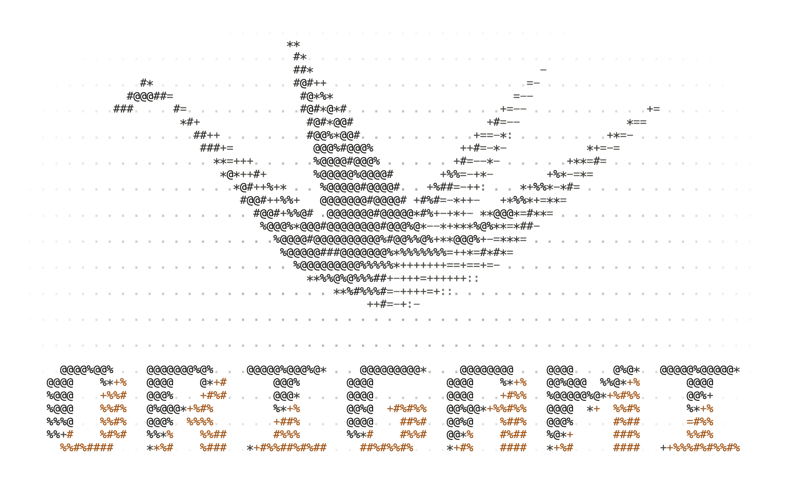
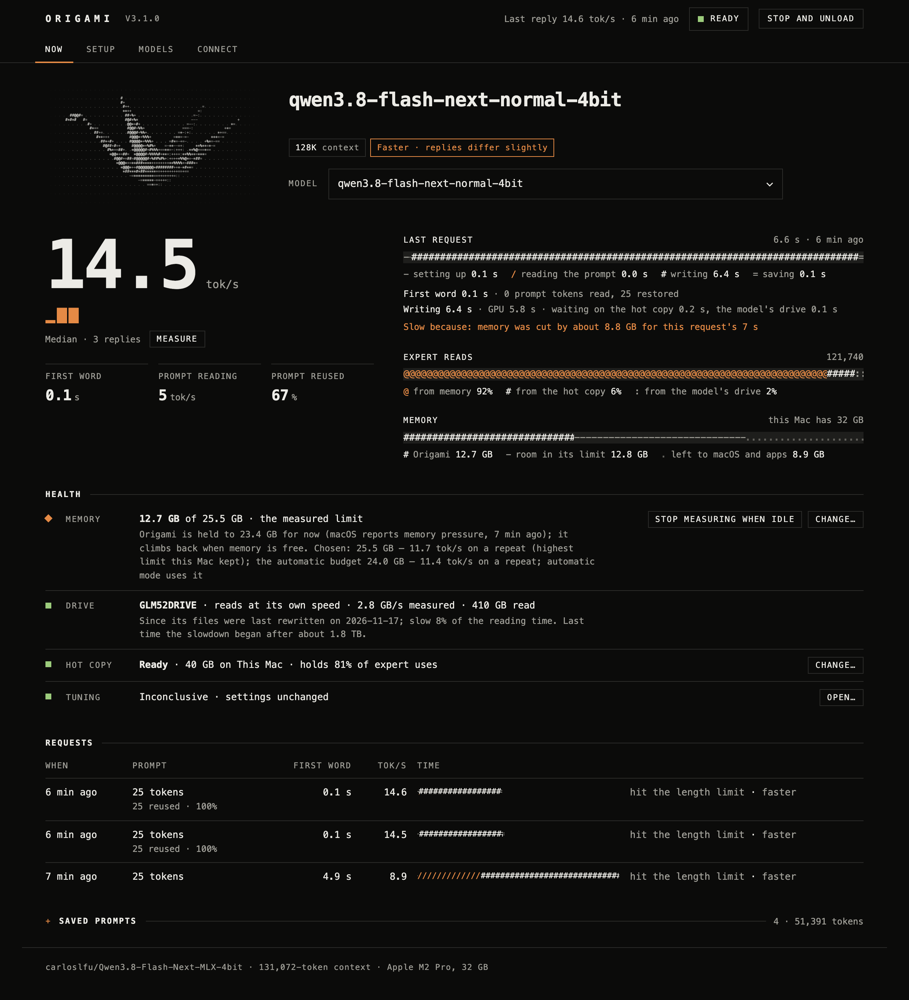
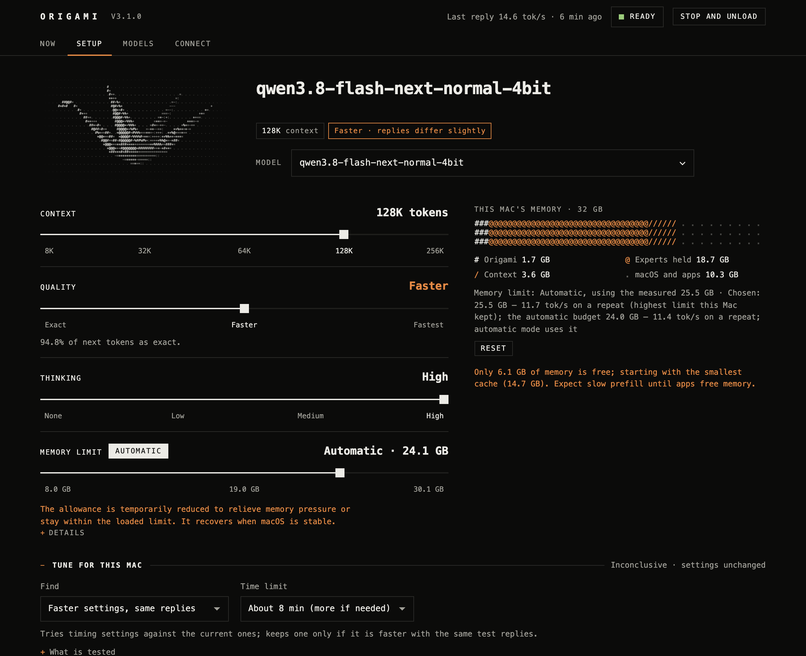
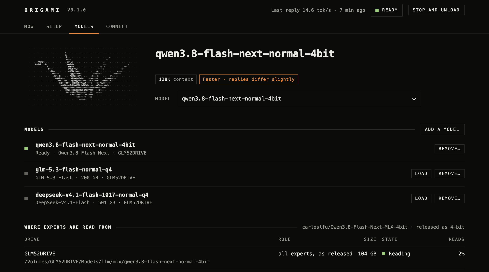

# Origami

<p align="center">
  <picture>
    <source media="(prefers-color-scheme: dark)" srcset="docs/images/logo-dark.png">
    <source media="(prefers-color-scheme: light)" srcset="docs/images/logo-light.png">
    
  </picture>
</p>

Origami runs mixture-of-experts language models that are much larger than your Mac's memory, on Apple Silicon.
The idea: in these models each token uses only a few "experts" out of hundreds. Origami keeps the always-used
weights in memory and reads each token's experts from the SSD as they are needed, with a cache, read-ahead and
fused Metal kernels to make that fast. Qwen3.8-Flash-Next's 104 GB checkpoint runs on a 32 GB Mac.

It is one native binary (Swift and Metal, no Python, no MLX) with a local server that speaks the OpenAI, Anthropic
and Ollama APIs, and a dashboard in the browser.

**New here?** Start with [the guide](docs/guide.md): install, first run, every feature in short, and what is planned.
The current release is 3.1.7 ([what changed](CHANGELOG.md)).



*The dashboard while Qwen3.8-Flash-Next serves on an M2 Pro with 32 GB (Origami 3.1.0, at the opt-in `faster`
level). More pictures [below](#the-dashboard).*

## What it does

- **Runs models larger than memory.** The always-used weights stay in memory; each token's experts are read from
  the SSD as they are needed, with a cache, read-ahead and fused Metal kernels.
- **Exact by default.** At `quality exact` replies are the model's own. Faster levels and low-bit experts are
  opt-in, measured on checkable tasks, and named in the status, the dashboard and the logs.
- **A hot copy.** While it serves, Origami copies the experts it misses most to the fastest drive with room and
  keeps that copy following what you use.
- **Saved prompts.** Follow-ups and repeated prompts reuse the model's saved state, also after a restart, so only
  the first read of a long prompt is slow.
- **Three APIs, one server.** OpenAI (chat completions and Responses), Anthropic and Ollama, with streaming, tool
  calls, JSON mode with a schema, images (Qwen) and thinking controls.
- **A dashboard in the browser.** Live speed and why a request was slow, memory, drives, models and files, and the
  settings as dials that show what this Mac's memory makes of each move.
- **Memory that fits your Mac.** An automatic limit that gives way when macOS is short of memory and climbs back;
  `origami tune --memory` measures this Mac's fastest limit and `origami tune` its timing settings.
- **Several models on one port.** Load and switch between them by name; requests wait in a queue.
- **Looks after the drive.** Measures each drive's speed, tells you when the model's drive reads slowly and
  rewrites its files in place (`origami refresh`), and carries on by itself when a drive is replugged.
- **Tools for the rest.** `origami setup` finds or downloads the model (resumable), `doctor` says what to fix,
  `bench` and `report` measure your Mac, `verify` checks the copies, `service install` starts it at login.

## Supported models

| Model | What Origami reads | Status |
|---|---|---|
| **Qwen3.8-Flash-Next** | MLX 4-bit builds; bf16, FP8, NVFP4 and GGUF checkpoints after a one-time conversion | Mature: the main, most-tested path. Text and images. |
| **GLM-5.3-Flash** | GGUF files; FP8 or BF16 safetensors after a one-time conversion | Newer. Text only. Slow on 32 GB. |
| **DeepSeek-V4.1-Flash** | GGUF files | Newer. Text only. Slow on 32 GB. |

Details, conversions and what each format gives you: [docs/models.md](docs/models.md). Each model has its own
license ([below](#model-licenses)).

## Will it run on my Mac?

Origami has been run on three Macs so far: an M2 Pro with 32 GB of memory on macOS 26, an M1 MacBook Air with 16 GB on
macOS 27, and a Mac Studio M4 Max with 128 GB that a user built it on and reported
([issue #1](https://github.com/janji/origami/issues/1)).

| Mac | Status |
|---|---|
| M2 Pro, 32 GB | Tested. |
| M4 Max, 128 GB | Tested by a user: every one of Qwen's experts stays in memory, about 30 tok/s once warm ([its numbers](#on-an-m4-max-with-128-gb)). |
| Other M2, M3 and M4 Macs, 24 GB or more | Expected to work (same kernels). Never run. |
| M1 family, 24 GB or more | Expected to work, with slower prompt reading (no bfloat16 matrix units). Its kernels, forced on the M2 Pro, gave the same replies with prompt reading about 10% slower. Run on an M1 with 16 GB only (last row). |
| M5 family, 24 GB or more | Expected to work. Long prompts use the M5's matrix units, so replies may differ slightly from other Macs. Never run. |
| 64 GB or more | Faster: more experts stay in memory (all of Qwen's from 128 GB, as the M4 Max showed). 64 and 96 GB are planned by simulation, never run. |
| 16 GB | Not recommended: the always-resident part of Qwen needs about 11 GB, so only an 8K context fits; `origami setup` warns. Under 16 GB it refuses. Tested on an M1 MacBook Air: it works and is slow ([its numbers](#on-a-16-gb-m1-macbook-air)). |

**If you run Origami on any other Mac, please help:** start the server, run `origami report`, and paste its output
into a GitHub issue. It shows the Mac, the memory plan and a short benchmark, with home-folder paths shortened.

## Requirements

- An Apple Silicon Mac with **macOS 15** or later (tested on macOS 26).
- **24 GB of memory** or more; 32 GB recommended.
- A fast SSD with room for the model. For Qwen: about **110 GB** for the model, plus about 18 GB for a copy of its
  most-used experts (more if it pays) and room for saved prompts. Origami keeps space free on each drive: saved prompts
  and expert copies leave 10 GB, the hot copy 20 GB, and a download needs 5 GB more than its size. GLM and DeepSeek
  are larger: the UD-Q4_K_XL files Origami runs are **199.7 GB** (GLM-5.3-Flash) and **500.7 GB**
  (DeepSeek-V4.1-Flash), plus 20–40 GB for their hot copy to start, best on another drive
  ([Get the files](docs/models.md#get-the-files)).
- Optional: a second fast drive (Thunderbolt or USB4 NVMe) for an extra copy of the experts.
- To build: **Xcode** or the **Command Line Tools**, version 26 or 27 (the macOS 26 SDK or later; built and run with
  Swift 6.3 and 6.4).

## Install

There is no prebuilt release yet; a signed binary is planned. Build from source:

```sh
git clone https://github.com/janji/origami.git
cd origami
swift build -c release
sudo mkdir -p /usr/local/bin && sudo ln -sf "$PWD/.build/release/origami" /usr/local/bin/origami
```

The program is `.build/release/origami`; the link puts it on your `PATH` while it stays beside its
`swift-transformers_Hub.bundle` (copy the binary elsewhere only together with that bundle), and a rebuild updates
it.

If the build stops with `Could not initialize build system` (reported with the Command Line Tools 27.2), build with
`swift build -c release --build-system native` instead.

## Run

```sh
origami setup            # finds Qwen3.8-Flash-Next or offers to download it (104 GB, resumable)
origami serve            # http://127.0.0.1:11439/v1
```

`origami setup` finds the model if you already have it (Hugging Face cache, LM Studio, SlotStream) or downloads it.
While it serves, Origami copies the experts it misses most next to the model (about 18 GB to start, more
while it pays), so they are read in one piece. Use your own folder with `origami setup --model <folder>`. Add a second drive with `origami setup --store /Volumes/MySSD/Origami`.
To keep the download on another drive, put the data folder there before the first setup
(`origami config set data_dir /Volumes/MySSD/Origami`), or download a model to any folder with
`origami model add <owner/repo> --to /Volumes/MySSD/models`. On an exFAT drive (as most portable SSDs are
sold) the model and its hot copy work as on any other; saved prompts stay on the Mac's own drive, because exFAT cannot
keep them private.

For GLM or DeepSeek, point Origami at the GGUF file (for a split GGUF, any one of its files):

```sh
origami serve --model /path/to/model.gguf
```

The port answers within a second; the model loads in the background (about 20 s for Qwen) and requests sent
meanwhile wait for it. Then use any OpenAI-compatible client:

```sh
curl http://127.0.0.1:11439/v1/chat/completions -H 'Content-Type: application/json' -d '{
  "model": "origami",
  "messages": [{"role": "user", "content": "Write a haiku about folding paper."}],
  "reasoning_effort": "none"
}'
```

`origami dashboard` opens the dashboard: load a model, change settings, see memory and drives, and manage files.
`origami stop` unloads the model and gives its memory back; `origami start` loads it again. If the dashboard or
`origami doctor` says the model drive reads its files far below its own speed, `origami refresh` rewrites them in
place ([troubleshooting](docs/troubleshooting.md#the-model-drive-got-slow)).

One request runs at a time; others wait in a queue.

## The dashboard

`origami dashboard` opens it. The **Now** tab is the picture at the top of this page. **Setup** has the context,
quality, thinking and memory as dials, with this Mac's memory answering each move, and tuning:



**Models** loads, adds and removes models, and shows where the experts are read from, each drive's share of the
reads, and every file Origami keeps:



The fourth tab, **Connect**, has the address and model name an app needs, who can reach Origami, and the log. The
pictures are of Origami 3.1.0 on the development Mac (3.1.1 looks the same); that Mac's network name and its access
line are left out of them. Every control: [docs/dashboard.md](docs/dashboard.md).

## What to expect

**Speed is not one number.** The figures below are single runs under the conditions they name, not promises: the
same model on the same Mac writes several times faster or slower from one request to the next. What decides it:

- **Cold or warm.** After a start, or after switching models, nothing is in memory: every expert a reply needs is
  read from the drive once, so the first replies are the slowest.
- **Which experts are in memory.** A reply close to what the model just did finds most of its experts in memory. A
  new topic, language or kind of task reads new ones.
- **The hot copy.** How many of the misses it holds, and how fast its drive is.
- **Saved prompts.** A follow-up or a repeated prompt skips what was read before, and its first word comes in a
  fraction of the time. A new long prompt is read in full.
- **Context and memory.** A longer context, and other apps, leave less memory for experts. When macOS is short of
  memory Origami shrinks its cache for a while, and that request is slower.
- **The drive.** Its speed, its cable and port (USB 2, USB 3, Thunderbolt), and whether it throttles or has slowed
  down on heavily read files.
- **Quality and thinking.** The faster levels read fewer experts. Thinking writes tokens before the answer starts.

The picture at the top shows it: the same 25-token request waited 4.9 s for its first word and wrote 8.9 tok/s the
first time, then 0.1 s and 14.5 tok/s on its repeats, with the prompt reused and the experts in memory (Qwen at the
opt-in `faster` level). The dashboard's Now tab says for every request where its time went and, when it was slow,
why. `origami bench` measures your own Mac.

### On an M2 Pro with 32 GB

Measured with Origami 3.1 on the development Mac: an M2 Pro with 32 GB on macOS 26, the models on an external NVMe
drive over Thunderbolt (its files freshly rewritten, see [the model drive got
slow](docs/troubleshooting.md#the-model-drive-got-slow)), exact mode, and the memory limit
`origami tune --memory` measured for each model (Qwen 24 GB, GLM and DeepSeek 22.5 GB). Single runs. Other Macs
will differ: speed depends mostly on the SSD and on how much memory the Mac has.

| Model (file) | Hot copy | First token, short prompt | Writing | First token, long prompt |
|---|---|---|---|---|
| Qwen3.8-Flash-Next (MLX 4-bit) | none at the start; 8 GB built during the run | 33.9–37.7 s (2,533 tokens) | 9.4 tok/s | 61.3 s (7,543 tokens) |
| GLM-5.3-Flash (UD-Q4_K_XL GGUF) | 70 GB | 46.0 s (2,471 tokens) | 1.37 tok/s | 123.6 s (7,280 tokens) |
| DeepSeek-V4.1-Flash (UD-Q4_K_XL GGUF) | 80 GB | 70.6 s (2,480 tokens) | 1.82 tok/s | 95.9 s (7,294 tokens) |

First-token times are what the client waited, from sending the request to the first content (the 2026-11-16
release runs; Qwen's short prompt over that morning's six runs); writing is a 200-token follow-up.

With experts already in memory from an earlier reply, Qwen writes at about 10 tok/s. GLM and DeepSeek are much
larger, so on a 32 GB Mac most of their experts come from the drive: the time goes to reading, not to the GPU. A
faster drive and more memory make all three faster; longer contexts make them slower
([docs/settings.md](docs/settings.md#context-what-stays-in-memory)).

Repeated prompts and chat follow-ups reuse saved prompts, also after a restart, so only the first read of a long
prompt is slow.

**Faster, opt-in: low-bit experts.** `origami model add <experts.gguf> --base <model>` serves your exact model with
its experts read from a published 2- to 3-bit file. Replies differ from the model's own, and `origami status`,
the dashboard and the logs say so. Same Mac ([docs/models.md](docs/models.md#low-bit-experts-on-the-4-bit-model-opt-in)):

| Variant | Writing | Checkable tasks solved (exact) | Next tokens equal to exact's |
|---|---|---|---|
| Qwen with ISTA-DASLab's GSQ-RCO Q2_0 experts | about 12 tok/s on a first reply, 14 warm | 12 of 14 (12) | 91% |
| GLM with lte-ai's Strata Q2_K/Q3_K experts file, 20 GB hot copy | 1.73–1.88 tok/s; 39 s to the first token | 12 of 14 (10) | 92% |

DeepSeek variants are not measured yet.

### On an M4 Max with 128 GB

A user's report ([issue #1](https://github.com/janji/origami/issues/1)), not measured by us: a Mac Studio with
Origami 3.1.3 built there (Swift 6.4.2, macOS 27.2), Qwen3.8-Flash-Next converted from Unsloth's UD-Q4_K_XL GGUF to
Origami's 4-bit format, on a Thunderbolt SSD that reads 3.3–4.4 GB/s, an 8K context, exact mode. Every expert stays in
memory once it is read (24,576 of them, 68 GB), so the drive matters only until then.

| Request | First word | Speed |
|---|---|---|
| First reply after a start | 7.3 s | 14.7 tok/s writing |
| Short question (23 tokens) | 1.0 s | 16.9–30.7 tok/s writing |
| Story (31 tokens) | 0.1 s with its prompt reused | 29.9–36.8 tok/s writing |
| 4,650-token document | 11.2–13.6 s | 343–416 tok/s reading |

The lower figures are from the first `origami bench` after the start, the higher ones from a later run. A warm-up of
four replies wrote 10, 18, 27 and 28 tok/s as the experts came into memory, and `origami tune --memory` wrote
29.6–31.6 tok/s on its repeats.

### Next to Strata, on the same file

[Strata](https://github.com/Niko1221/Strata) v0.2.17 and Origami on this Mac, both reading the experts from the same
file (ISTA-DASLab's GSQ-RCO IQ3_S GGUF of Qwen3.8-Flash-Next) on the same Thunderbolt drive, with no experts' copy
and Origami held to the memory Strata took (12.5 GB). An 8K context, greedy, thinking off, 320 tokens written, each
engine started fresh. Strata and Origami 3.1.2 were measured on 20 November 2026:

| | Strata v0.2.17 | Origami 3.1.2 | Origami 3.1.3 |
|---|---|---|---|
| Writing | 4.1–4.2 tok/s | 6.1 tok/s | as 3.1.2 |
| First token, 1,076-token prompt | 23.1 s | 19.8 s | as 3.1.2 |
| First token, 7,426-token prompt | 115.8 s | 54.3 s | as 3.1.2 |
| First token, the same 1K prompt again | 1.35 s | 1.38 s | **0.15 s** |
| First token, the same 8K prompt again | 1.18 s | 5.10 s | **0.16 s** |
| Peak memory | 12.8 GB | 9.9 GB | as 3.1.2 |

In 3.1.2 a repeated prompt waited for the reply's saved prompts to reach the drive; 3.1.3 changes that and nothing
else on this path. Its two times are from the next day, with the same settings and prompts but the 4-bit model
instead of the IQ3_S file, twice each, with 3.1.2 run in turn beside it (1.5–9.8 s); "as 3.1.2" rows were not
measured again, and Strata was not run again.

One run per engine and cell: the repeat was spoiled by the drive slowing down. The Mac was short of memory (4.9 GB
of swap in use before the start), so both engines are slower here than on a quiet Mac. Strata's instructions put the
model on the internal SSD; here it was on the external drive for both. With each engine as it installs (Strata with
its experts' copy on the internal SSD, Origami with automatic memory and no hot copy) Strata wrote 4.2–4.4 tok/s and
Origami 6.3–6.7. The replies' quality was not scored, and prompts longer than 8K were not compared.

### On a 16 GB M1 MacBook Air

The smallest Mac Origami starts on, with Qwen3.8-Flash-Next (MLX 4-bit) on a portable exFAT SSD over USB 3 that
reads 0.6–0.7 GB/s, an 8K context, exact mode, and other apps open. Three runs of `origami bench` with Origami 3.1.0
and 3.1.1 (the last one built on that Mac), each soon after a start, with no hot copy and then 38 GB and 18 GB of it:

| Request | First word | Speed |
|---|---|---|
| Short question (23 tokens) | 15–23 s | 0.8–1.1 tok/s writing |
| Story (31 tokens) | 18–28 s | 1.0–1.3 tok/s writing |
| 4,650-token document | 142–159 s | 29–33 tok/s reading |

A follow-up that reused its conversation (627 of 657 prompt tokens) answered in 41 s where the first turn took 183 s.
The first request after a start takes about a minute there even for 20 tokens: every expert is read once at the
drive's speed.

## Settings you may need

Nothing needs configuring. The ones people change most:

```sh
origami config                        # list every setting, its value and where it comes from
origami config set context 32k        # default 8k; coding agents (Claude Code, Codex) need 32k or more
origami tune --memory                 # measure this Mac's fastest memory limit (server running); automatic memory then uses it
origami config set memory_limit 20GB  # or set Origami's memory ceiling yourself (default: fitted to this Mac)
origami config set hot_copy off       # disk for the copy of the most-used experts: a size, off, or automatic
origami store add /Volumes/MySSD/Origami --size 150GB   # a second drive for expert copies
origami config set quality faster     # faster replies that differ slightly from the model's own (default exact)
origami config set reasoning_effort medium   # thinking for requests that do not ask
origami config set api_key "$(openssl rand -hex 16)"   # require a key on every request
origami config set listen lan         # let other devices on your network in (they need a key; plain HTTP, see docs/integration.md#tls)
```

Every setting is also a flag (`--context 32k`) or an environment variable (`ORIGAMI_CONTEXT=32k`). The full list,
and how memory, context and drives trade against each other: [docs/settings.md](docs/settings.md).

**Exact by default.** At the default `quality exact`, Origami uses every expert the model picks, so replies are the
model's own. Faster modes that skip experts are opt-in, and each model offers only those that clearly helped it on
checkable tasks: `faster` and `fastest` for Qwen, `faster` for GLM, `dynamic-fastest` for DeepSeek
([docs/models.md](docs/models.md#quality-dial)).
[docs/settings.md](docs/settings.md#which-settings-change-replies) lists which settings can change replies.

## Connecting apps

- **Any OpenAI client** (Open WebUI and others): base URL `http://127.0.0.1:11439/v1`, any key.
- **Anthropic clients and Claude Code**: `ANTHROPIC_BASE_URL=http://127.0.0.1:11439`.
- **Ollama clients**: `OLLAMA_HOST=127.0.0.1:11439`.
- **Codex**, **Pi**, **llama-swap**, starting at login (`origami service install`), API keys and network access:
  [docs/integration.md](docs/integration.md).

Use streaming: a long prompt can take minutes before the first word, a stream sends a keepalive every 10 s, and a
non-streamed request whose client closes its sending side is treated as gone.

Streaming, tool calls, JSON mode (`response_format`, a JSON schema), images (Qwen), thinking controls and the usual
sampling fields work in every API.

## Documentation

| Page | What is in it |
|---|---|
| [docs/guide.md](docs/guide.md) | Start here: install, first run, every feature in short, what is planned |
| [docs/models.md](docs/models.md) | Models and formats, conversions, low-bit expert variants, the quality dial, MTP |
| [docs/settings.md](docs/settings.md) | Every setting; memory, context and drives; where files live |
| [docs/integration.md](docs/integration.md) | API endpoints, thinking and images, chat commands, connecting apps, security |
| [docs/dashboard.md](docs/dashboard.md) | The dashboard's four tabs, the hot copy control, files, tuning and the fastest memory limit |
| [docs/troubleshooting.md](docs/troubleshooting.md) | Diagnostic commands and common problems |
| [docs/switches.md](docs/switches.md) | Every `ORIGAMI_*` environment variable |
| [docs/content-receipts.md](docs/content-receipts.md) | Verifying model files against known checksums |
| [INTERNALS.md](INTERNALS.md) | How Origami works inside |
| [CONTRIBUTING.md](CONTRIBUTING.md) | Building, checking and changing the code |
| [CHANGELOG.md](CHANGELOG.md) | What changed in each release |
| [ROADMAP.md](ROADMAP.md) | What comes next |

## Credits and licenses

Origami is licensed under the Apache License 2.0 (see [LICENSE](LICENSE)). Parts of its arithmetic are adapted from
[SlotStream](https://github.com/carloslfu/slotstream), [MLX](https://github.com/ml-explore/mlx), Ollama and ggml
(all MIT); it links Apple's and Hugging Face's Swift packages (Apache 2.0) and two MIT packages. See
[THIRD_PARTY_NOTICES.md](THIRD_PARTY_NOTICES.md). Origami's license covers its code, not the models.

### Model licenses

Origami ships no model. Each model, and each converted or quantised file of it, comes from its publisher under the
publisher's license: read it before you use the model or share it or its output. What each publisher's page shows
(checked on 2026-11-15):

| Files | Publisher | License shown |
|---|---|---|
| [Qwen/Qwen3.8-Flash-Next](https://huggingface.co/Qwen/Qwen3.8-Flash-Next) | Qwen | Qwen Community License 1.0 (Copyright (c) 2026 Qwen), with conditions for very large products and for model-as-a-service and AI work assistant businesses |
| [carloslfu/Qwen3.8-Flash-Next-MLX-4bit](https://huggingface.co/carloslfu/Qwen3.8-Flash-Next-MLX-4bit), what `origami setup` downloads | a mirror of pipenetwork's MLX 4-bit conversion | Qwen Community License 1.0, included in the download |
| [mlx-community/Qwen3.8-Flash-Next-4bit](https://huggingface.co/mlx-community/Qwen3.8-Flash-Next-4bit) | mlx-community | none stated; made from Qwen/Qwen3.8-Flash-Next |
| [unsloth/Qwen3.8-Flash-Next-GGUF](https://huggingface.co/unsloth/Qwen3.8-Flash-Next-GGUF) | Unsloth | Qwen Community License 1.0 |
| [ISTA-DASLab/Qwen3.8-Flash-Next-GSQ-RCO-GGUF](https://huggingface.co/ISTA-DASLab/Qwen3.8-Flash-Next-GSQ-RCO-GGUF) (low-bit experts) | ISTA DASLab | the card's text: the base model's license; its metadata and the GGUF's: apache-2.0 |
| [zai-org/GLM-5.3-Flash](https://huggingface.co/zai-org/GLM-5.3-Flash) | Z.ai | MIT (Copyright (c) 2026 Z.AI Co., Ltd) |
| [unsloth/GLM-5.3-Flash-GGUF](https://huggingface.co/unsloth/GLM-5.3-Flash-GGUF) | Unsloth | MIT |
| [lte-ai/GLM-5.3-Flash-Strata-Q2Q3-Experts](https://huggingface.co/lte-ai/GLM-5.3-Flash-Strata-Q2Q3-Experts) (low-bit experts) | lte-ai | MIT; keep the upstream notices it lists (Z.ai, Unsloth, patrickbdevaney, Strata, ggml) when redistributing |
| [deepseek-ai/DeepSeek-V4.1-Flash](https://huggingface.co/deepseek-ai/DeepSeek-V4.1-Flash) and [-1017](https://huggingface.co/deepseek-ai/DeepSeek-V4.1-Flash-1017) | DeepSeek | MIT (Copyright (c) 2023 DeepSeek) |
| [unsloth/DeepSeek-V4.1-Flash-1017-GGUF](https://huggingface.co/unsloth/DeepSeek-V4.1-Flash-1017-GGUF) | Unsloth | MIT |
| [ISTA-DASLab/DeepSeek-V4.1-Flash-1017-GSQ-RCO-GGUF](https://huggingface.co/ISTA-DASLab/DeepSeek-V4.1-Flash-1017-GSQ-RCO-GGUF) (low-bit experts) | ISTA DASLab | MIT, the base model's |

Origami makes files from the weights as it runs: converted models (`origami model add`), the hot copy
and other expert copies in your stores, saved prompts (the model's state after reading
your prompts), usage counts (which experts the model picked) and tuning results. They stay on your Mac, in the data
folder, your stores and `context_dir` ([docs/settings.md](docs/settings.md#where-origami-keeps-its-files)); Origami
sends none of them anywhere. The dashboard's **Models** tab lists and deletes them.
